# Why does quantum mechanics need i? The twist, path integrals, and what existing work says (Nov 25, 2026)

**Path integrals, first (Brennan's naming question).** "Path integrals are a special case of the weighted circle operation" is **true in a weaker, precise sense, and false as a blanket claim.** True: chaining the weighted circle operation over many short steps, with order kept, *is* the product integral (Volterra 1887), the time-ordered exponential behind every path integral; expanding that chain is literally a sum over paths; the slicing error is led by the twist; and a path's accumulated twist is its signed area, which becomes Feynman's p·dq phase once size is kept. Set the dial to k = −i/ħ and the chain of energy-times-time steps converges to the quantum propagator; set it real and you get the heat kernel (Feynman–Kac). Not supplied by the framework: the Hamiltonian or action, the size of ħ, and a rigorous measure on paths in real time. So the honest headline is "both are whole-chain compositions; Feynman's path integral is the weighted circle chain at an imaginary dial, with the dynamics put in" (section 5). Every piece is known; the dial reading is ours.

**Result.** Brennan's hunch, that the twist (the orientation of the order-cost area) is why i is required, matches a well-established idea: i can be read as an oriented area turned into an action, a quarter turn whose square is −1, and the sign of the twist is exactly the choice between i and −i. That part is known. What the literature adds is a caution: **orientation alone never gives i**. Every known road needs one more ingredient besides the twist: a length, or the rule that composing never changes total size, or carrying a state round a loop. None of the roads gives the size of ħ, and none settles why complex numbers rather than real numbers or quaternions; that is decided by how composite systems combine, and it is still argued in 2026.

**What is ours.** Two small, honest connections, from known group theory read through the order dial:

1. The order dial's stretch-and-shift group **is** the hyperbolic upper half-plane. Each map x ↦ λx + s is the point s + iλ; doing nothing is the point i; each dial k is a straight line through i that ends at its centre −1/k on the edge. The group's own length and its own twist give J = multiplication by i.
2. **The wall −1/k is where mult-add maps start flipping i.** Mult-add elements before the wall keep the sign of every frequency; past the wall (1 + ka < 0) they flip it, exactly as swapping i for −i does.

**Lead worth following:** Klauder's *affine quantization* is built on this very group, with [Q, D] = iħQ in place of [Q, P] = iħ. It is the closest existing bridge from our affine twist to quantum mechanics, and it is where the order dial's i would enter. Next step: see whether the dial k (and its centre −1/k) has a natural meaning there.

Checks: `checks.py` → `checks_output.txt`, **44/44 pass** (numpy, sympy, scipy). Lean: `lean/WhyI.lean`, 21 small integer identities, **compiled** in the shared library (`FusedAlgebra.Topics.WhyI`, standard axioms only, no `sorry`).

Method (Brennan, Nov 25): build from existing published work, not new inventions. Every claim below cites its source; anything beyond the sources is labeled *ours*.

---

## 1. The twist, restated

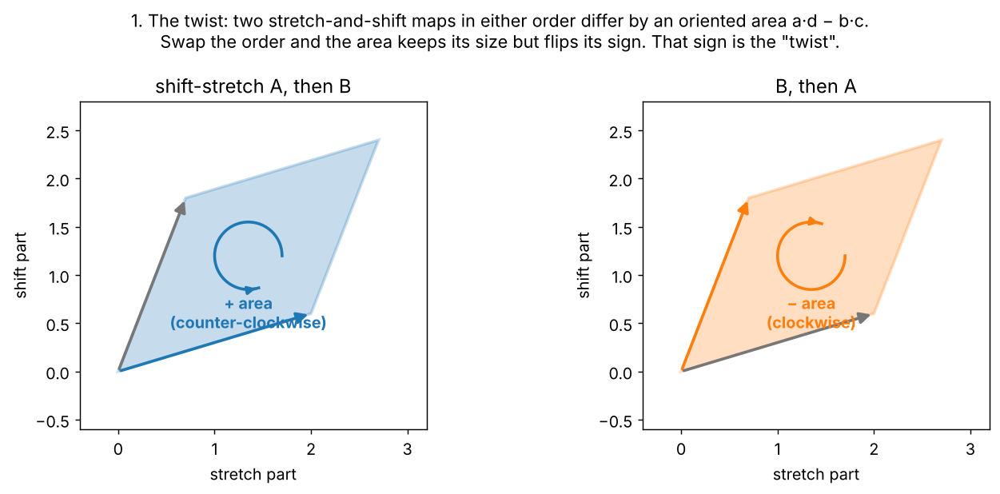

From [order-dial](../order-dial/): with (a, c) the map x ↦ (1 + a)x + c, the two orders differ by a pure shift a·d − b·c, an oriented area (check A1). Swap the order and the area flips sign (A2). Two mult-add elements with the same dial never twist (A3); with different dials k, k₂ the twist is (k − k₂)·a·b (A4).

## 2. Six known roads from the twist to i

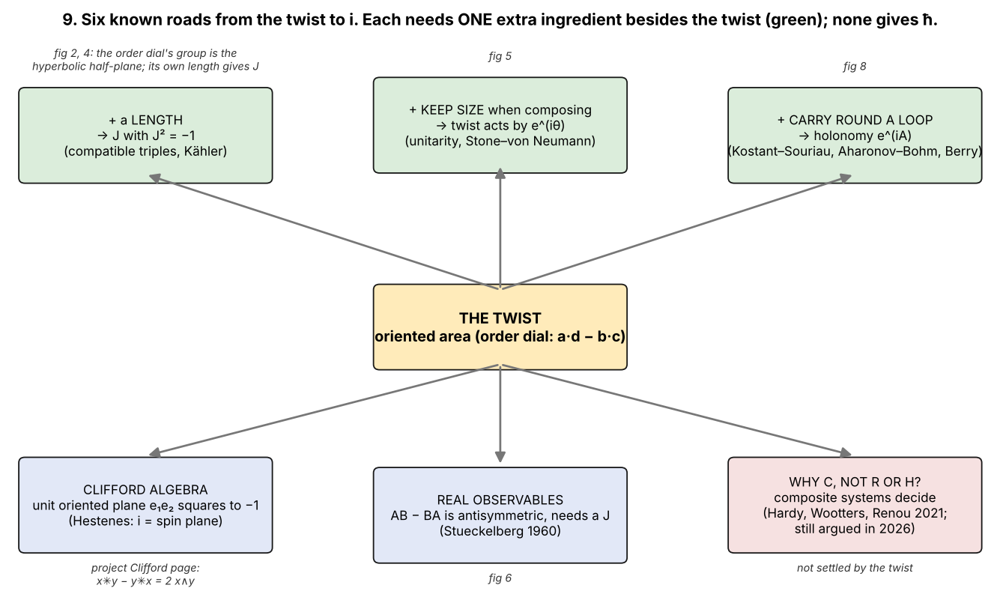

### Road 1. Twist + a length → J with J² = −1 (compatible triples, Kähler geometry)

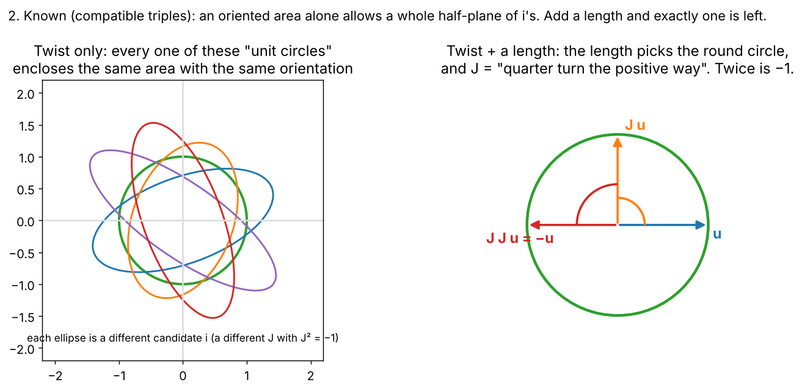

An oriented area on a plane (a symplectic form ω) is compatible with a whole half-plane of different "quarter turns" J (the Siegel upper half-plane; checks B1–B4). Choosing a length g picks exactly one, through ω(u, v) = g(Ju, v) (B5); a different length picks a different one (B6). This triple (ω, g, J) is the standard "compatible triple" of symplectic geometry, and a space carrying all three consistently is Kähler. In quantum optics the different J's are literally the different squeezed vacuum states, so the choice of length is physical, not decoration.

*So:* the twist supplies the antisymmetry; the length turns it into an operation; the twist raised by a length is θ·J, which squares to −θ² (B8).

### Road 2. The twist's sign is i's sign (time reversal is complex conjugation)

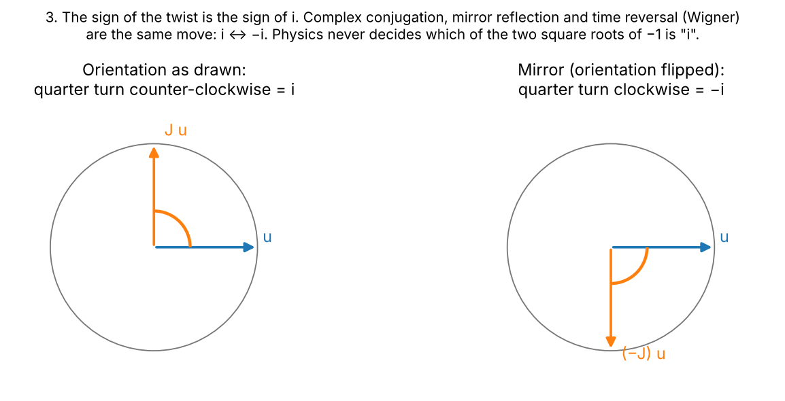

A mirror turns the area into −area and J into −J (B7). In physics, complex conjugation, mirror reflection and time reversal are the same move on the phase (Wigner 1932: time reversal is antiunitary). Nothing in physics decides which square root of −1 is called i; only the orientation, once chosen, fixes it. This is the precise, known version of Brennan's "difference in the twist".

### Road 3. Twist + "composing keeps size" → the twist acts as e^(iθ) (unitarity, Stone–von Neumann)

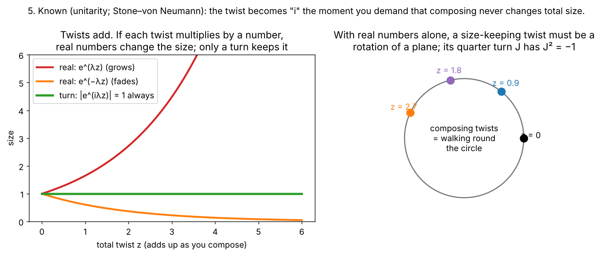

In the Heisenberg group the twist lands in the centre: the commutator of a shift a and a boost b is the central element with area a·b (D4). Represent it so that composing never changes total size (probability), and the central twist must act by a number of size 1 that turns sums into products: e^(iλz) and nothing real (D1). Written with real numbers only, it is a rotation of a plane whose generator J has J² = −1 (D3). The Stone–von Neumann theorem then says there is essentially one such representation: ordinary quantum mechanics. This is where the order-dial page left "i put in by hand"; the hand is the size-keeping rule.

### Road 4. Twist carried round a loop → a turn by the area (Aharonov–Bohm, Kostant–Souriau, Berry)

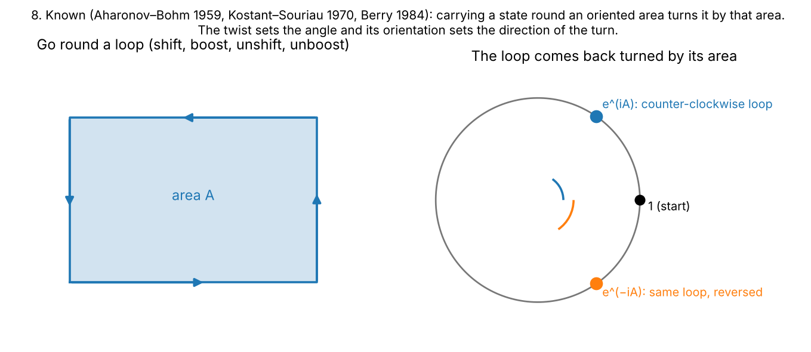

Carry a state round a closed loop of oriented area A and it comes back multiplied by e^(iA) (H1); go round the other way and it is e^(−iA) (H2). Kostant and Souriau built geometric quantization on exactly this: quantizing a space with an area form means finding a complex line whose turning (curvature) is that area form. Aharonov–Bohm (1959) and Berry (1984) are the measured versions. The twist sets the angle; its orientation sets which way the phase turns.

### Road 5. Clifford algebra: a unit oriented plane squares to −1 (Hestenes)

In geometric algebra the unit plane e₁e₂ is an oriented area element, and (e₁e₂)² = −1. Hestenes (1967 onward) rewrote the Dirac equation over the reals with the i replaced by the bivector of the electron's spin plane, so "iħ" reads as "spin plane times its size". This is the closest existing statement of Brennan's hunch, and the project's [Clifford page](../clifford/) already has the mult-add side: x✳y − y✳x = 2 x∧y.

### Road 6. Real observables: the order cost is antisymmetric, so it needs a J (Stueckelberg 1960)

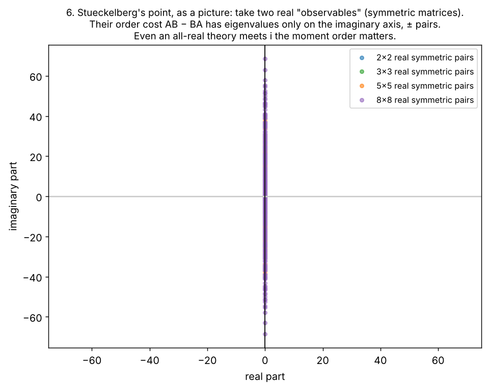

Take two real observables (symmetric matrices). Their order cost AB − BA is antisymmetric (E1) and its eigenvalues are purely imaginary, in ± pairs (E2). So even an all-real theory meets i the moment order matters. Stueckelberg's "Quantum theory in real Hilbert space" (1960) turned this into a theory: to keep the uncertainty principle he needed an operator J with J² = −1 commuting with all observables, and with it real quantum theory becomes complex quantum theory in disguise. (A 2016 re-examination, arXiv:1611.09029, calls his argument physically sound but mathematically loose, and recovers J more carefully from Poincaré symmetry.)

### Why complex, and not real or quaternionic? The twist does not decide

A J with J² = −1 can also come from quaternions, which have three of them (E4). Which number system quantum mechanics uses is settled by how *composite* systems combine, not by the twist: Hardy (2001) and Wootters (local tomography) single out the complex case among standard frameworks; Renou et al. (*Nature* 600, 625, 2021) showed real quantum theory with the usual tensor-product rule makes different predictions in a two-source network, and two 2022 experiments (Chen et al., *PRL* 128, 040403; Li et al., *PRL* 128, 040402) confirmed the complex prediction. **This is still argued:** Barrios Hita et al. (*PRL* 136, 240202, June 2026) build a real formulation with a different composition rule that matches all multipartite experiments, and a July 2026 preprint (arXiv:2607.05865) argues that construction is complex quantum mechanics in real notation. Quaternionic quantum mechanics (Adler 1995) has been tested (Peres 1979 proposal) with no sign of it.

## 3. Where the order dial meets these roads

### The order dial's group is the hyperbolic half-plane

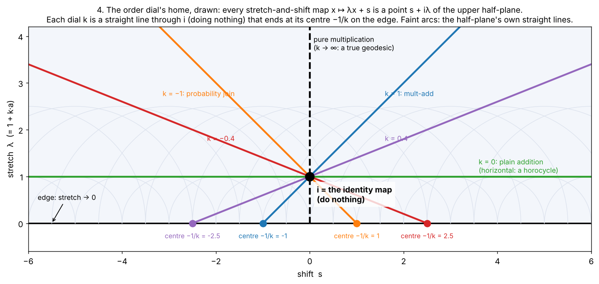

- Each orientation-keeping stretch-and-shift x ↦ λx + s (λ > 0) is the point s + iλ, and composing maps is acting by z ↦ λz + s, a holomorphic map (C1). Doing nothing is the point i.
- The dial-k elements form the straight line λ = 1 + k·s through i, ending at the centre −1/k on the edge; the group law along that line is a + b + k·ab (C2). Every one-parameter subgroup is such a line (C3).
- In the half-plane's own geometry, pure multiplication is a true straight line (geodesic), plain addition (k = 0) is a horocycle, and every other dial is a hypercycle: it stays a fixed distance from the geodesic over its centre (C8, C9).
- **Answer to "does our twist plus a natural length give a J?": yes.** The group's invariant length (ds² + dλ²)/λ² (C4) and invariant area ds∧dλ/λ² give J = rotation by 90°, which is multiplication by i in z = s + iλ (C5). The length is nearly forced: *every* invariant length on this group has constant negative curvature (C6, C7; Milnor 1976), so the only freedom is a scale.

*Honest caveat:* this i is geometric (the half-plane's complex structure). It is the same object quantum mechanics uses, but it becomes the *quantum* i only through Road 3 (a size-keeping representation). Also, the affine group's own twist stretches rather than turns: [X, Y] = Y has real eigenvalues 0 and 1 (F1), and it is not central (order-dial J5, J6). The turning comes from the area form plus length, not from the bracket alone.

### The wall flips i

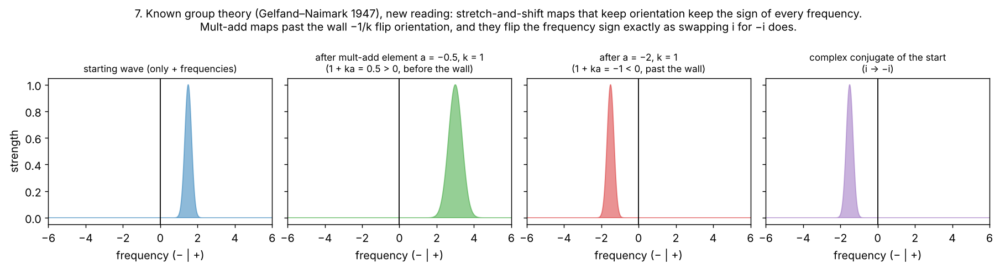

Gelfand and Naimark (1947) showed the orientation-keeping stretch-and-shift group has exactly two big unitary representations, on positive-frequency and on negative-frequency waves (the same split behind wavelets: Grossmann, Morlet, Paul 1985). Orientation-keeping maps never mix them (G1). A mirror sends one to the other (G2), and so does i → −i (G3). For mult-add the mirror is built in: element a has stretch 1 + ka, which turns negative past the wall a = −1/k. Before the wall, mult-add maps keep each frequency's sign; past it they flip it (G4). **So the wall is where the twist reverses and i becomes −i.** Known group theory; the reading of the wall is ours.

## 4. Verdict, lead by lead

- **The twist hunch: right, and known.** The orientation of the order-cost area is the sign of i (Roads 2, 4, 5, 6). The precise version is: *twist + one more ingredient = i*. Stated alone, "the twist forces i" is not true, because an oriented area with nothing else allows infinitely many i's (Road 1) or none (the affine bracket by itself only stretches).
- **Worth following: affine quantization (Klauder).** It quantizes exactly our stretch-and-shift group, with dilation D = (PQ + QP)/2 and [Q, D] = iħQ, and its irreducible pieces are Q > 0, Q < 0 and Q = 0, which look like the two sides of the wall and the wall itself (a resemblance, not yet checked). Concrete next step: rewrite [Q, D] = iħQ with Q shifted by the centre 1/k (so the dial picks where Q = 0 sits) and check whether mult-add composition becomes the affine coherent-state product. If it does, the order dial has a known quantum home where i enters by the size-keeping rule. No new prediction expected; the value is the bridge.
- **Worth keeping, small: the half-plane picture of the dials and the wall-flips-i reading.** Both are new framings of known facts, good for the README's "Where it unifies", not discoveries.
- **Not answered by this route:** the size of ħ; why complex rather than real or quaternionic (composite systems decide, still disputed); dynamics.

## 5. Path integrals: are they a case of the weighted circle operation?

Brennan's question (Nov 25, voice): if Feynman path integrals can honestly be shown to be a case of the framework, the name "path theory" is justified. Here is the relationship, piece by piece, from published work.

### 5.1 A chain of steps is a product integral, and expanded it is a sum over paths

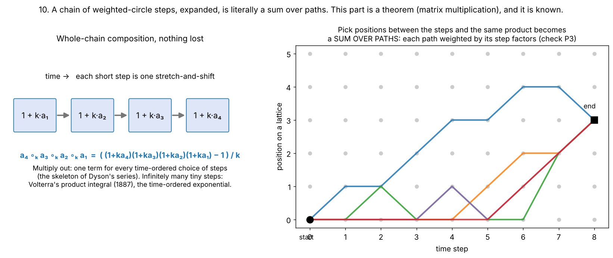

- **The chain is a product.** For any steps, even non-commuting matrices with order kept, 1 + k·(a_N ∘ₖ … ∘ₖ a₁) = (1 + k a_N)…(1 + k a₁) (check P1; for numbers, `chain_two`, `chain_three` in Lean). With infinitely many tiny steps this is Volterra's **product integral** (1887; Dollard and Friedman, *Product Integration*, 1979), the same object physicists call the time-ordered exponential.
- **Multiplied out, it is a sum over every time-ordered choice of steps** (P2). That is the combinatorial skeleton of Dyson's series (1949).
- **Choose positions between the steps and it is a sum over paths.** For a particle hopping on a ring, the chain's entry from start to end equals the sum, over every lattice path, of the product of its step weights (P3). This is just matrix multiplication; it is exactly how Feynman (1948) built the path integral, by inserting positions between short-time steps.
- *Bonus, known:* at k = −1 the chain of hazards is survival analysis, 1 − ∏(1 − hⱼ) (P11; `survival_two`; Gill and Johansen 1990 use product integrals for exactly this, the Kaplan–Meier estimator). So the project's probability-join dial already has a published "path" life in statistics.

### 5.2 The dial picks real or imaginary time

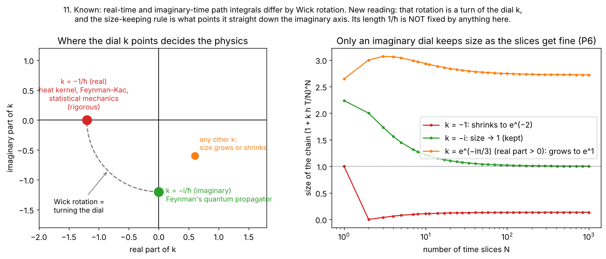

- With steps H·dt and dial **k = −i** (ħ = 1), the chain converges to the quantum propagator e^(−iHt), error shrinking like 1/N (P4). With **k = −1** it converges to the heat kernel e^(−Ht) (P5), the imaginary-time path integral that Kac (1949) made rigorous (Feynman–Kac).
- One short step keeps total size, to first order, only if the dial is purely imaginary: |1 + k h ε| = 1 + Re(k)·h·ε + … (P6). So the size-keeping rule from section 2 (Road 3) is what points the dial at −i/ħ. The length of the dial, 1/ħ, is not fixed by anything here.
- *Known:* real and imaginary time differ by Wick rotation (Wick 1954). *Ours:* reading Wick rotation as a turn of the dial k, and the 1 + k·(chain) identity as the bridge.

### 5.3 Order costs the twist, slice by slice

![Log-log errors against slices: the k = −i chain, the k = −1 chain and Trotter slicing all fall like 1/N; the Trotter error sits on the predicted line |[A,B]|/(2N)](figures/fig13-slices-converge.png)

Splitting a step into two non-commuting parts and alternating them (Trotter 1959; Chernoff 1968) errs by an amount led by the twist [A, B]/(2N) (P7). That is the order-dial result in the path-integral setting: order costs exactly the commutator, and fine slicing pays it down.

### 5.4 The twist summed along a path is its area, and becomes the phase

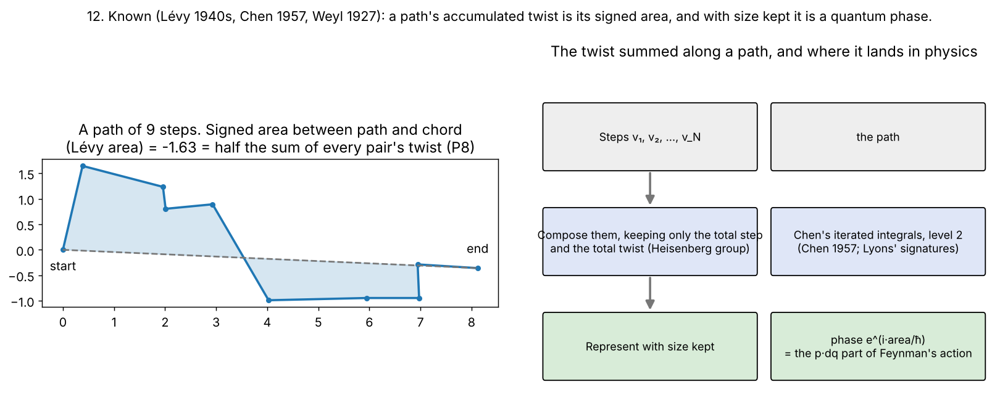

Multiply the steps of a path in the Heisenberg group and the central part records the path's **signed (Lévy) area**, which is half the sum of every pair's twist (P8; `levy_three` in Lean). Joining two paths multiplies their records (P9): this is Chen's identity for iterated integrals (Chen 1957), the foundation of Lyons' rough paths and path signatures (Lyons 1998; Hambly and Lyons 2010 show the signature keeps everything about a path except back-tracking). Represented with size kept, the area becomes the phase e^(i·area/ħ), the p·dq part of Feynman's action (Weyl 1927; phase-space path integrals: Berezin 1980; Sharan 1979 wrote Feynman's path integral with the Moyal star product). So "whole-chain composition with nothing lost" has a published precise form: the path signature, which is the weighted-circle chain run in the free (non-commuting) algebra.

### 5.5 Scorecard and verdict

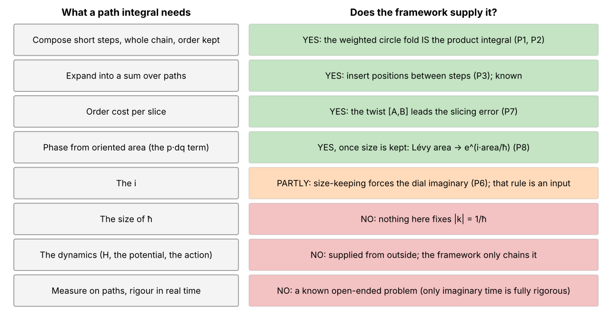

- **True, precisely:** every path integral is a whole-chain composition of short steps, and that composition is the weighted circle chain (product integral), with Feynman's case at the dial k = −i/ħ. The expansion into paths, the twist as slicing error and the area as phase all hold (P1–P9).
- **True only in the weaker sense** for the name: path integrals and the framework are both instances of one known structure (time-ordered composition: product integrals, signatures, the Heisenberg group), rather than path integrals falling *out of* the framework. The framework is the chaining rule; Feynman's integral is that rule plus a Hamiltonian, a dial value, and a sum over intermediate positions.
- **False as stated** ("the weighted circle operation is the general form and path integrals are a special case, full stop"): the dynamics (H or the action S), the size of ħ, and a rigorous real-time measure on paths are not supplied. The real-time path integral itself is not rigorous in general (only imaginary time is, via Feynman–Kac), so no framework can claim it as a theorem yet.
- **What would have to be proved for the strong claim:** (1) a convergence theorem: the ∘ₖ chain with k = −i/ħ converges to the propagator for unbounded Hamiltonians (this is Chernoff's theorem, with the implicit step (1 + iH dt/ħ)⁻¹ in place of 1 − iH dt/ħ, so it is known; the framework would cite it); (2) a reason inside the framework for the dial to sit at −i/ħ (size-keeping gives the direction, nothing yet gives ħ); (3) a reason for the Hamiltonian, i.e. the dynamics. (1) is available from the literature; (2) is half there; (3) is untouched.
- **On the name, plainly:** "path" is fair as a description of what the framework does (chains steps and keeps the whole chain), and the precise sentence that the literature supports is: *"Feynman's path integral is the weighted circle chain at an imaginary dial; the framework supplies the chaining, not the dynamics."* Calling the weighted circle operation "the general form" of path integrals would overclaim. Note the word is busy in math already (path algebras of quivers, path signatures, path groupoids).

## 6. Assumptions

- Real coefficients throughout; the half-plane picture uses the orientation-keeping maps (λ = 1 + ka > 0). Maps past the wall are the mirror half.
- "Length" means an invariant inner product on the group (left-invariant metric); "keeps size" means a unitary representation; characters are assumed continuous.
- Checks G1–G4 use a discretized wave (4096 points, FFT); "keeps sign" means less than 10⁻³ of the weight crosses zero frequency.
- The literature survey is from my reading, spot-checked against current sources for Renou et al., the 2022 experiments, the 2026 dispute, Stueckelberg, Hestenes and Klauder; other citations are textbook and not re-fetched.
- `lean/WhyI.lean` was written without a Lean toolchain; it is plain integer algebra proved with `grind`, but it must be compiled before it joins the library.
- Path checks P1–P9 use finite matrices and finite lattices; for unbounded Hamiltonians the convergence statement is Chernoff's theorem, cited, not proved here. "Sum over paths" means sums over lattice positions; continuum path measures are not claimed.

## Files

- `checks.py` → `checks_output.txt`: 44/44 pass (numpy, sympy, scipy).
- `figures.py` → `figures/fig1` … `fig14` (PNG, labeled; fig10–14 are the path-integral section).
- `lean/WhyI.lean`: 21 theorems, core Lean 4, no imports, no `sorry`, **not yet compiled**. To add: copy to `lean-library/FusedAlgebra/Topics/WhyI.lean`, add `FusedAlgebra.Topics.WhyI` to `build.sh` after `FusedAlgebra.Topics.OrderDial`, add an import line in `FusedAlgebra.lean`, then run `build.sh`.

## Sources

Checked this session:
- Renou et al., "Quantum theory based on real numbers can be experimentally falsified", *Nature* 600, 625–629 (2021): [arXiv:2101.10873](https://arxiv.org/abs/2101.10873)
- Chen et al., "Ruling out real-valued standard formalism of quantum theory", *PRL* 128, 040403 (2022): [arXiv:2103.08123](https://arxiv.org/abs/2103.08123); Li et al., *PRL* 128, 040402 (2022); Wu et al., *PRL* 129, 140401 (2022)
- Barrios Hita, Trushechkin, Kampermann, Epping, Bruß, *PRL* 136, 240202 (2026), and the reply preprint [arXiv:2607.05865](https://arxiv.org/abs/2607.05865); also [arXiv:2504.02808](https://arxiv.org/abs/2504.02808)
- Stueckelberg, "Quantum theory in real Hilbert space", *Helv. Phys. Acta* 33, 727 (1960); re-examined in [arXiv:1611.09029](https://arxiv.org/abs/1611.09029)
- Hestenes, "Real Dirac theory" and spacetime algebra papers (1967, 1975): [quant-ph/0509178](https://arxiv.org/abs/quant-ph/0509178) (review)
- Klauder, affine quantization, [arXiv:2108.04083](https://arxiv.org/abs/2108.04083), [gr-qc/9906013](https://arxiv.org/abs/gr-qc/9906013); Aslaksen and Klauder, *J. Math. Phys.* 9, 206 (1968)

Path-integral section, checked this session: Sharan, "Star-product representation of path integrals", *Phys. Rev. D* 20, 414 (1979) ([INSPIRE](https://inspirehep.net/literature/7427)); Marinov's phase-space path integral as discussed in [arXiv:2007.02483](https://arxiv.org/abs/2007.02483).

Path-integral section, textbook, not re-fetched: Volterra (1887, product integral); Feynman, *Rev. Mod. Phys.* 20, 367 (1948); Dyson (1949); Kac (1949); Wick (1954); Chen (1957, iterated integrals); Trotter (1959); Chernoff (1968); Dollard and Friedman, *Product Integration* (1979); Berezin (1980, phase-space path integrals); Gill and Johansen, *Ann. Statist.* 18 (1990); Lyons (1998, rough paths); Hambly and Lyons, *Ann. Math.* 171 (2010).

Textbook, not re-fetched: Weyl (1927); Wigner (1932, time reversal); Groenewold (1946); Moyal (1949); Gelfand and Naimark (1947, ax + b group); Aharonov and Bohm (1959); Kostant (1970) and Souriau (1970); Milnor (1976, left-invariant metrics); Peres (1979); Berry (1984); Grossmann, Morlet and Paul (1985); Adler (1995, quaternionic QM); Hardy (2001, five axioms); Hardy and Wootters (2012); McDuff and Salamon (compatible triples).
