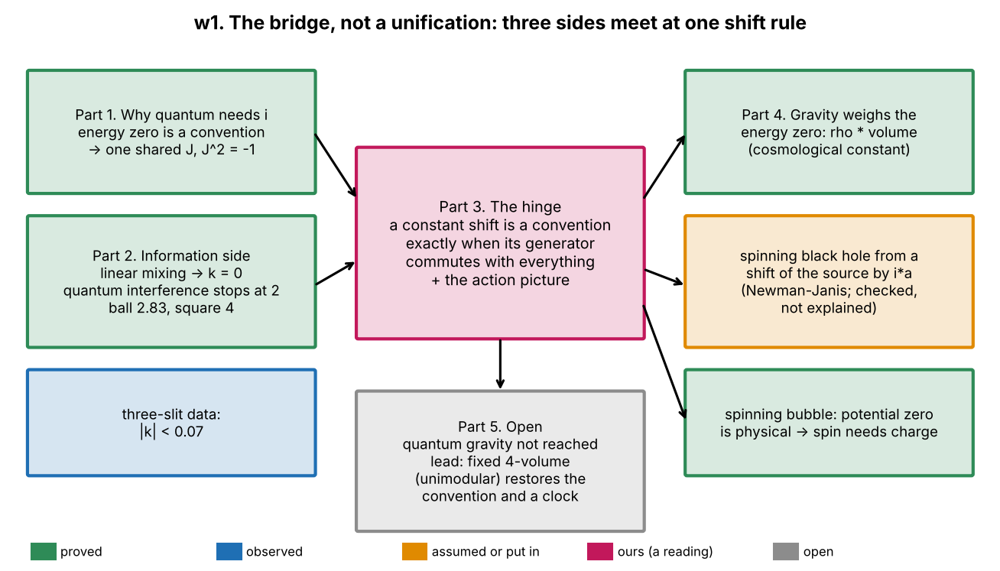
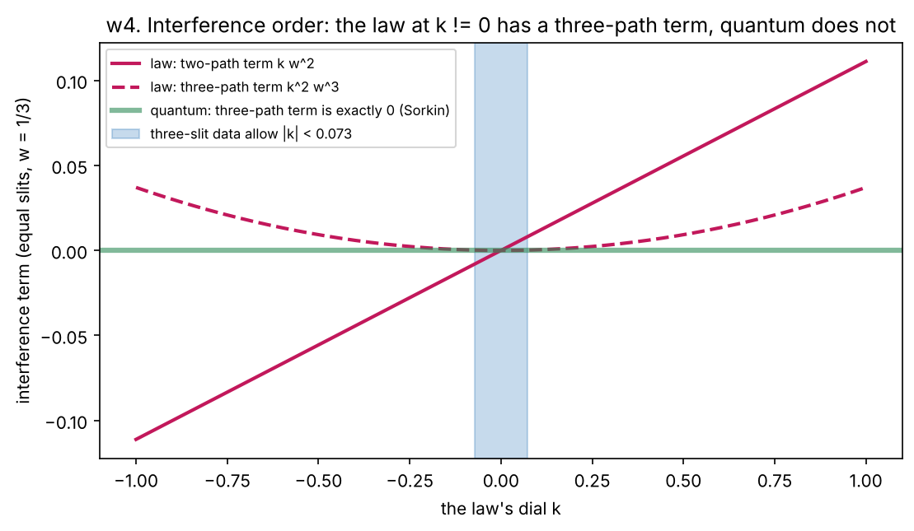
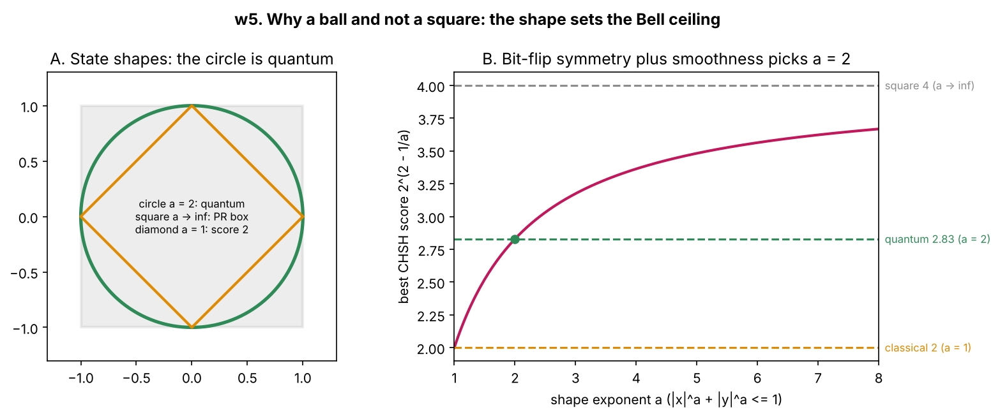
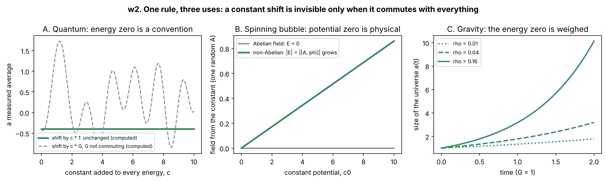
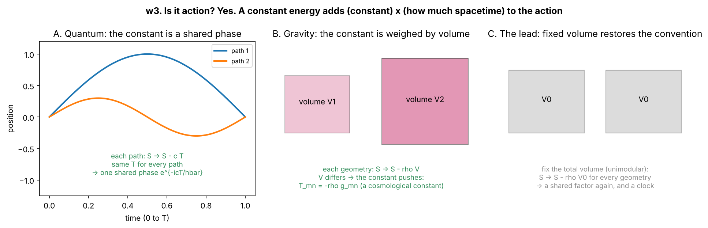
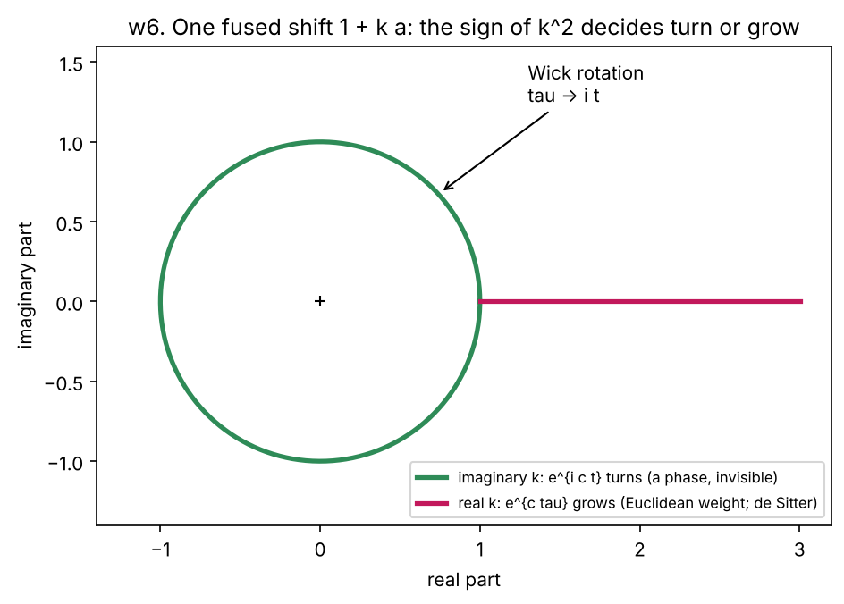
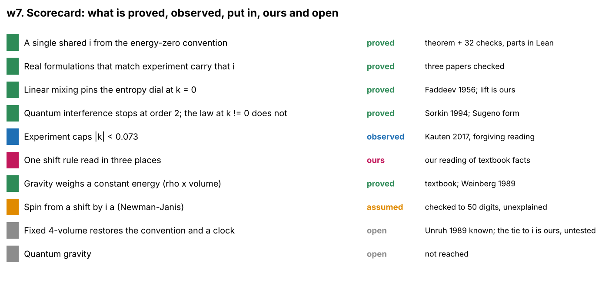

# DRAFT: Why quantum needs i, and a small bridge toward gravity (Nov 28, 2026)

**DRAFT. Not versioned, not submitted, not pushed to the repo. Only Part 1 has steps proved in Lean.**

Asked by Brennan on a voice call: "I want to expand the scope of that paper to this whole discussion we've had", "I feel like
the discussion is about quantum gravity at its heart", "definitely don't think it's been reached", and "I feel like there's a
little bridge here". Then, in the thread: "Is there a concept of action at work here? Whenever we're saying that gravity weighs
it, is that action, or is that just because it's an aggregate?" and "Please be sure to explore those ideas in the paper".

This paper widens the short why-i paper ([`../rotations-force-i/arxiv/main.tex`](../rotations-force-i/arxiv/main.tex)), which
stays as it is for arXiv. Part 1 is that paper, summarized. Parts 2 to 5 are new to this write-up.

Checks: [`checks.py`](checks.py) → [`checks_output.txt`](checks_output.txt), **17 of 17 pass** (about 10 seconds; numpy, scipy,
sympy). Check P1 re-runs the theorem's own 32 checks. Numbers are in [`results.json`](results.json). Pictures:
[`figures.py`](figures.py) → [`figures/`](figures/) w1 to w7. Hashes: [`SHA256SUMS`](SHA256SUMS).

**Colour key on every picture: green = proved (a theorem, or derived from stated assumptions), blue = observed, orange = assumed
or put in by hand, magenta = ours (a reading, not a unification), grey = open.**

---

## The result in plain words

**Quantum mechanics needs i because the zero of energy is a convention. Gravity is exactly where that stops being true, because
gravity weighs a constant energy. That one rule, a constant shift is invisible only when it commutes with everything, is the
bridge.** It runs through three places: the derivation of i, the spinning bubble that must carry charge, and the cosmological
constant. The action makes it concrete. A constant energy adds (the constant) × (how much spacetime) to the action. In quantum
mechanics every path has the same duration, so the constant is one shared phase. In gravity different geometries have
different volumes, so the constant pushes on the geometry.

**Quantum gravity is not reached.** What the bridge gives is a sharp question at its far end: what happens to i where the
energy zero is weighed? One known corner of gravity fixes the total volume of spacetime (unimodular gravity), and there a
constant energy is a convention again and ordinary time evolution comes back. **That opens a lead worth testing, on its own
merits:** it is the one place we found where why-i's key assumption is restored inside gravity rather than lost. The physics
there is known (Unruh 1989; Henneaux and Teitelboim 1989). The tie to the derivation of i is ours and untested.

*w1. The paper on one page. Left: the quantum side (Part 1) and the information side (Part 2), with the three-slit data. Middle:
the hinge, one shift rule (Part 3). Right: the gravity side (Part 4). Bottom: what stays open (Part 5).*

---

## Part 1. Why quantum needs i (proved)

This is the short paper, and it is the foundation for everything after it.

- **The setting.** Quantum dynamics over the real numbers: each Hamiltonian H gets a generator A(H) that is antisymmetric
  (norm-preserving), commutes with H (energy is conserved), and turns each energy level at the rate |E|/ħ (Planck–Einstein).
  Every such dynamics has its own quarter turn J with J² = −1. That much is known (Ashtekar and Magnon 1975; Aste; Vaughan).
- **The one requirement (A4).** Shifting the energy zero, H → H + c, changes the dynamics only by a fixed common rotation:
  A(H + c) = A(H) + c·A(1).
- **The theorem.** Then A(H) = JH/ħ with one J shared by every Hamiltonian, and [J, H] = 0 for all H. The proof takes five lines.
- **Consequences.** Real quantum theory with all symmetric observables breaks A4. So does quaternionic quantum theory with
  quaternion-linear dynamics. For two systems, A4 gives J_A ⊗ 1 = 1 ⊗ J_B, which turns the real tensor product into the complex
  one. The three recent "real" formulations that match experiment (Hoffreumon–Woods; Barrios Hita et al.; Maioli–Curado–Gazeau)
  each meet the assumptions and carry the shared J.
- **Where A4 comes from.** It is derived three ways in the paper: from composite systems, from measured averages, and from a
  Euclidean (imaginary-time) formulation. The last one matters for this write-up. **On the Euclidean side, shifting the energy
  zero multiplies every path weight by the same positive number e^(−cτ/ħ), for every history. Continuing τ → it turns that
  common factor into the common rotation e^(−ict/ħ), and that is where i enters.** Part 3 shows this is exactly the step
  gravity breaks.

**Status: proved.** 32 checks (re-run here as P1), with the algebraic steps also checked in Lean 4. The paper is not yet
peer-reviewed. Our search found no prior statement of the energy-zero argument (Adler's 1995 book on quaternionic quantum
mechanics is unchecked).

---

## Part 2. The information side (mostly known; the dial reading is ours)

The law a ∘ₖ b = a + b + kab acts as a dial. Here the question is where quantum theory sits on that dial, from the side of
information. The answer, every time, is **k = 0**, or the shape that goes with it.

### 2.1 Entropy on the dial

- **Tsallis entropy is the law (known).** For independent systems, S_q(AB) = S_q(A) + S_q(B) + (1 − q)·S_q(A)·S_q(B). That is
  mult-add with k = 1 − q (check I1, error 4×10⁻¹⁶; Tsallis 1988). Shannon's entropy is k = 0.
- **Linear mixing pins k = 0 (known theorem; the lift is ours).** Mixing quantum states with ordinary coin weights gives the
  grouping rule S(p₁, p₂, …) = S(p₁ + p₂, …) + (p₁ + p₂)·S(p₁/(p₁+p₂), p₂/(p₁+p₂)). Shannon passes. Tsallis at q = 2 (k = −1)
  misses by 0.019 (check I2). Faddeev (1956) proved the grouping rule singles out Shannon. Reading that as "the coin rule
  forces k = 0 on the law" is ours ([`spin-i-tie/linear-mixing/`](../../spin-i-tie/linear-mixing/)).
- **A consequence on the gravity side (ours, from the bridges study).** An entropy with k ≠ 0 can't come from linearly mixing
  quantum states. That bears on cosmologies that give horizons a Tsallis-type entropy (see 4.4).

### 2.2 Interference stops at two paths, and experiment caps k

*w4. The law at k ≠ 0 has interference at every order: a two-path term k·ab and a three-path term k²·abc. Quantum mechanics has
two-path interference and an exactly zero three-path term (Sorkin 1994). The blue band is what three-slit experiments allow.*

- The law used as a measure gives I₂ = k·ab and I₃ = k²·abc, exactly (check I3, symbolic). Quantum amplitudes give I₃ = 0 to
  machine precision while I₂ ≠ 0 (same check). Averaging quantum outcomes gives only k = 0
  ([`spin-i-tie/interference-law/`](../../spin-i-tie/interference-law/)).
- **The three-slit cap (new since the outline).** If the law touched quantum odds at all, the best three-slit data keep
  **|k| < 0.073** (Kauten et al. 2017), or |k| < 0.73 from the older Sinha et al. 2010. This uses the forgiving reading: the law
  rides on top of ordinary quantum interference, with each slit's share w = 1/3 (check I4;
  [`spin-i-tie/three-slit-cap/`](../../spin-i-tie/three-slit-cap/)). The cap is really on k·w.

**Status:** Sorkin's hierarchy is known. The cap is a number for the k ≠ 0 world, not a discovery.

### 2.3 Why a ball and not a square

*w5. A. Three state shapes. The circle is quantum, the square is the "PR box" that no-signalling alone allows, and the diamond
scores no better than classical. B. For the shape |x|^a + |y|^a ≤ 1, the best Bell (CHSH) score is 2^(2 − 1/a): 2 at a = 1,
2√2 ≈ 2.83 at a = 2, and 4 as the shape becomes a square.*

- **XOR is the law at k = −2 (ours, a restatement).** On bits, a + b − 2ab = a XOR b (check I5). Information causality
  (Pawłowski et al. 2009) is built on XOR guessing games, so it is a statement about the law at k = −2.
- **The circle gives 2√2 (known).** Correlations on a circle top out at 2√2 = 2.828427 (Tsirelson 1980; check I6, optimized).
  The ceiling 2^(2 − 1/a) matches at a = 1, 2 and the square limit (same check). Bit-flip symmetry plus smoothness picks a = 2
  ([`spin-i-tie/forces-circle/`](../../spin-i-tie/forces-circle/)).
- **Information causality from the coin rule needs more (known).** Getting information causality from linear mixing also needs a
  measurement-entropy assumption, strong subadditivity and Holevo's bound (Barnum et al. 2010). With those, a ball passes and a
  square fails ([`spin-i-tie/ic-from-coin/`](../../spin-i-tie/ic-from-coin/)).
- **Polygon state shapes (ours).** Among regular polygons, only the triangle (a classical trit) and the exact disk pass the
  entropy tests ([`spin-i-tie/polygon-entropy/`](../../spin-i-tie/polygon-entropy/)).

**What Part 2 adds to the bridge.** Every route from information lands quantum theory at k = 0, or on the circle that goes with
it. That is the same additive point the gravity side uses (4.4).

---

## Part 3. The hinge: one shift rule, and the action (ours, built from textbook facts)

### 3.1 The rule

**A constant shift is a convention exactly when its generator commutes with everything.** "Convention" means nothing you can
measure changes. If the generator fails to commute with something, the shift shows up in what that thing does.

This is a reading of textbook facts. We didn't find it stated as one rule
([`spin-i-tie/`](../../spin-i-tie/README.md), section 1).

### 3.2 Three uses, in two directions

*w2. A. Quantum: adding c to every energy leaves a measured average exactly flat (computed); shifting along a generator that
doesn't commute moves it by order one. B. The spinning bubble: in an Abelian field a constant potential makes no field; in a
non-Abelian field it does, |[A, φ]| = 0.86 for one random field. C. Gravity: a constant energy density ρ sets how fast the
universe grows.*

1. **why-i runs the rule forward.** It *demands* that the energy zero be a convention, and that forces one shared, commuting
   quarter turn: the i (check H1: change 1×10⁻¹⁵ for c·1, 0.75 for a non-commuting generator).
2. **The spinning bubble runs it backward.** In the Bartnik–McKinnon bubble the zero of the electric potential is *not* a
   convention, because the non-Abelian field doesn't commute with it (check H2). The staticity theorem then says a regular bubble
   can spin only if that physical zero meets a charge (Brodbeck, Heusler, Straumann and Volkov 1997). **So a spinning bubble must
   be charged.**
3. **Gravity breaks it.** A constant energy gravitates (checks H3, H5). That is the cosmological constant problem
   (Weinberg 1989), seen as a failure of why-i's assumption A4.

### 3.3 Is it action, or aggregation? Action.

*w3. A. Quantum: adding a constant c changes every path's action by −c·T. Every path takes the same time T, so the change is
one shared phase. B. Gravity: adding a constant energy density ρ changes each geometry's action by −ρ·V. Different geometries
have different volumes V, so the change pushes on the geometry. C. The lead in Part 5: if every geometry has the same volume
V₀, the change is shared again.*

- **Quantum (textbook).** The action is S = ∫(kinetic − potential − c)dt. The constant adds −c·T to every path. The difference
  between any two paths' actions doesn't move: it stays 0.3346 for c = 0, 1 and 5 (check H4). Nothing measurable changes,
  because only differences of action between paths interfere.
- **Gravity (textbook).** A constant energy density enters the action as −ρ·∫√(−g) d⁴x, which is −ρ × (volume of spacetime).
  Volume depends on the metric, so the constant is no longer the same for every history. Varying the metric gives
  T_μν = −ρ·g_μν (check H3, symbolic), which is exactly a cosmological constant. Two geometries with volumes 1 and 3.375
  differ in action by 2.375·ρ (check H4).
- **Aggregation is a separate issue.** It explains why the predicted vacuum energy is so large: summing every field mode's
  zero-point energy overshoots by many orders of magnitude. But a single small constant would still gravitate. That comes from
  how the action weighs it, not from how many pieces add up.

**The bridge in one line (ours):** the constant is harmless when it multiplies the same amount of spacetime for every history,
and harmful when the amount of spacetime is itself part of what varies.

### 3.4 The same step, seen from imaginary time (ours, a reading)

Part 1's Euclidean route to A4 says: on the imaginary-time side, a constant energy multiplies every history's weight by the same
factor e^(−cτ/ħ), and the continuation to real time turns that into one shared phase. In Euclidean gravity, the factor is
e^(−ρV/ħ) with V each history's four-volume. Histories have different volumes, so **the factor is not shared, and the Euclidean
argument for A4 stops at exactly the step that supplied the i.** This is where the two sides of the bridge touch.

*w6. One fused shift, two outcomes. With imaginary k the shift turns (a phase, invisible). With real k it grows (a Euclidean
weight, or de Sitter expansion). The Wick rotation τ → it swaps one for the other.*

In the law's language, one fused shift a ↦ 1 + k·a carries both. Imaginary k walks around the circle (|e^(it)| = 1). Real k walks
outward, like de Sitter expansion a(t) = e^(Ht) with H = √(8πGρ/3): a(2) = 1.784, 3.183 and 10.130 for ρ = 0.01, 0.04 and 0.16
(check H5). Which one happens is set by the sign of k². That is the Wick rotation, which is textbook.

---

## Part 4. The gravity side

### 4.1 The energy zero is weighed (textbook)

Shown in 3.3. Status: textbook (Einstein's equations with a cosmological constant; Weinberg 1989). Not solved here, and no new
number comes out.

### 4.2 The spinning bubble needs charge (textbook; the rule's reading is ours)

Shown in 3.2. The slowly spinning bubble exists to first order and must be charged (BHSV 1997; Volkov and Gal'tsov 1998).
Whether an exact spinning bubble exists is open, and van der Bij and Radu (2002) conjecture it doesn't. The charge requirement
holds either way.

### 4.3 The spinning black hole from a shift by i (checked, not explained)

- Take the source of a non-spinning black hole and move it to height i·a on the spin axis. The complex distance to that source
  gives the spinning (Kerr) black hole's radius exactly: √((x, y, z − ia)²) = r − i·a·z/r (check G2, at a sample point to 10⁻¹⁰).
- Far away, the space around it is dragged around at the rate 2J/r³ with J = M·a (check G1, symbolic).
- In the river picture this one move sets every cell's speed, turn and lattice, and every field equation of empty space holds to
  50 digits ([`gravity-from-theory/spinning-river/`](../../gravity-from-theory/spinning-river/), 139 of 139 checks, hash-verified
  in U1).

**Status: put in, then checked.** The shift is the Newman–Janis shift (1965). It works, and nobody has explained why. In this
theory i is a setting of the dial, not a trick, which makes it a lead. It is not derived here.

### 4.4 The entropy side of gravity sits at k = 0 (known dictionary; one claim is ours)

The bridges study ([`bridges-study/`](../../bridges-study/README.md), 8 of 8 checks, hashes verified in U1) found that every
quantum–gravity bridge stands on one of two legs:

- **Entropy = area:** an additive quantum entropy equals a horizon area in Planck units (Bekenstein, Hawking, Jacobson 1995,
  Ryu–Takayanagi 2006).
- **Phase = action:** a quantum phase equals an action over ħ. That is the leg Part 3 stands on.

They meet at i, because a boost is a rotation in imaginary time (Unruh 1976). Where a bridge has a dial, the standard result sits
at k = 0. Dong's Rényi branes have tension (n − 1)/(4nG), which vanishes only at n = 1, the Ryu–Takayanagi point. With n = 1 − k
that is k = 0 (check H6). **So linear mixing (2.1) gives a quantum-side reason the entropy Jacobson and Ryu–Takayanagi assume must
be additive.** The new claim is the converse: a k ≠ 0 horizon entropy can't come from linearly mixing quantum states.

### 4.5 The river model (known law; the reading is ours)

Gravity's energy constraint, written in river variables, is one layer of the law's cube: Q = 8πGρ (Arnowitt, Deser and Misner
1959), with Q = 0 giving Schwarzschild ([`gravity-from-theory/jet-river/`](../../gravity-from-theory/jet-river/)). The flat cell
lattice is still an assumption.

---

## Part 5. What's open

**Quantum gravity is not reached.** Nothing here quantizes gravity, fixes ħ or Λ, or makes a new prediction that separates the
law from textbook physics. What the bridge does is point at two places where the question "what happens to i?" has a sharp
answer.

1. **Canonical quantum gravity: no energy zero at all (known territory).** There the Hamiltonian is a constraint, Hψ = 0
   (DeWitt 1967), so there is no zero to shift and why-i's lever is missing. The best-known state of the universe, the
   Hartle–Hawking state (1983), is real-valued. Complex phases come back once a clock emerges semiclassically (Halliwell's
   lectures). This is the problem of time. Our clock test found that one shared clock keeps the i but can't make quantum odds on
   its own: reaching 2√2 needs a signal of at least 0.41 bits per pair, which matches Valentini's (1991) picture
   ([`spin-i-tie/clock-test/`](../../spin-i-tie/clock-test/)).
2. **Unimodular gravity: the convention restored (the lead).** Fix the total four-volume of spacetime and every history has the
   same V₀. Then −ρ·V₀ is again one shared factor, and a constant energy drops out of the field equations (its trace-free part is
   zero; check H7). The cosmological constant comes back as a constant of integration instead of a coupling. Unruh (1989) showed
   that in this version of gravity the Hamiltonian constraint is replaced, the quantum theory has ordinary Schrödinger-type
   evolution, and the Wheeler–DeWitt equation is avoided. The price is a fixed background volume element (Unruh 1989;
   Henneaux and Teitelboim 1989).

   **Why it's worth a test (ours, untested):** it is the one setting we found where A4, the assumption that produces i, is
   restored inside gravity, and it comes with a clock. The test: write why-i's assumptions for a unimodular minisuperspace model
   and see whether the theorem goes through with the cosmological constant as the energy conjugate to unimodular time. If it does,
   the shared i of quantum mechanics and the time of unimodular gravity are the same object. If it fails, the failure says which
   assumption gravity actually breaks. Caveat: I have read only the abstract of Unruh's paper, not the paper itself, and the
   physics is well studied, so any result has to be judged against that literature first.

*w7. Scorecard. Green: proved. Blue: observed. Orange: put in by hand and then checked. Magenta: our reading. Grey: open.*

---

## Assumptions

- **Part 1:** A0 (observables lie in a set of Hamiltonians containing 1 and closed under H + c), A1 (antisymmetric generator),
  A2 (energy conserved), A3 (rotation rate |E|/ħ), A4 (the energy-zero rule); A5 to A7 for the complex and composite
  statements. Each is weakened or derived in the short paper. Finite dimensions only.
- **Part 2:** the law is applied as a measure to odds or to entropy composition. The three-slit cap uses the forgiving reading
  (the law on top of quantum interference) and slit shares w = 1/3; the cap is on k·w. Kauten's limit is taken as κ ≈ 10⁻⁴.
- **Part 3:** "convention" means no measured average changes. The action comparison uses a classical action for illustration;
  the gravity term is the standard −ρ√(−g). The imaginary-time reading in 3.4 assumes the Euclidean path integral is the right
  starting point for gravity, which is itself unsettled (the conformal-factor problem).
- **Part 4:** the Newman–Janis shift is put in, not derived. The river model assumes a flat cell lattice. The bridges-study
  results are taken from that page.
- **Part 5:** unimodular gravity fixes a background volume element. Whether that is physical is debated.

## Checks (17 of 17 pass)

| Check | What it shows |
|---|---|
| P1 | The theorem's own checks re-run: 32 of 32 pass |
| I1 | Tsallis entropy composes by the law with k = 1 − q |
| I2 | The coin-weighted grouping rule holds for Shannon (k = 0), fails for k = −1 |
| I3 | The law has I₂ = k·ab, I₃ = k²·abc; quantum has I₃ = 0 |
| I4 | Three-slit cap: \|k\| < 0.073 (Kauten 2017), < 0.73 (Sinha 2010) |
| I5 | XOR is the law at k = −2 |
| I6 | The circle gives 2√2; the ceiling 2^(2 − 1/a) gives 2, 2√2, 4 |
| H1 | Shifting by c·1 changes no average; a non-commuting shift does |
| H2 | A constant potential makes no field in an Abelian theory, a nonzero one in su(2) |
| H3 | −ρ√(−g) in the action gives T_μν = −ρ·g_μν |
| H4 | The constant shifts every path's action equally in QM, each geometry's differently in gravity |
| H5 | Imaginary k turns, real k grows; de Sitter solves a″/a = 8πGρ/3 |
| H6 | Dong's tension vanishes only at k = 0 |
| H7 | With fixed volume the constant drops out and weight ratios don't move |
| G1 | Frame dragging far from Kerr is 2J/r³ |
| G2 | The shift by i·a gives Kerr's radius |
| U1 | Six upstream outputs show no failures; bridges-study hashes verify |

U1 records the SHA-256 of each upstream output in `results.json`. One note: the theorem folder's stored `checks_output.txt` is out
of date (it says SymPy was missing). P1 re-runs the script instead, and it passes 32 of 32.

## Files

`README.md` (this write-up), `checks.py`, `checks_output.txt`, `results.json`, `figures.py`, `figures/w1` to `w7`, `SHA256SUMS`.

## Sources

- Ashtekar and Magnon, Proc. R. Soc. Lond. A 346, 375 (1975).
- Hoffreumon and Woods, arXiv:2504.02808; Barrios Hita et al., Phys. Rev. Lett. 136, 240202 (2026), arXiv:2503.17307;
  Maioli, Curado and Gazeau, arXiv:2604.19482. Full list in the short paper.
- Osterwalder and Schrader, Commun. Math. Phys. 31, 83 (1973) and 42, 281 (1975).
- Tsallis, J. Stat. Phys. 52, 479 (1988). Faddeev, Uspekhi Mat. Nauk 11, 227 (1956).
- Sorkin, Mod. Phys. Lett. A 9, 3119 (1994). Sinha et al., Science 329, 418 (2010), arXiv:1007.4193. Kauten et al., New J. Phys.
  19, 033017 (2017), arXiv:1508.03253.
- Tsirelson, Lett. Math. Phys. 4, 93 (1980). Popescu and Rohrlich, Found. Phys. 24, 379 (1994). Pawłowski et al., Nature 461,
  1101 (2009). Barnum et al., New J. Phys. 12, 033024 (2010), arXiv:0909.5075.
- Brodbeck, Heusler, Straumann and Volkov, Phys. Rev. Lett. 79, 4310 (1997), gr-qc/9707057. Volkov and Gal'tsov, hep-th/9810070.
  Van der Bij and Radu, gr-qc/0111046.
- Weinberg, Rev. Mod. Phys. 61, 1 (1989).
- Newman and Janis, J. Math. Phys. 6, 915 (1965).
- Arnowitt, Deser and Misner (1959); see gr-qc/0405109.
- Bekenstein, Phys. Rev. D 7, 2333 (1973). Hawking, Commun. Math. Phys. 43, 199 (1975). Unruh, Phys. Rev. D 14, 870 (1976).
  Jacobson, Phys. Rev. Lett. 75, 1260 (1995). Ryu and Takayanagi, Phys. Rev. Lett. 96, 181602 (2006). Dong, Nat. Commun. 7,
  12472 (2016).
- DeWitt, Phys. Rev. 160, 1113 (1967). Hartle and Hawking, Phys. Rev. D 28, 2960 (1983). Halliwell, arXiv:0909.2566.
- Valentini, Phys. Lett. A 156, 5 (1991).
- Unruh, Phys. Rev. D 40, 1048 (1989). Henneaux and Teitelboim, Phys. Lett. B 222, 195 (1989).
