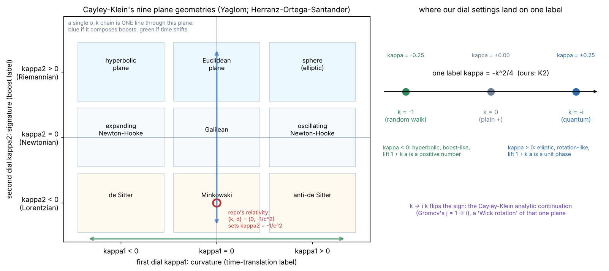
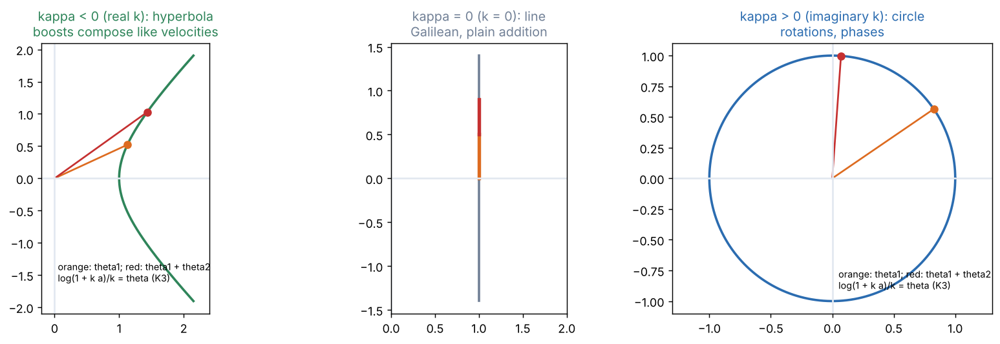
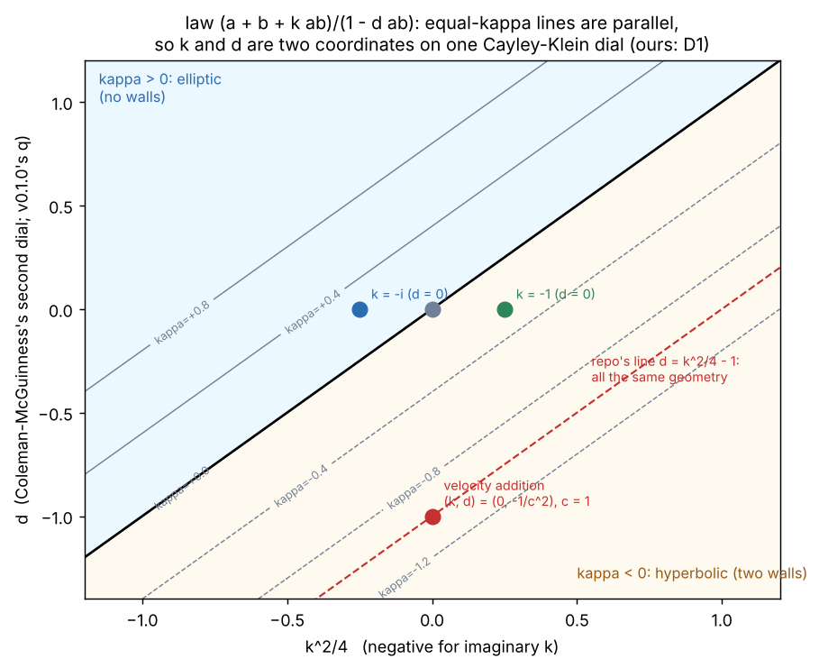
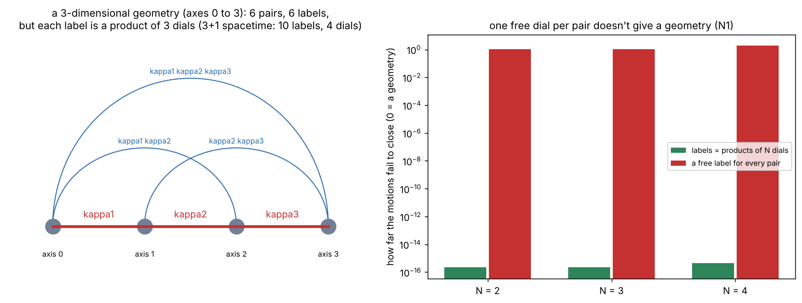
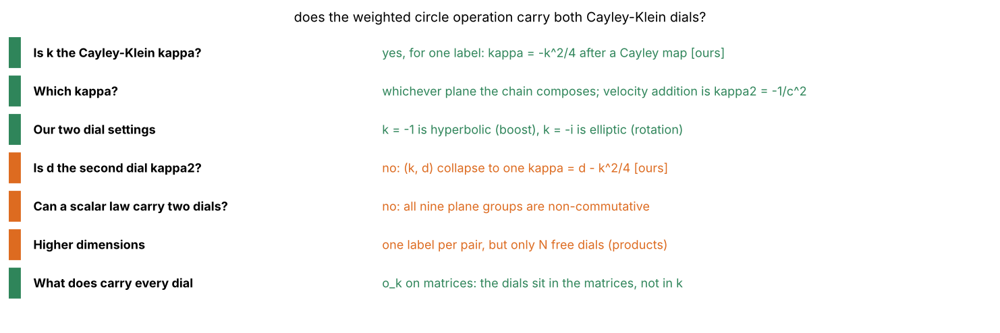

# Is k the Cayley–Klein dial? And does the circle operation carry both dials?

Nov 25, 2026. Part of topics/why-i.

*Notation: κ, κ₁ and κ₂ on this page are the Cayley–Klein labels of the literature (Herranz–Ortega–Santander). The dials keep their letters k and d; in the dial names (`affine-names/`) the single label κ is the reading −Δ/4 = d − k²/4, with Δ = k² − 4d.*

**Verdict.** Yes, k is a Cayley–Klein dial, but only one of them at a time. After a change of coordinates it is the curvature label κ = −k²/4 of whatever one-parameter motion the chain composes. Real k is the hyperbolic case (boosts, κ < 0). Zero is the flat case. Imaginary k is the elliptic case (rotations, κ > 0). So our step from k = −1 to k = −i is exactly the Cayley–Klein flip from a boost to a rotation.

The plane's second dial d is **not** the second Cayley–Klein dial. Together, k and d collapse to one value, the label κ = d − k²/4 = −Δ/4, where Δ = k² − 4d is the form's discriminant.

No single-number law can hold two Cayley–Klein dials, because all nine plane geometries have motions that don't commute. In higher dimensions there is one label per pair of directions, but only N of them are free; the rest are products of those N. The circle operation does carry every dial when its elements are matrices. There the dials live in the matrices, not in k.

## 1. What the literature says

- **Cayley–Klein geometries.** The plane has nine constant-curvature geometries, set by two dials (Yaglom 1979; Herranz, Ortega and Santander 2000):
  - κ₁ is the label of time translations, which is the curvature;
  - κ₂ is the label of boosts, which is the signature; κ₂ = −1/c² gives a Lorentzian spacetime.
  - The nine are: sphere, Euclidean and hyperbolic planes; oscillating Newton–Hooke, Galilean and expanding Newton–Hooke; anti-de Sitter, Minkowski and de Sitter.
- **Labels and dials.** Each one-parameter motion has its own label: κ₁ for time shifts, κ₂ for boosts, κ₁κ₂ for space shifts. The motion is a "rotation" whose tangent composes by (x + y)/(1 − κxy).
- **Higher dimensions.** An N-dimensional Cayley–Klein geometry has N dials and N(N+1)/2 labels, each a product of consecutive dials. The Cayley–Klein algebras are a distinguished subset of the graded contractions of so(N+1) (Herranz, de Montigny, del Olmo and Santander 1994). The wider graded-contraction family has more parameters, 2^N − 1, but it is a family of algebras, not of motions of a single space.
- **Gromov's contractions and analytic continuations** multiply coordinates by parameters j ∈ {1, ι, i}, where ι is nilpotent (ι² = 0). These play the same roles as our k being real, zero or imaginary.
- **Velocity addition.** Lévy-Leblond (1976) derives the Lorentz transformation from group structure alone. The one leftover constant is our κ₂. Bacry and Lévy-Leblond (1968) classify the possible kinematical groups; they are the de Sitter groups and their contractions.
- **Coleman and McGuinness (1991)** classify the rational formal group laws (x + y + cxy)/(1 − dxy) by c² − 4d. This is the repo's (k, d) plane.

## 2. k is one Cayley–Klein label (checks K1–K5)

- **The Cayley map** a = T/(1 − (k/2)T) turns κ-tangent addition into a ∘ₖ b exactly, with **κ = −k²/4** (ours, a short derivation; K2).
  - Only the sign of κ is a true invariant. Its size is a choice of units, both in Cayley–Klein and for ∘ₖ.
- **The hidden coordinate** log(1 + ka)/k is the Cayley–Klein arc length, meaning the rapidity or the angle (K3).
- **The lift 1 + ka** is a positive number e^(kθ) when k is real. The same e^(kθ) is a unit phase when k is imaginary (K4). So the quantum setting k = −i composes phases on a circle, and the random setting k = −1 composes positive factors on a hyperbola.
- **Velocity addition** is the κ = −1/c² law. With k = 2/c the lift is the squared Doppler factor (Bondi's k-calculus, a name clash to watch). With c = 1 this gives a = u/(1 − u); the repo's a = 2u/(1 − u) is the same law with a rescaled, which makes k = 1 (K5). Only the sign of κ is invariant, so this is a choice of units.
- **Which κ is it?** A single chain composes one kind of motion, so k is the label of that motion:
  - composing boosts (the relativity page): κ₂, the signature;
  - composing time shifts: κ₁, the curvature;
  - composing space shifts: κ₁κ₂.
  - A one-dimensional law alone can't tell these apart. The difference only shows up when the motions are combined.

## 3. The plane's second dial d is not κ₂ (checks D1–D4)

- **Ours, from two known results:** every law (a + b + kab)/(1 − dab) is the κ-tangent law in disguise, under the same Cayley map, with **κ = d − k²/4 = −Δ/4** (D1).
  - So (k, d) are two coordinates on one dial, and lines of equal κ are the parabolas on which d − k²/4 stays fixed.
  - Coleman and McGuinness's discriminant is k² − 4d = −4κ. It counts the walls: two when κ < 0, none when κ > 0 (D2).
- **Same geometry, different coordinates (D3):** the repo's relativity point (0, −1/c²), pure ∘ₖ at k = 2/c, and every point on the repo's line d = k²/4 − 1 all have κ = −1/c².
- **Why no scalar law can carry κ₂ (D4):** every one of the nine plane groups, Galilean included, has motions that don't commute. Every scalar law is commutative.

## 4. Higher dimensions (checks N1–N4)

- **Labels must be products (N1).** The motion generators J_ab (one per pair of directions) close into a Lie algebra only when κ_ac = κ_ab·κ_bc. Then every label is a product of N dials. With an independent label for each pair they don't close, for N = 2, 3 and 4. So the picture of "one dial for each pair of directions" isn't quite right: each pair has a label, but only N of them are free.
- **Ours (N2).** Each pair's one-parameter group is a scalar ∘ₖ chain with its own dial k_ab, and its label is the reading κ_ab = −k_ab²/4. So a chain across the planes carries all the labels, with the k's tied together by k_ac² = −k_ab²·k_bc²/4. (The check starts from the literature's labels and recovers each k_ab, because it is a bridge into their system; checks K2–K4 run the other way, from k.)
- **Matrices carry everything (N3).** With matrix elements, ∘ₖ (with A = G − 1) is the group law of every Cayley–Klein group, all dials included.
- **The i step (N4).** Multiplying k by i flips the sign of that plane's κ. That is the Cayley–Klein analytic continuation, a "Wick rotation" of that one plane.

## 5. What this means for the framework

- **Brennan's instinct holds, with one correction.** k really is a curvature dial, and a space of dials really does give the curved geometries. But the dials don't come from making k itself multi-dimensional. They come from the *kinds of motion* being composed, and in N dimensions only N are free.
- **The scalar (k, d) plane is a picture of one Cayley–Klein dial,** drawn in two coordinates.
- **Tie to why i.** The step from k = −1 to k = −i, which separates Kac's random walk from Feynman's checkerboard, is the hyperbolic-to-elliptic flip of one label. In Cayley–Klein language, i is what turns a boost into a rotation.
- **No new lead on its own.** This places the framework's dial inside a well-mapped published family. The next useful step would be to compose two kinds of motion as matrices, for example boosts and time shifts, and check that the chain reproduces the de Sitter / anti-de Sitter corners. That is known physics, so it would be a demonstration, not a discovery.

## 6. Assumptions

- **Field:** real Cayley–Klein geometries. Imaginary k is allowed as a complex coordinate for the elliptic case.
- **Sign conventions:** κ₁ > 0 is anti-de Sitter / oscillating Newton–Hooke, and κ₁ < 0 is de Sitter / expanding, following Herranz–Ortega–Santander.
- **Our k is defined on the quantity composed,** as in the repo's NAMING-COLLISIONS page. The Cayley map is normalized so that a ≈ T for small T; another normalization rescales k but not the sign of κ.
- **The "no free label per pair" check** uses the standard realization of motions as matrices acting on one space. As abstract algebras, graded contractions allow more parameters.
- **Lean:** none for this part. The identities are rational-function identities, checked numerically on random inputs.

## 7. Files

- `checks.py` → `checks_output.txt`: **13/13 pass** (K1–K5, D1–D4, N1–N4).
- `figures.py` → `figures/f1`–`f5`.

## 8. Sources

- I. M. Yaglom, *A Simple Non-Euclidean Geometry and Its Physical Basis* (Springer, 1979).
- F. J. Herranz, R. Ortega and M. Santander, "Trigonometry of spacetimes: a new self-dual approach to a curvature/signature (in)dependent trigonometry," J. Phys. A 33, 4525 (2000), arXiv:math-ph/9910041.
- F. J. Herranz, M. de Montigny, M. A. del Olmo and M. Santander, "Cayley–Klein algebras as graded contractions of so(N+1)," J. Phys. A 27, 2515 (1994), arXiv:hep-th/9312126.
- F. J. Herranz and M. Santander, general solution of the graded contraction equations, arXiv:hep-th/9601032.
- N. A. Gromov and collaborators, Cayley–Klein groups over the Pimenov algebra (for example arXiv:math/0209158).
- J.-M. Lévy-Leblond, "One more derivation of the Lorentz transformation," Am. J. Phys. 44, 271 (1976).
- H. Bacry and J.-M. Lévy-Leblond, "Possible kinematics," J. Math. Phys. 9, 1605 (1968).
- A. Coleman and S. McGuinness, "Rational formal group laws," Pacific J. Math. 147 (1991).
