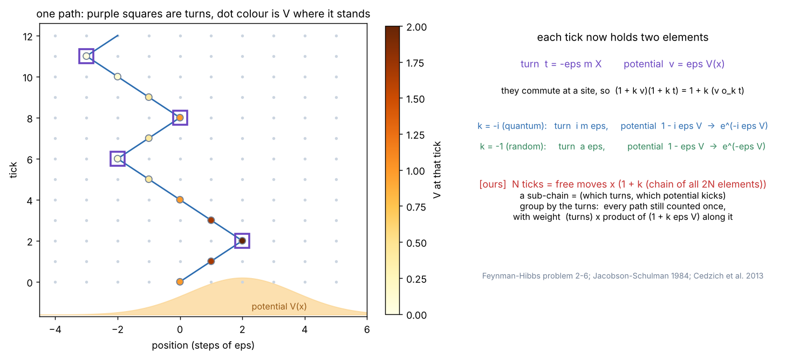
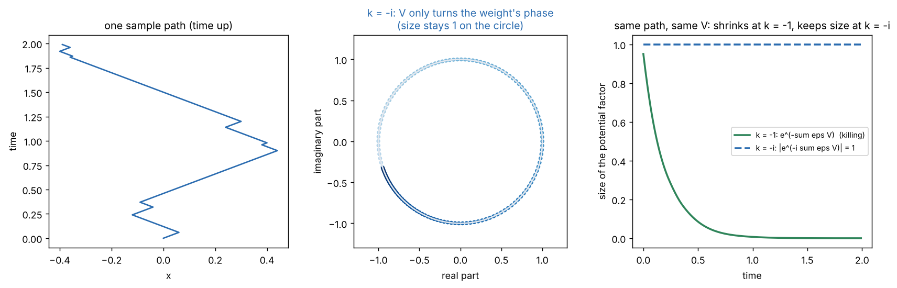
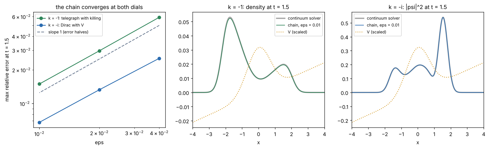
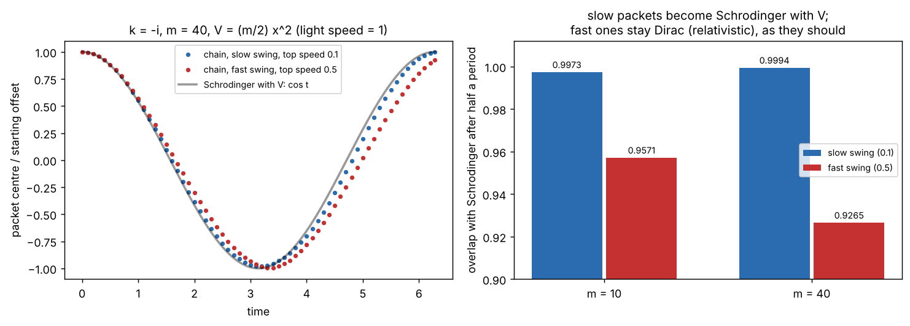
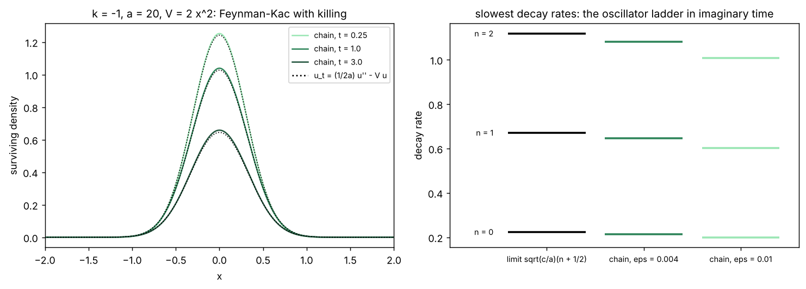
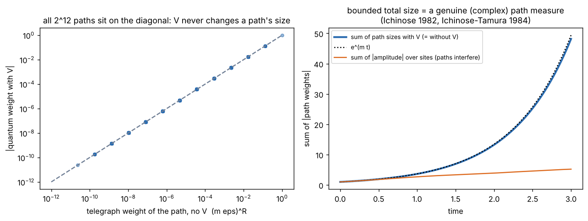
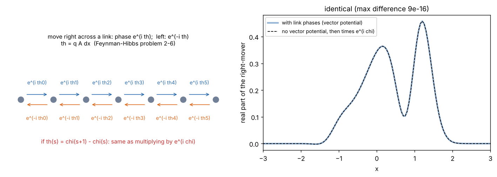
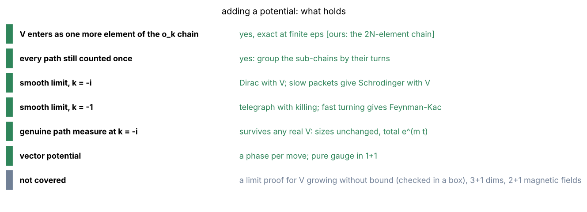

# Adding a potential to the checkerboard / telegraph chain

> **Names:** some words or symbols on this page (twist) also mean something else in standard math, physics or computing, or inside this project. [NAMING-COLLISIONS.md](../../../NAMING-COLLISIONS.md) says which meaning is in play.

Nov 25, 2026. Part of topics/why-i, after topics/why-i/checkerboard.

**Verdict.** A potential fits the weighted-circle chain as one more element in every tick, and every path is still counted exactly once. As the steps shrink, the chain becomes the Dirac equation with that potential at the quantum setting and the telegraph equation with killing at the random setting. At long times these become Schrödinger's equation with the potential and Feynman–Kac diffusion with killing. The genuine path measure at the quantum setting survives any real potential, because the potential only turns each path's phase and never changes its size.

All of these limits are published physics. What's new here is that one chain with one dial carries both of them. This closes the usual objection that a path-sum model only works for a free particle. It doesn't open a new lead by itself. The next real test is a magnetic field in two space dimensions, where the gauge field can't be removed.

## 1. What the literature already does

- **Feynman and Hibbs (1965), problem 2-6:** an electromagnetic potential enters the checkerboard as a phase per step. A scalar potential is a phase e^(−iεV) per tick, and a vector potential is a phase e^(iqAΔx) per move.
- **Jacobson and Schulman (1984)** take the checkerboard to its non-relativistic limit. **Gaveau, Jacobson, Kac and Schulman (1984)** connect it to Kac's telegraph by continuing the turn rate.
- **Ichinose (1982) and Ichinose and Tamura (1984)** build a genuine countably additive path measure for the 1+1 Dirac propagator. The 1984 paper includes an electromagnetic potential.
- **Cedzich et al. (2013)** study the "electric quantum walk": a unitary walk with a phase e^(−iεV) per step.
- **Meyer (1996)** and **Bialynicki-Birula (1994)** treat the unitary walk as a lattice Dirac equation.
- **Kac (1949)** gives the Feynman–Kac formula. At the random setting a potential is a killing rate, weight e^(−∫V dt) per path. The telegraph version is a random evolution (Griego and Hersh, Pinsky). I didn't check those two sources myself.
- **Trotter (1959) and Strang (1968):** alternating a "kinetic" step with a "potential" step converges to the joint evolution. That is how the tick is built here, and how the independent solver used in the checks works.
- **Ord** and **Kauffman–Noyes** give discrete Dirac models. I only checked Kauffman–Noyes, and only for the free case.

## 2. How the potential enters the chain

Units: c = ħ = 1. Steps are ε in both time and space. Notation is as in topics/why-i/checkerboard.

- **Turn element:** t = −εμX, where X swaps right- and left-movers at a site. The turn weight is −kεμ: a ε at k = −1 (Kac) and i m ε at k = −i (Feynman).
- **Potential element:** v = εV(x)·I, the same number for both directions at a site. Its factor is 1 + kv:
  - 1 − iεV at k = −i, which is a phase to first order;
  - 1 − εV at k = −1, which is killing to first order.
  - Choosing v = (e^(kεV) − 1)/k instead makes the factor exactly e^(−iεV) (unitary) or e^(−εV) (killing). It is still one element, and the chain identities don't change.
- **No twist inside a tick:** at one site, v and t commute. So one tick is (1 + kv)(1 + kt) = 1 + k(v ∘ₖ t), followed by the move (check A1; Lean `scalar_comm`, `tick_factor`).

**The identity (ours, exact at every ε; check A2).** Move every element back through the free moves to tick 0. N ticks then equal

  free moves × (1 + k · (chain of all 2N turn and potential elements)).

The elements no longer commute once they are moved, because a turn changes direction and so changes where later potentials are felt. The weighted-circle chain still holds. It needs only associativity, not commutativity.

## 3. Every path is still counted once

The chain expands into every ordered sub-chain once. A sub-chain now picks two things: which ticks turn, and which ticks get a potential kick. Group the sub-chains by their turns. The turns fix the path, and summing over the potential kicks on that fixed path gives Π(1 + kεV(x_j)) along it (check B2; Lean `subsetSum_eq_prod`). That sum is the Dyson series in V, done path by path.

So each checkerboard path appears once, with weight

  (−kεμ)^R × Π over the path of (1 + kεV(x_j)).

Brute force over all 2^12 paths matches the chain at both settings (check B1).

## 4. Smooth limits (steps shrink, time fixed)

- **k = −i:** the chain goes to the 1+1 Dirac equation with an electric potential, i∂ₜψ = (pσ_z − mσₓ + V)ψ.
- **k = −1:** the chain goes to the telegraph equation with killing, ∂ₜψ = (−σ_z∂ₓ + aσₓ − a − V)ψ in the normalized form.
- **Check C1:** the chain is compared with an independent continuum solver (Strang splitting with FFT) for a bump-plus-slope potential. The error halves each time ε halves, at both settings: 5.9e-2 → 1.5e-2 for the telegraph, 2.5e-2 → 6.8e-3 for Dirac.
- **Check C2:** the plain factor 1 − iεV and the phase e^(−iεV) give the same limit. Their gap halves each time ε halves.
- **Check C3:** with the phase, the quantum chain keeps total probability exactly. With e^(−εV) and V ≥ 0, the random chain keeps probabilities non-negative, and their total only falls.

The proof is the same Lie–Trotter argument as in topics/why-i/checkerboard, now with the potential as a third bounded generator. For a bounded, smooth V the proof goes through unchanged. For a V that grows without bound, it is checked numerically in a box (section 5), not proved here.

## 5. Long times

**Quantum setting: Schrödinger with V (check D1).** I took a slow packet in V = (m/2)x² with m = 40 and light speed 1, starting at x = 0.1. After half a period it has swung to x = −0.099. Its overlap with Schrödinger's packet with the same V is 0.9994, up from 0.9973 at m = 10.

A fast swing that reaches half light speed matches Schrödinger with an overlap of only 0.93. The chain follows Dirac there, and it should, because that motion is relativistic. This is Jacobson and Schulman's non-relativistic limit, now with a potential.

The small lag that remains in the slow swing late in the period is the relativistic correction. It shrinks like 1/m.

**Random setting: Feynman–Kac with killing.**
- **Check D2:** with fast turning (a = 20), the chain's density matches u_t = (1/2a)u'' − Vu to 1% (relative L1).
- **Check D3:** with V = (c/2)x², the slowest decay rates are Ω(n + ½). That is the oscillator in imaginary time. On the lattice Ω = √(2cD) with D = (1 − aε)/(2a), and the rates match this within 3% at two step sizes. As ε → 0 they tend to √(c/a)(n + ½).
- **Check E3:** a Monte Carlo average over random Kac paths, weighted by e^(−Σ εV), reproduces the chain: 0.0296 ± 0.0002 against 0.0298.

## 6. The genuine path measure at the quantum setting survives

With the phase e^(−iεV), each path's weight has size (mε)^R. That is the same size it had with no potential, and the same as its telegraph weight at k = −1.

So the total size of all path weights is still (1 + mε)^N → e^(mt), which is bounded at fixed time (check E1). This is the bounded variation that makes Ichinose's complex path measure exist, and it holds for any real V, bounded or not.

With the plain factor 1 − iεV, the sizes grow at most by (1 + ε²·max V²)^(N/2). That tends to 1 when V is bounded on the light cone (check E2).

## 7. A vector potential is a phase on each move

Following Feynman and Hibbs, a vector potential is a phase e^(iθ) on each rightward move across a link and e^(−iθ) on each leftward move, with θ = qAΔx.

In 1+1 dimensions any such field is pure gauge. If θ(s) = χ(s+1) − χ(s), the result equals the free evolution multiplied by e^(iχ(x)), to 9e-16 (check G1).

So in one space dimension a vector potential adds nothing physical. The real test of the gauge part needs two space dimensions, where a magnetic field can't be removed.

## 8. What this does and doesn't settle

- **Settled, for 1+1 dimensions and bounded smooth V:**
  - interactions through a scalar potential fit the chain;
  - each path is still counted once;
  - both limits hold at both settings;
  - the path measure at the quantum setting survives.
- **Not settled:**
  - a limit proof for a V that grows without bound (checked in a box only);
  - 3+1 dimensions, where the checkerboard has no simple form;
  - a magnetic field in 2+1;
  - self-interaction, that is, a potential that depends on the state.

On its own merits this removes an obstacle rather than opening a new direction. The free chain from topics/why-i/checkerboard was the lead. This shows the lead doesn't break when the particle feels a force.

## 9. Assumptions

- **Space and units:** 1+1 dimensions; c = ħ = 1; equal time and space steps ε.
- **The potential:** real and time-independent, acting the same on both directions (an electric scalar potential, not a mass-like term).
- **Limit proofs:** for bounded smooth V. Unbounded V, such as the harmonic well, is checked numerically on a finite box that the packet never reaches the edge of.
- **Long-time Schrödinger check:** starts from the positive-energy spinor at rest, (1, −1)/√2 times a Gaussian. Slow means a top speed of 0.1.
- **Random setting:** "potential" means a killing rate. V ≥ 0 keeps it a sub-probability. Negative V means branching, which the linear chain still handles but is no longer a probability.
- **Vector potential:** link phases on a ring large enough that the packet never reaches the seam.
- **Lean file:** compiles in the shared library as `FusedAlgebra.Topics.CheckerboardPotential` (3 theorems; each uses only `propext`).

## 10. Files

- `cbv.py`: the chain with a potential (`evolve_v`), the independent Dirac/telegraph solver (`reference`), a Schrödinger solver and a heat-with-killing solver.
- `checks.py` → `checks_output.txt`: **17/17 pass** (A1–A2, B1–B2, C1–C3, D1–D3, E1–E3, G1).
- `figures.py` → `figures/p1`–`p8`.
- `lean/CheckerboardPotential.lean`: `scalar_comm`, `tick_factor`, `subsetSum_eq_prod`. Compiled in the shared library.

## 11. Sources

- R. P. Feynman and A. R. Hibbs, *Quantum Mechanics and Path Integrals* (1965), problem 2-6.
- T. Jacobson and L. S. Schulman, "Quantum stochastics: the passage from a relativistic to a non-relativistic path integral," J. Phys. A 17, 375 (1984).
- B. Gaveau, T. Jacobson, M. Kac and L. S. Schulman, "Relativistic extension of the analogy between quantum mechanics and Brownian motion," Phys. Rev. Lett. 53, 419 (1984).
- T. Ichinose, "Path integral for the Dirac equation in two space-time dimensions," Proc. Japan Acad. 58, 290 (1982).
- T. Ichinose and H. Tamura, "Propagation of a Dirac particle. A path integral approach," J. Math. Phys. 25, 1810 (1984).
- C. Cedzich, T. Rybár, A. H. Werner, A. Alberti, M. Genske and R. F. Werner, "Propagation of quantum walks in electric fields," Phys. Rev. Lett. 111, 160601 (2013).
- D. A. Meyer, "From quantum cellular automata to quantum lattice gases," J. Stat. Phys. 85, 551 (1996).
- I. Bialynicki-Birula, "Weyl, Dirac, and Maxwell equations on a lattice as unitary cellular automata," Phys. Rev. D 49, 6920 (1994).
- L. H. Kauffman and H. P. Noyes, "Discrete physics and the Dirac equation," Phys. Lett. A 218, 139 (1996). Free case only.
- M. Kac, "On distributions of certain Wiener functionals," Trans. AMS 65, 1 (1949).
- H. F. Trotter, "On the product of semi-groups of operators," Proc. AMS 10, 545 (1959). G. Strang, "On the construction and comparison of difference schemes," SIAM J. Numer. Anal. 5, 506 (1968).
- E. Nelson, "Feynman integrals and the Schrödinger equation," J. Math. Phys. 5, 332 (1964).
- R. Griego and R. Hersh; M. Pinsky, *Lectures on Random Evolution* (1991). Random evolutions; not checked here.
