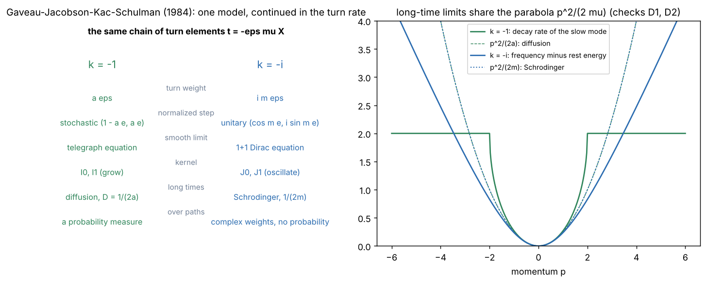
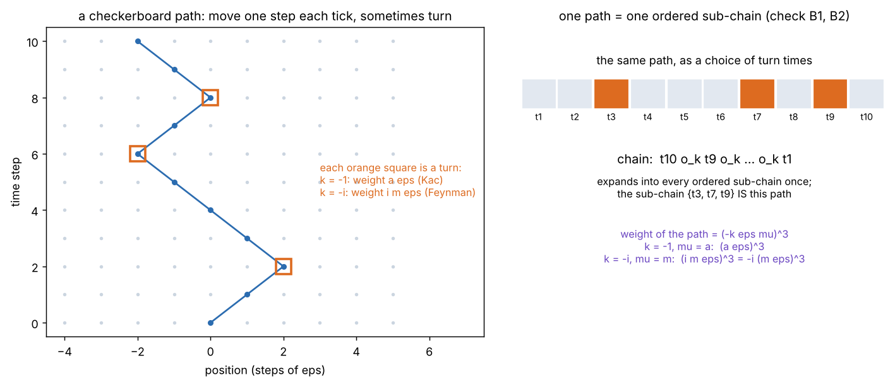
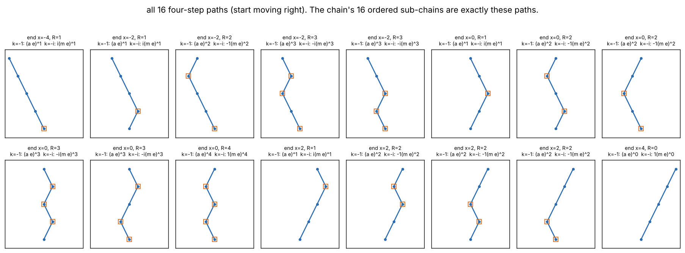
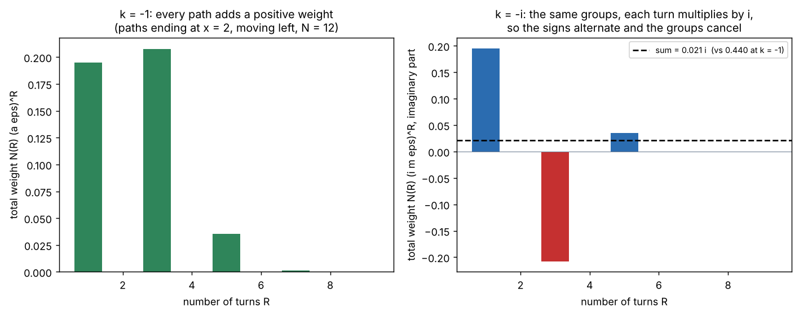
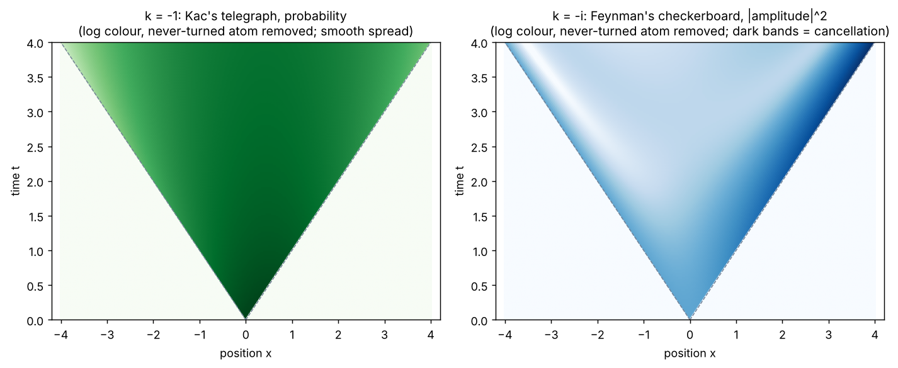
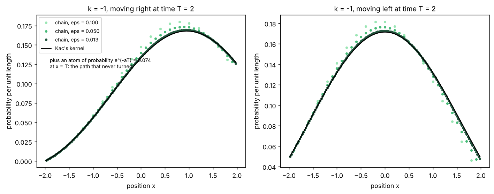
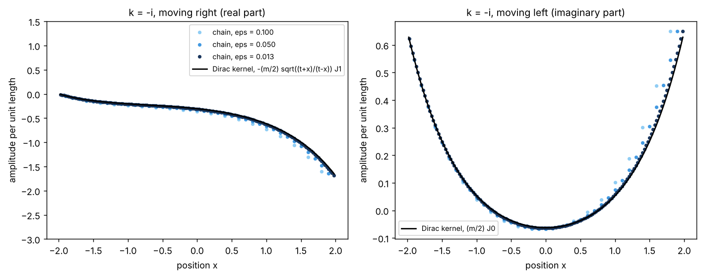
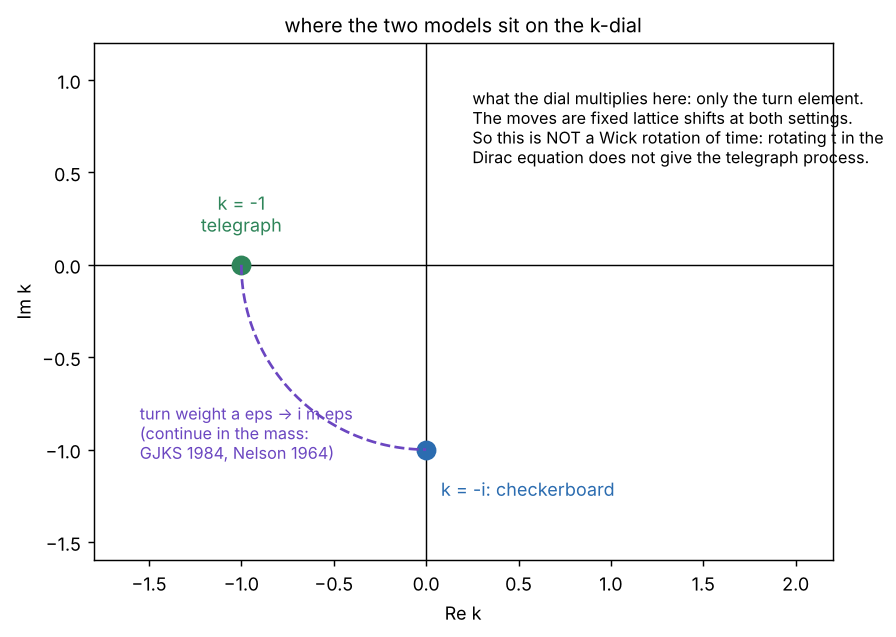

# Feynman's checkerboard and Kac's telegraph as one weighted-circle chain

> **Names:** some words or symbols on this page (twist) also mean something else in standard math, physics or computing, or inside this project. [NAMING-COLLISIONS.md](../../../NAMING-COLLISIONS.md) says which meaning is in play.

Nov 25, 2026. Part of topics/why-i.

**Verdict.** Feynman's checkerboard and Kac's telegraph are the same weighted-circle chain of turn steps. Set the dial to minus one and you get Kac's random walk. Set it to minus i and you get Feynman's checkerboard, with every path counted exactly once at every step size. As the steps shrink, the chain goes to the telegraph equation at one setting and to the Dirac equation at the other. At long times it goes to diffusion at one setting and to Schrödinger's free particle at the other. Those limits are published results. What's new here is writing both models as one chain.

There is one honest catch: here the dial multiplies only the turns, not time, so this is a continuation in the mass rather than a Wick rotation.

## 1. The chain

Units: c = ħ = 1. Time and space steps are both ε. A particle moves one site per tick, right (R) or left (L).

- **Turn element:** t = −ε μ X, where X swaps R and L at the same site. With the dial k, the turn factor is 1 + k t = 1 − kεμX, so a turn carries the weight −kεμ.
  - k = −1, μ = a: weight a ε. This is Kac's telegraph with turn rate a.
  - k = −i, μ = m: weight i m ε. This is Feynman's checkerboard (Feynman–Hibbs 1965, problem 2-6).
- **Move:** R moves one site right and L one site left. The move is the same at both dial settings.
- **One tick:** turn (maybe), then move. The particle starts at the origin, facing right.

**The identity (ours, exact at every ε; check B1).** Let t_j be the turn element seen from tick j, that is, the turn moved back through the free moves. Then N ticks equal the free moves times 1 + k(t_N ∘ₖ ⋯ ∘ₖ t_1).

That is a weighted-circle chain of the turn elements. The chain expands into every ordered sub-chain once (A1, A2, and Lean `circ_three`). An ordered sub-chain is a set of turn times, and a set of turn times is a checkerboard path. So the chain is exactly Feynman's sum over paths: each path with R turns gets the weight (−kεμ)^R (B2, brute force over all 2^12 paths).

**Path counts (established).** Feynman and Hibbs, and Jacobson and Schulman, count the paths with R turns ending at x. Let r be the right moves plus one for the starting direction, and l the left moves:
- ending facing right, R = 2s: C(r−1, s)·C(l−1, s−1);
- ending facing left, R = 2s + 1: C(r−1, s)·C(l−1, s).

These are checked against brute force for N = 12 (B3) and for every N ≤ 8 in Python. Lean `counts_five` states it for N = 5.

**Adding versus cancelling.** At k = −1 every path adds a positive weight. At k = −i each turn multiplies by i, so groups of paths with different turn counts alternate in sign and cancel. In the example below the total is 0.021 against 0.440.

## 2. Normalized steps: a probability at one setting, unitary at the other

- **k = −1:** Kac's chain uses continue 1 − aε and turn aε. Every entry is a probability, and they sum to 1 at every tick (B5). It equals our chain with turn weight aε/(1 − aε), times (1 − aε)^N (B4).
- **k = −i:** the step (cos mε, i sin mε) keeps the total |amplitude|² exactly 1 (B6). This is the discrete-time quantum walk (Meyer 1996; Bialynicki-Birula 1994). The plain chain (1, i m ε) drifts by (1 + m²ε²)^{N/2}, which goes to 1 as ε → 0.

*Ours, as a framing:* each dial setting has its own natural normalization. The real dial makes the step stochastic, and the imaginary dial makes it unitary.

## 3. The continuum limit

**What converges.** Divide the chain's amplitude by 2ε, since only every other site is reachable at a given tick. Inside the light cone |x| < t it converges to the kernel of

  ∂t G_R = −∂x G_R + w G_L,  ∂t G_L = ∂x G_L + w G_R,  with w = −kμ.

Started facing right at the origin, the kernel is

  G_R = δ(x − t) + (w/2)·√((t+x)/(t−x))·I₁(w√(t²−x²)),  G_L = (w/2)·I₀(w√(t²−x²)).

- **k = −1 (w = a):** with Kac's damping e^{−at} put back, this is Kac's telegraph kernel. The density u = p_R + p_L solves u_tt + 2a u_t = u_xx (C4). The atom e^{−at} at x = t is the path that never turned (C2).
- **k = −i (w = i m):** I₀(imu) = J₀(mu) and I₁(imu) = iJ₁(mu). This gives the 1 + 1 Dirac kernel, G_R = δ(x−t) − (m/2)√((t+x)/(t−x)) J₁ and G_L = (im/2) J₀. Each component solves Klein–Gordon (C4b).

The kernels solve the equations (C3). The chain's error halves each time ε halves, at both settings (C1).

**Proof (standard; the steps are checks C5 and C6).**
1. In momentum p one tick is S(p) = diag(e^{−ipε}, e^{ipε})·(I − kεμσₓ) = I + εA + O(ε²), with A = −ipσ_z − kμσₓ.
2. For each fixed p, S(p)^{t/ε} → e^{tA}. This is the Lie–Trotter product formula (C5).
3. The step's size is at most √(1 + μ²ε²) at every p for k = −i, and 1 for Kac's normalized k = −1 step. So N = t/ε ticks stay below e^{μ²εt/2} → 1 uniformly in p (C6).
4. Dominated convergence on the lattice Fourier integral then gives convergence of the kernel as a distribution in x.
5. Inverting the Fourier transform of e^{tA} gives the I₀ and I₁ (or J₀ and J₁) formulas above.

Pointwise convergence inside the cone, which is what the pictures show, is Jacobson and Schulman's result (1984), from the exact path counts. This argument is not in Lean: it needs real analysis, and the project's Lean uses core only.

## 4. Long times: diffusion and Schrödinger

- **k = −1:** the slow mode decays at rate p²/(2a), so the walk becomes diffusion with D = 1/(2a) (D1; Kac 1974). The mean square distance is t/a − (1 − e^{−2at})/(2a²), which becomes the diffusive t/a (D4).
- **k = −i:** the frequencies are √(m² + p²), relativistic, and for small p they are m + p²/(2m). That is Schrödinger's free particle with mass m (D2; Jacobson–Schulman 1984 derive the non-relativistic path integral this way).
- **The link:** the turn rate a continued to i m sends 1/(2a) to −i/(2m), which turns the heat equation into Schrödinger's (D3). This is Nelson's continuation in mass (1964), seen at the level of the chain.

## 5. A real measure at the quantum dial, for this model

Path by path, the k = −i weight (i m ε)^R has the same size as the k = −1 weight (m ε)^R. Summed, the sizes are (1 + mε)^N → e^{mt}, finite as ε → 0 (E1). So at the quantum dial this chain carries a complex path measure of bounded total variation.

Ichinose (1982) and Ichinose–Tamura proved that the 1 + 1 Dirac equation has a countably additive, matrix-valued measure on paths. Gaveau, Jacobson, Kac and Schulman (1984) built it from Poisson turn times. This is why Cameron's no-go for Schrödinger does not bite here: the paths are light-speed zigzags, and turns come at a finite rate.

*Ours, as a reading:* the dial rotates each path's weight by i per turn and leaves its size alone. That is the gap 3 answer for this model.

## 6. What this does and doesn't settle

- **Settled, for this model:** dynamics, since the free 1 + 1 Dirac equation comes out and the mass is the turn rate. Also a measure at both dial settings, and an exact finite-ε identity with the weighted circle chain.
- **The catch:** the dial multiplies only the turn element. The moves are fixed lattice shifts at both settings. So the passage from telegraph to Dirac is a continuation in the turn rate, or mass (GJKS 1984; Nelson 1964). It is not a Wick rotation of time, because rotating t in the Dirac equation does not give the telegraph process.
- **Not settled:** ħ is still a unit (the turn weight is ε m c²/ħ). A potential needs a position-dependent turn weight or phase. I haven't worked that out for this chain or searched for published versions yet. Going beyond 1 + 1 dimensions is harder: the checkerboard has no unique 3 + 1 extension, and that is debated in the literature.
- **Bargmann link (suggestive, ours):** in the earlier write-up the mass was the size of the boost/shift twist. Here it is the rate at which the direction flips. Both say that mass measures how much the order of two moves matters. I haven't made this precise.

## 7. Assumptions

- Convention: a tick is turn then move, and the start is facing right. The path-count formula above uses this convention (r includes the starting direction). Feynman–Hibbs fix the first step's direction instead, which shifts r by one.
- Sign convention: our k = −i chain has turn weight +i m ε, Feynman's sign. The resulting Dirac Hamiltonian is H = −iσ_z∂ₓ − mσₓ, which is the usual one with m → −m. The physics is the same.
- The chain is checked on a finite ring large enough that the light cone never wraps.
- C1 tests five interior points at t = 2 with m = a = 1.3 and ε from 0.05 down to 0.00625. D1 and D2 use ε = 0.002 and p ≤ 0.2.
- Citations: GJKS 1984 (Phys. Rev. Lett. 53, 419) and Ichinose 1982 (Proc. Japan Acad. 58, 290) were confirmed by search this session. Feynman–Hibbs, Jacobson–Schulman 1984, Kac 1974, Nelson 1964, Meyer 1996 and Bialynicki-Birula 1994 are cited as standard, not re-read. The search found GJKS's analytic-continuation claim only in secondary sources. I have not read the PRL text itself.
- `lean/Checkerboard.lean` compiles in the shared library as `FusedAlgebra.Topics.Checkerboard` (4 theorems, standard axioms only; one type annotation was added to `counts_five` at merge). It holds the integer identities (circle chain on non-commuting 2×2 matrices, the three-step expansion, turn/move order, path counts at N = 5). The Python mirror of `counts_five` passes for every N ≤ 8.

## 8. Files

- `cb.py`: the chain (shared code).
- `checks.py`: 24 checks, all pass (output in `checks_output.txt`). A = circle identity, B = chain = paths, C = continuum limit, D = long times, E = measure.
- `figures.py`: writes the 8 pictures in `figures/`.
- `lean/Checkerboard.lean`: integer identities, compiled in the shared library.

## 9. Sources

- Feynman, R. P., Hibbs, A. R. (1965). Quantum Mechanics and Path Integrals, problem 2-6.
- Kac, M. (1974). A stochastic model related to the telegrapher's equation. Rocky Mountain J. Math. 4. (Goldstein, S. (1951), Q. J. Mech. Appl. Math. 4, is the earlier form.)
- Gaveau, B., Jacobson, T., Kac, M., Schulman, L. S. (1984). Relativistic extension of the analogy between quantum mechanics and Brownian motion. Phys. Rev. Lett. 53, 419.
- Jacobson, T., Schulman, L. S. (1984). Quantum stochastics: the passage from a relativistic to a non-relativistic path integral. J. Phys. A 17, 375.
- Ichinose, T. (1982). Path integral for the Dirac equation in two space-time dimensions. Proc. Japan Acad. 58A, 290; Ichinose, T., Tamura, H. (1984). J. Math. Phys. 25.
- Nelson, E. (1964). Feynman integrals and the Schrödinger equation. J. Math. Phys. 5.
- Meyer, D. A. (1996). From quantum cellular automata to quantum lattice gases. J. Stat. Phys. 85; Bialynicki-Birula, I. (1994). Weyl, Dirac, and Maxwell equations on a lattice as unitary cellular automata. Phys. Rev. D 49.
