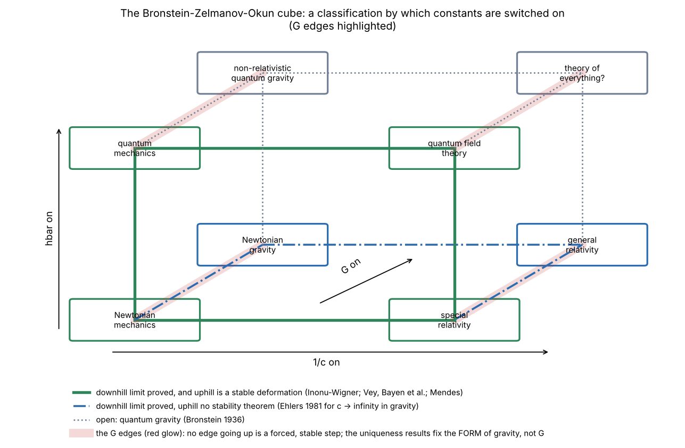
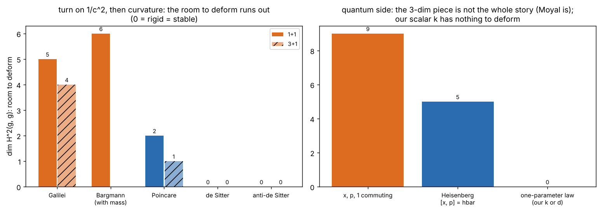
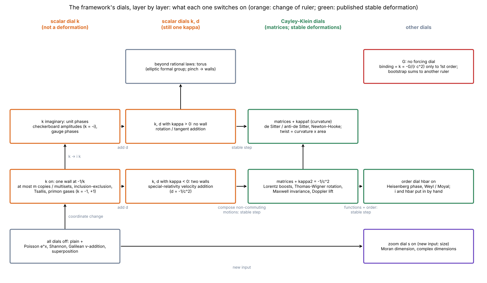
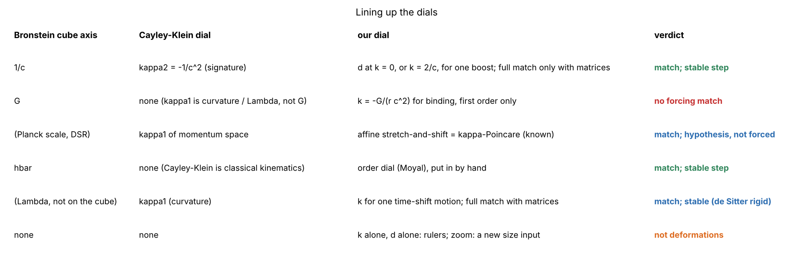
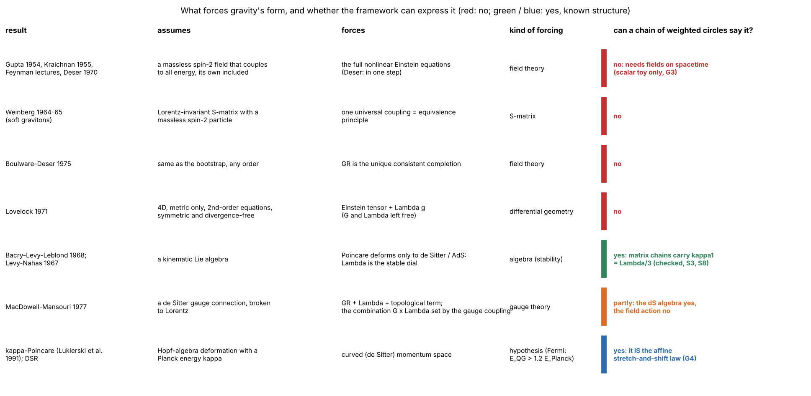
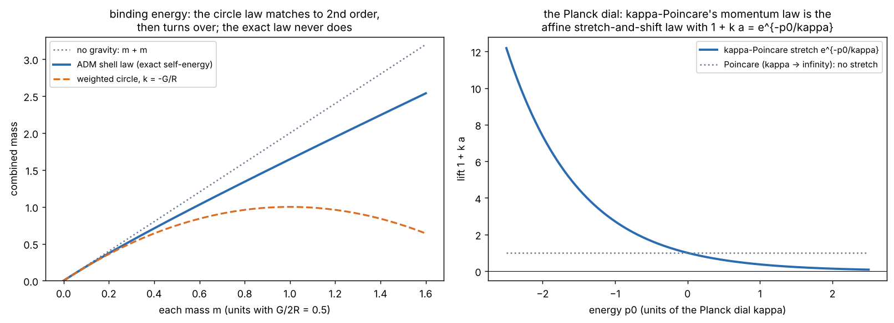
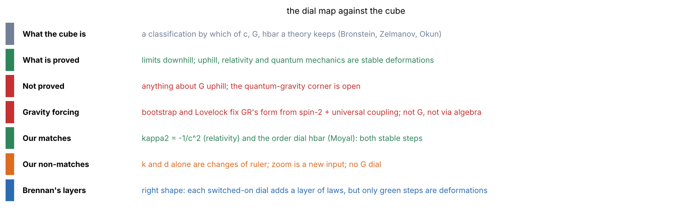

# The dial map, and can the framework make gravity a forced step?

Nov 25, 2026. Part of topics/why-i.

*Notation: κ₁ and κ₂ are the Cayley–Klein labels of the literature, and κ in κ-Poincaré is its Planck-energy scale. The dials keep their letters k and d (see `affine-names/`).*

**Verdict.** No. The framework doesn't make the gravity step forced, and this isn't a lead worth following for that goal.

The cube of theories (c, G, ħ) is a classification, not a derivation. Its relativity and quantum edges are backed by stability theorems. Its gravity edge isn't, and the results that do force gravity's form (the spin-2 bootstrap and Lovelock's theorem) are field-theory arguments that a chain of weighted circle operations can't express. What our chains do reach is known structure: matrix chains carry the cosmological-constant dial Λ, and the affine stretch-and-shift law is exactly κ-Poincaré's momentum composition.

## 1. What the cube is based on (Brennan's question)

- **Origin.** Bronstein drew the scheme in the 1930s; Zelmanov and Okun popularised it as a cube (Okun 2001, hep-ph/0112339; history in Gorelik 2005). Each corner keeps or drops c, G and ħ, and the theories are placed by hand. So by itself it is a classification by which constants a theory keeps.
- **What has been proved going down (switching a constant off).**
  - c → ∞: special relativity goes to Newtonian mechanics. This is an exact contraction of the symmetry algebra (Inönü–Wigner 1953). Check S7.
  - ħ → 0: quantum mechanics goes to classical mechanics in deformation quantization.
  - c → ∞ in gravity: general relativity goes to Newtonian gravity in Ehlers' frame theory (1981).
- **What has been proved going up (switching a constant on).** This is the part that answers "do the axes produce relativity and quantum mechanics?", and the answer is: in a precise sense, yes, for c and ħ.
  - The Galilei algebra can be deformed, and its stable deformations are Poincaré and then de Sitter. De Sitter can't be deformed further (Lévy-Nahas 1967; Bacry–Lévy-Leblond 1968). Checks S1–S3 reproduce this.
  - The commutative algebra of classical observables deforms, essentially uniquely, into the Moyal product with ħ (Vey 1975; Bayen, Flato, Fronsdal, Lichnerowicz, Sternheimer 1978).
  - Faddeev (1990) and Flato (1982) read these as "relativity and quantum mechanics are the stable deformations of what came before". Mendes (1994) showed the relativistic quantum algebra is still unstable and needs two more constants, a length and a mass (also Chryssomalakos–Okon 2004).
- **What has not been proved.** No stability theorem puts G on an edge. The quantum-gravity corner is open.

## 2. The dial map, layer by layer

- **Scalar k alone** turns on one wall at −1/k and the laws on the earlier pages (bounded counting, inclusion–exclusion, Tsallis, primon gases). It is a change of ruler, not a deformation: log(1 + kx)/k turns it back into plain addition (S5, S6).
- **k imaginary** turns the lift into a unit phase, giving checkerboard amplitudes and gauge phases. Still the same ruler story.
- **k with d** still gives one Cayley–Klein label, −Δ/4 = d − k²/4 (Cayley–Klein page). Two walls give velocity addition; no wall gives tangent addition.
- **Matrix chains with κ₂ = −1/c²** give Lorentz boosts, Thomas–Wigner rotation and Maxwell invariance. This is a published stable step.
- **Matrix chains with κ₁** (curvature) give de Sitter, anti-de Sitter and Newton–Hooke. This is the last stable step (S3, S8).
- **The order dial ħ** gives the Heisenberg phase and Moyal, with i and ħ put in by hand. This is a published stable step.
- **The zoom dial** brings in a new input, size, and gives Moran dimension. It isn't on the cube.
- **G** has no forcing dial (section 4).

## 3. Lining the dials up

- **1/c** matches Cayley–Klein κ₂ and our d (or k = 2/c for one boost). The full match needs matrices.
- **ħ** matches the order dial.
- **Λ**, which isn't on the cube, matches Cayley–Klein κ₁. In matrix chains it is our curvature label.
- **G** matches nothing. A correction to the earlier framing: Cayley–Klein κ₁ is curvature, i.e. Λ, not G.
- **Two more corrections to the earlier framing.**
  - Poincaré isn't stable by itself; it deforms to de Sitter.
  - Poincaré together with the Heisenberg relations is unstable, and needs a length and a mass scale (Mendes).

## 4. The main question: can the gravity step be made forced?

### What forces gravity's form in the literature

- **The spin-2 bootstrap.**
  - Gupta 1954, Kraichnan 1955, the Feynman lectures, Deser 1970.
  - Assume a massless spin-2 field that couples to all energy, its own included. Consistency then forces the full nonlinear Einstein equations. Deser does it in one step, from the first-order form.
- **Weinberg 1964–65 (soft gravitons).** A Lorentz-invariant S-matrix with a massless spin-2 particle forces one universal coupling, which is the equivalence principle.
- **Boulware–Deser 1975.** The same assumptions at every order give GR as the unique consistent completion.
- **Lovelock 1971.** In 4 dimensions, with only the metric, second-order equations, and a symmetric divergence-free left side, the field equations must be the Einstein tensor plus Λg.
- **What all of these leave free.** G and Λ are left free in every case. They force the shape of gravity, not the value of G, and they are a different kind of forcing from the stability theorems behind c and ħ. They start from fields on spacetime and an assumed spin-2 particle.
- **The algebraic part that does exist.** Poincaré's only stable deformation is de Sitter or anti-de Sitter, so Λ is the forced dial, not G. MacDowell–Mansouri (1977) build GR + Λ as a broken de Sitter gauge theory, where the gauge coupling sets the combination G·Λ.
- **κ-Poincaré / doubly special relativity.** Lukierski, Ruegg, Nowicki, Tolstoy (1991); Amelino-Camelia (2000s). It adds a Planck-energy dial and makes momentum space curved, in fact de Sitter (Kowalski-Glikman–Nowak, hep-th/0304101). It is a hypothesis, not a forced step. The Fermi telescope's burst GRB 090510 bounds the linear version above the Planck energy (E_QG > 1.2 E_Planck; Nature 462, 331, 2009).

### What a chain of weighted circle operations can say

- **Λ as κ₁: yes, with matrices.** This is the Cayley–Klein curvature label. It is known structure, and the stable one (S3, S8).
- **κ-Poincaré: yes, exactly.**
  - Its 1+1 momentum composition, (p₀ + q₀, p₁ + e^(−p₀/κ) q₁), is the order-dial page's affine stretch-and-shift composition (a ∘ₖ b, c + (1 + ka)d), with 1 + ka = e^(−p₀/κ).
  - It is associative, order matters only in the shifted slot, and it goes back to plain addition as κ → ∞ (G4, G5).
  - The identification is a one-line change of variables. The structure is known, so it counts as a match, not a discovery. A fuller comparison with doubly special relativity is the next piece of work.
- **Newtonian binding: only to first order.**
  - Two masses at distance r weigh mA + mB − G·mA·mB/(rc²). That is a ∘ₖ b with k = −G/(rc²), as a reading (G1).
  - The exact self-energy of a shell (Arnowitt–Deser–Misner 1960) gives bare mass L(m) = m + (G/2R)m². Composing through that ruler agrees with ∘ₖ (k = −G/R) at second order and differs at third by 4α²ab(a + b), where α = G/2R (G2).
  - The circle law turns over at its wall; the exact law never does.
- **The bootstrap itself: no.**
  - A scalar cartoon of it does run as an iteration (ours, G3): "add the binding energy of the current mass", m ← m₀ − αm². It converges to the ADM closed form.
  - But the summed result is just another ruler for a one-number law, not the k-ruler. Every one-number law is a ruler change of addition, so this can't force anything.
  - The real bootstrap needs a field with two indices on spacetime and a coupling to its own energy–momentum. Neither scalar nor matrix chains carry that.

### What the framework adds, and whether it's a lead

- **What it adds.** It adds one clean picture: the dials that are stable deformations (κ₂, κ₁, ħ) are exactly the ones that need non-commuting elements (matrices or ordered functions). The scalar dials are rulers.
- **Why it isn't a lead for G.** Gravity's forcing arguments live at the level of fields, not composition laws. The two places our chains touch gravity, Λ and κ-Poincaré, are already in the literature.
- **What would change this.** A composition law whose stability forces a G-like constant. Nothing in the literature or here points to one. Mendes' extra length and mass scales are the nearest thing, and they aren't G.

## 5. Checks

`python3 checks.py` gives 15/15 pass (checks_output.txt).

- **S0–S4: stability numbers.** dim H²(g, g) for:
  - 1+1: Galilei 5, Bargmann 6, Poincaré 2, de Sitter 0, anti-de Sitter 0;
  - 3+1: Galilei 4, Poincaré 1, de Sitter 0, anti-de Sitter 0;
  - abelian 3D 9, Heisenberg 5.
  - The 3+1 Poincaré value of 1 is Lévy-Nahas' result.
- **S5–S6.** A one-number law has nothing to deform; every k is addition after a ruler change.
- **S7–S8.** The contractions are exact: c → ∞ and curvature radius → ∞.
- **G1–G5: the gravity checks** in section 4.

## 6. Assumptions

- The stability test is H²(g, g) = 0 for finite-dimensional Lie algebras. The quantum case is represented by a 3-dimensional stand-in, and the real statement (Moyal) is quoted from the literature, not computed.
- The 3+1 algebras are built from Cayley–Klein matrices with labels (κ₁, κ₂, 1, 1). This covers the de Sitter family, not every kinematical algebra.
- G1 is a first-order reading at fixed separation, not a derivation.
- G2 uses the ADM shell with c = 1 and bare masses that add on one shell.
- G3 is a scalar toy, labelled ours. It is not the Deser argument.
- G4 is κ-Poincaré in 1+1 dimensions in the bicrossproduct basis. Other bases give other composition formulas for the same algebra.
- Citations checked by search this session: Okun 2001, Gorelik 2005, Mendes 1994, Chryssomalakos–Okon 2004, Ehlers 1981, Deser 1970, Kowalski-Glikman–Nowak 2003, Fermi-LAT 2009. Quoted from standard references without a fresh search: Gupta, Kraichnan, Weinberg, Boulware–Deser, Lovelock, MacDowell–Mansouri, Lukierski et al., Lévy-Nahas, Bacry–Lévy-Leblond, Vey, Bayen et al., Inönü–Wigner, ADM.

## 7. Files

- `checks.py`, `checks_output.txt`
- `figures.py` → `figures/m1` to `m7`

## Sources

- L. B. Okun, "Cube or hypercube of natural units", hep-ph/0112339 (2001); G. Gorelik, Phys. Usp. 48, 1039 (2005).
- E. Inönü, E. P. Wigner, PNAS 39, 510 (1953); H. Bacry, J.-M. Lévy-Leblond, J. Math. Phys. 9, 1605 (1968); M. Lévy-Nahas, J. Math. Phys. 8, 1211 (1967).
- J. Vey, Comment. Math. Helv. 50, 421 (1975); F. Bayen et al., Ann. Phys. 111, 61 and 111 (1978); L. Faddeev, "On the relation between mathematics and physics" (1990); R. Vilela Mendes, J. Phys. A 27, 8091 (1994); C. Chryssomalakos, E. Okon, IJMPD 13, 2003 (2004), hep-th/0410212.
- J. Ehlers (1981), reprinted as a GRG Golden Oldie (2019).
- S. N. Gupta, Phys. Rev. 96, 1683 (1954); R. Kraichnan, Phys. Rev. 98, 1118 (1955); S. Deser, GRG 1, 9 (1970), gr-qc/0411023; S. Weinberg, Phys. Rev. 135, B1049 (1964) and 138, B988 (1965); D. Boulware, S. Deser, Ann. Phys. 89, 193 (1975); D. Lovelock, J. Math. Phys. 12, 498 (1971).
- S. MacDowell, F. Mansouri, PRL 38, 739 (1977).
- R. Arnowitt, S. Deser, C. Misner, Phys. Rev. 120, 313 (1960).
- J. Lukierski, H. Ruegg, A. Nowicki, V. Tolstoy, Phys. Lett. B 264, 331 (1991); J. Kowalski-Glikman, S. Nowak, hep-th/0304101; Fermi-LAT and GBM, Nature 462, 331 (2009).
