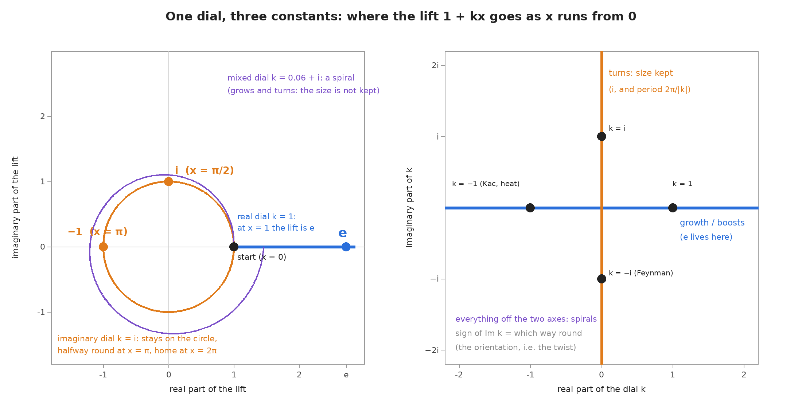
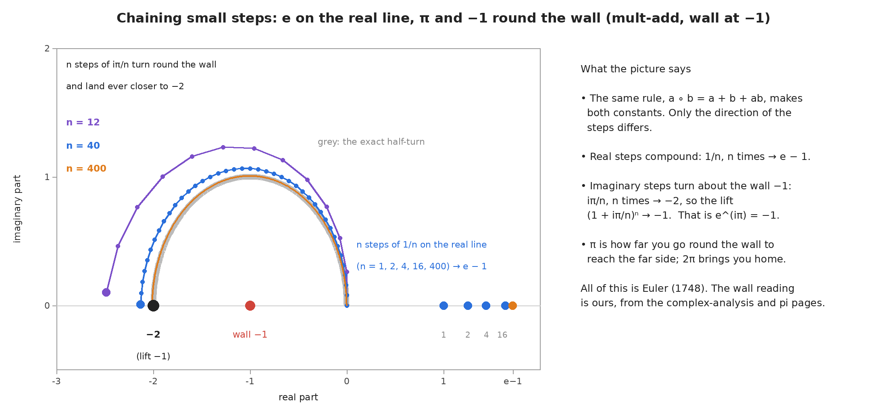
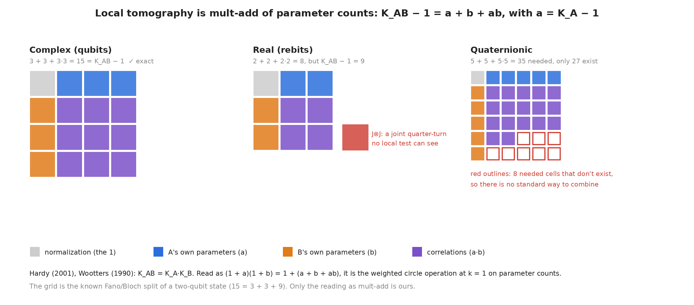
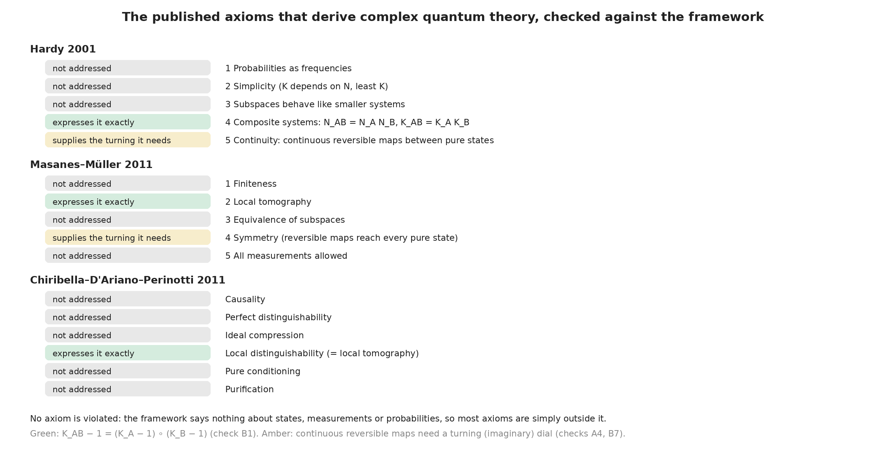
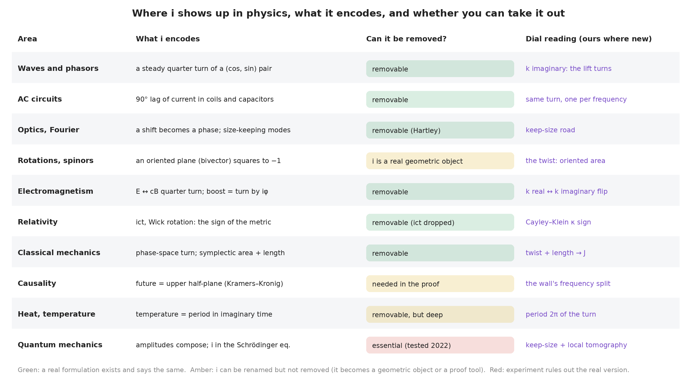
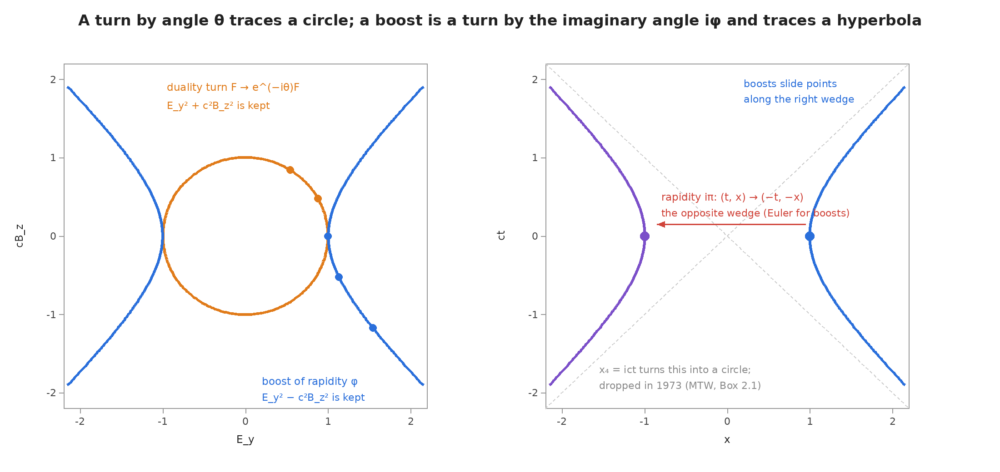
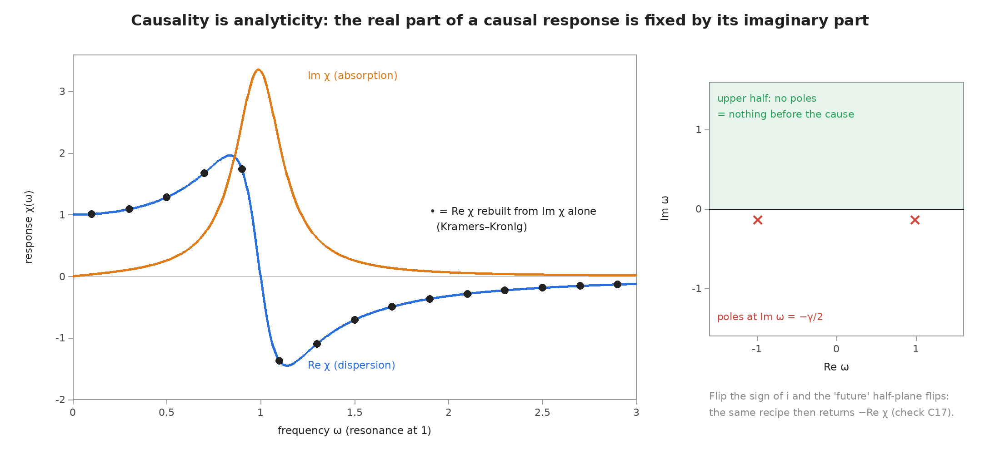
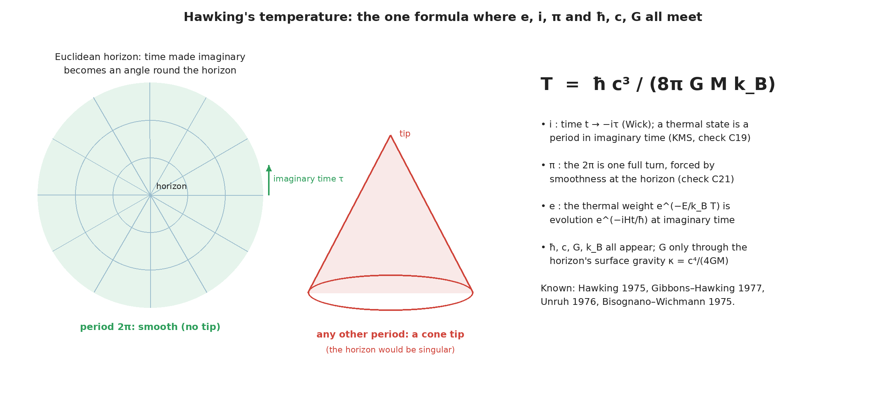
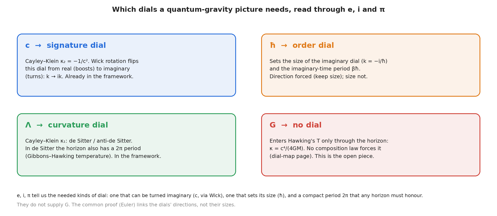
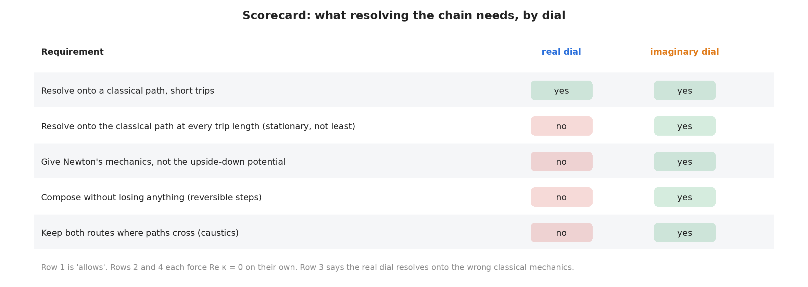

# e, i and π from one dial, and where i lives in physics (Nov 25, 2026)

> **Names:** some words or symbols on this page (mult-add, wall) also mean something else in standard math, physics or computing, or inside this project. [NAMING-COLLISIONS.md](../../../NAMING-COLLISIONS.md) says which meaning is in play.

**Verdict.** In classical physics i is always removable shorthand. It stands for one of four things: a quarter turn, an oriented area, a flipped signature (time measured as an angle), or the fact that causes come before effects. Only in quantum composition is i essential. Composite systems need complex numbers to be described by local measurements (local tomography), and 2021–22 experiments rule out real-number quantum theory, though that is still argued in 2026.

In the dial picture:
- **e** is the real dial chained over tiny steps.
- **i** is the one direction of the dial that keeps size.
- **π** is the half turn that carries the lift to −1.

Euler's identity is the sentence that joins them. Euler is known; reading it through the dial and its wall is ours.

**For quantum gravity**, e, i and π fix the *kinds* of dial needed: c (signature, flipped by Wick rotation), ħ (order, with its direction forced and its size free), and a compulsory 2π period at every horizon. Hawking's temperature is the one formula where e, i, π, ħ, c and G all meet. G still has no dial: Euler links the dials' directions, not their sizes.

**Brennan's hunch** was that classical physics is a resolved composition chain and quantum physics is the steps along it. The test is in [chain-resolves/](chain-resolves/). Resolving the chain *allows* any dial for short trips. Two separate things *force* the imaginary one:
- reversible steps, and
- picking out the classical path at every trip length (stationary, not least, action).

Checks:
- `checks.py` writes `checks_output.txt`: **42/42 pass** (numpy only).
- `chain-resolves/checks.py`: **18/18 pass**.
- Lean: `lean/EIPi.lean`, 17 small integer identities, **compiled** in the shared library as `FusedAlgebra.Topics.EIPi` (standard axioms only, no `sorry`).

Method (Brennan, Nov 25): build from published work. Anything beyond the sources is labeled *ours*.

---

## 1. One dial, three constants

The circle operation (called mult-add before 1.0) at dial k is a ∘ₖ b = a + b + k·ab. Its lift 1 + kx turns it into multiplication (check A1). Chaining n copies of x/n gives ((1 + kx/n)ⁿ − 1)/k, which tends to (e^{kx} − 1)/k:

- **e:** at k = 1 and x = 1, the chain tends to e − 1. The error falls like 1/n (A2). So e is the lift of one whole unit, chained finely.
- **A dial is a direction:** k·(a ∘ₖ b) = (ka) ∘₁ (kb) (A3). Over the complex numbers, choosing a dial is the same as choosing which way the inputs point.
- **i:** the lift keeps size 1 for every x exactly when k is purely imaginary (A4). One short step has size 1 + Re(k)·ε, so keeping size forces Re k = 0 (A5).
- **π:** at k = i the flow first comes back to 0 at x = 2π (A6). At x = π it lands on −2/k, the mirror of the start through the wall −1/k, where the lift is −1 (A7).

**Euler by pure chaining.** 400,000 steps of π/400,000 at k = i land within 2·10⁻⁵ of the point whose lift is −1 (A8). There is also an exact discrete version on the Gaussian integers at k = 1 (A9; Lean §3):
- q = −1 + i lifts to i;
- q ∘ q = −2 lifts to −1;
- four copies give 0, which lifts to 1.

The flat coordinate log(1 + kx)/k turns ∘ₖ into +, up to whole turns 2πi/k (A10). The dial −i walks the same circle the other way (A11).

*Known:* the product-integral limit (1 + z/n)ⁿ → eᶻ, and Euler. *Ours:* reading e, i and π as the real dial, the size-keeping direction, and the half turn to the wall's mirror point.

## 2. Why complex, not real or quaternion: the axiom check

Hardy's local-tomography rule says the parameter count of a joint system is the product of the parts' counts, K_AB = K_A·K_B. In the dial's terms that is exactly the circle operation of the counts minus one: (K_A − 1) ∘₁ (K_B − 1) = K_AB − 1 (B1; Lean §4).

- **Complex:** 15 = 3 + 3 + 3·3 = 3 ∘ 3. Products of local 2×2 observables span all 16 two-qubit directions (B2).
- **Real:** 2 ∘ 2 = 8, but there are 9 joint parameters. The hidden one is σy⊗σy = −J⊗J, a quarter turn done jointly on both sides that no local measurement sees (B3, B4).
- **Quaternionic:** K(2) = 6 and K(4) = 28. Local tomography needs 5 ∘ 5 = 35 cells, but only 27 exist (B5).

Masanes–Müller's bit-ball dimension is d = 2 (real), 3 (complex) or 5 (quaternionic). Only d = 3 satisfies (d + 1)² = K(4) (B6).

| Axiom (source) | The dial framework |
|---|---|
| Hardy 4: K_AB = K_A K_B | **expresses it exactly** (the circle operation of counts) |
| Hardy 5: continuous reversible paths between pure states | **supplies the turning** it needs (the size-keeping dial; B7) |
| Hardy 1–3 (probabilities, simplicity, subspaces) | does not address |
| Masanes–Müller 2: local tomography | **expresses it exactly** |
| Masanes–Müller 4: continuous reversibility | **supplies the turning** |
| Masanes–Müller 1, 3, 5 (finite dimension, subspace, all effects allowed) | does not address |
| CDP local distinguishability | **expresses it exactly** (same count rule) |
| CDP causality, perfect distinguishability, ideal compression, atomicity of composition, purification | does not address |

**No axiom is violated.** The honest summary is that the dial explains the step that picks complex numbers (counting) and supplies the continuous turning. The rest of the reconstruction comes from the published axioms, not from us.

*Known:* the axioms and the 15 = 3 + 3 + 9 split (Bloch / Fano). *Ours:* reading K_AB = K_A K_B as the circle operation, and naming the hidden real parameter as a joint quarter turn J⊗J.

## 3. i across physics: removable or essential?

| Area | Is i essential? | What i encodes | Check |
|---|---|---|---|
| Phasors, AC circuits | removable: complex numbers are the real matrices [[a,−b],[b,a]] | a quarter turn in the (cos, sin) plane | C1, C2 |
| Fourier | removable: the real Hartley transform gives the same power | a size-keeping shift has eigen-waves on the unit circle | C3, C4 |
| 2D rotations, spinors (Clifford, Hestenes) | removable: i becomes a real geometric object | the oriented plane e₁e₂, or the volume σ₁σ₂σ₃ | C5, C6 |
| Electromagnetism (Riemann–Silberstein) | removable but illuminating | F = E + icB; a boost is a turn by the imaginary angle iφ; the Lorentz group is SO(3, ℂ); duality is the E-to-B quarter turn; vacuum Maxwell is curl F = i ∂F/∂t | C7–C11 |
| Relativity (ict) | removable, and dropped (MTW Box 2.1) | signature: a boost is a rotation by iφ. **Euler for boosts:** rapidity iπ gives −1 (the reflection to the opposite wedge); 2πi gives 1 | C12, C13 |
| Classical mechanics | removable | the oscillator's phase-space turn, a = (ωq + ip)/√(2ω); Koopman–von Neumann's real antisymmetric generator has a purely imaginary spectrum | C14, C15 |
| Causality (Kramers–Kronig) | removable, but the *sign* of i is physical | causes first means analytic in the upper half-plane; the acausal recipe returns −Re χ | C16–C18 |
| Thermal physics (KMS) | removable as notation | temperature is a period in imaginary time; e^{−βH} is e^{−iHt} at t = −iβ | C19, C20 |
| Horizons (Unruh, Hawking) | the 2π is forced | the Euclidean horizon is smooth only with period 2π | C21–C24 |
| Quantum composition | **essential** | local tomography (Section 2); experiments in 2022 | B1–B6 |

*Known:* every row of the table. *Ours:* the common thread. Each classical use of i is one of four things (turn, area, signature, causality), and each is a direction of the same dial. The one place the dial's *size-keeping* direction cannot be swapped for a real stand-in is composition.

## 4. The quantum-gravity dials

Hawking's formula T = ħc³/(8πGMk_B) is the one place where e, i, π, ħ, c and G all meet. For one solar mass it gives 6.17·10⁻⁸ K (C23). Each constant has a known reading:

- **i:** time becomes imaginary (Wick rotation), and a thermal state is a period in that time (KMS, C19).
- **π:** the 2π is one full turn, forced by the horizon being smooth (C21; Gibbons–Hawking 1977).
- **e:** the thermal weight e^{−E/k_BT} is ordinary evolution e^{−iHt/ħ} at imaginary time (C20).
- **G** enters only through the horizon's surface gravity κ = c⁴/(4GM). It is the same formula as Unruh's at that acceleration (C22, C24).

The same 2π shows up as Euler for boosts (C13): rapidity iπ is the reflection between Rindler wedges. That is the Bisognano–Wichmann result, which ties the boost to the thermal state.

| Constant | Its dial | Status |
|---|---|---|
| c | signature, Cayley–Klein κ₂ = −1/c² | in the framework; Wick rotation flips the dial from real to imaginary |
| ħ | order, k = −i/ħ | direction forced (keep size); **size not forced** |
| Λ | curvature, Cayley–Klein κ₁ | in the framework; de Sitter horizons carry the same 2π |
| G | **none** | no composition law forces it ([dial-map](../dial-map/)); **the open piece** |

**Lead worth following:** the Euclidean horizon argument. It is the one known place where the 2π (π), the imaginary-time period (i) and the thermal weight (e) jointly fix a number containing G. Its known weak spot is that the Euclidean gravity path integral is unbounded below (the conformal factor problem, Gibbons–Hawking–Perry 1978). In dial terms, the real dial diverges for gravity exactly as it does past a caustic in [chain-resolves](chain-resolves/). That parallel is ours and untested.

## 5. Does resolving the chain force the turn?

Full write-up: [chain-resolves/README.md](chain-resolves/README.md).

Short answer:
- **Allowed by resolution alone:** both dials pick out the classical path on short trips (Laplace's method and stationary phase).
- **Forced by reversibility:** only the imaginary dial keeps every step undoable.
- **Forced by every trip length:** past the first caustic the classical path is a saddle, the real dial diverges, and only the imaginary axis survives.

---

## Assumptions

1. The dial and the lift are taken from the earlier pages ([order-dial](../order-dial/), [cayley-klein](../cayley-klein/)). Nothing here re-derives them.
2. "Size-keeping" means the lift has modulus 1. Its physical reading (probability conserved, reversible steps) is an interpretation, not a derivation.
3. Parameter counts use the standard forms K(n) = n² (complex), n(n+1)/2 (real) and n(2n−1) (quaternionic).
4. The physics values (Unruh, Hawking) use CODATA constants as numpy floats. They check formulas, not experiments.
5. The axiom scorecard reads the published axioms as stated in the papers. "Does not address" means the dial adds nothing there, not that it conflicts.

## Known vs new

| Known (published) | Ours |
|---|---|
| Euler; (1 + z/n)ⁿ → eᶻ; product integrals | e, i, π as real dial, size-keeping direction, half turn to the wall's mirror point |
| Local tomography picks ℂ (Hardy, Masanes–Müller, CDP, Wootters) | K_AB = K_A K_B read as the circle operation; the hidden real parameter named as J⊗J |
| Each row of the i-across-physics table | the four-way sorting (turn, area, signature, causality), each as a dial direction |
| Hawking, Unruh, KMS, Bisognano–Wichmann, Gibbons–Hawking | the ledger of which constant has a dial; the conformal-factor/caustic parallel (untested) |
| Real QM ruled out experimentally (Renou 2021; 2022 experiments) | nothing |

## Files

- `checks.py` writes `checks_output.txt` (42/42 pass).
- `figures.py` and `svgkit.py` write `figures/*.svg` and `.png`.
- `lean/EIPi.lean`: compiled; library path `FusedAlgebra/Topics/EIPi.lean`.
- `chain-resolves/`: the chain test (README, checks 18/18, figures r1–r6).

## Sources

Checked this session (read or searched):
- Masanes & Müller, "A derivation of quantum theory from physical requirements", NJP 13, 063001 (2011), arXiv:1004.1483.
- Karam, "Why are complex numbers needed in quantum mechanics? Some answers for the introductory level", Am. J. Phys. 88, 39 (2020).
- Bisognano & Wichmann, J. Math. Phys. 16, 985 (1975) and 17, 303 (1976); review arXiv:2403.18937.
- Unruh, Phys. Rev. D 14, 870 (1976).

Textbook or standard, not re-fetched this session:
- Hardy, "Quantum theory from five reasonable axioms", quant-ph/0101012 (2001).
- Chiribella, D'Ariano & Perinotti, "Informational derivation of quantum theory", PRA 84, 012311 (2011).
- Masanes, Müller, Augusiak & Pérez-García, PNAS 110, 16373 (2013).
- Wootters, in *Complexity, Entropy and the Physics of Information* (1990); Hardy & Wootters, Found. Phys. 42, 454 (2012).
- Renou et al., "Quantum theory based on real numbers can be experimentally falsified", Nature 600, 625 (2021).
- Silberstein, Ann. Phys. 22, 579 (1907); Bialynicki-Birula, Acta Phys. Pol. A 86, 97 (1994) and Prog. Opt. 36 (1996).
- Misner, Thorne & Wheeler, *Gravitation* (1973), Box 2.1 ("Farewell to ict").
- Hestenes, *Space-Time Algebra* (1966); Hartley, Proc. IRE 30, 144 (1942).
- Kronig, JOSA 12, 547 (1926); Kramers (1927); Toll, Phys. Rev. 104, 1760 (1956).
- Koopman, PNAS 17, 315 (1931); von Neumann, Ann. Math. 33 (1932).
- Kubo, J. Phys. Soc. Jpn. 12, 570 (1957); Martin & Schwinger, Phys. Rev. 115, 1342 (1959).
- Hawking, Commun. Math. Phys. 43, 199 (1975); Gibbons & Hawking, Phys. Rev. D 15, 2752 (1977); Gibbons, Hawking & Perry, Nucl. Phys. B 138, 141 (1978).
- Osterwalder & Schrader, Commun. Math. Phys. 31, 83 (1973).
