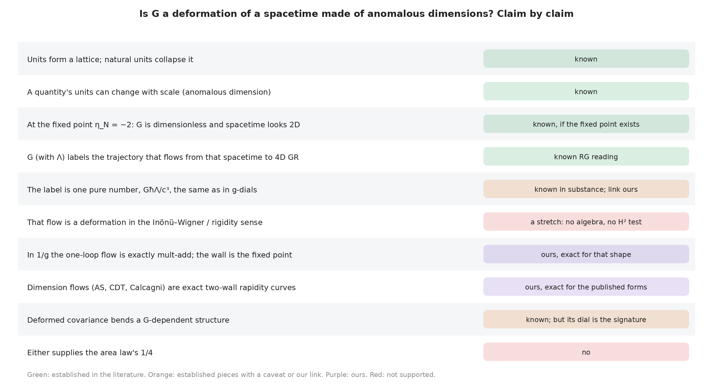
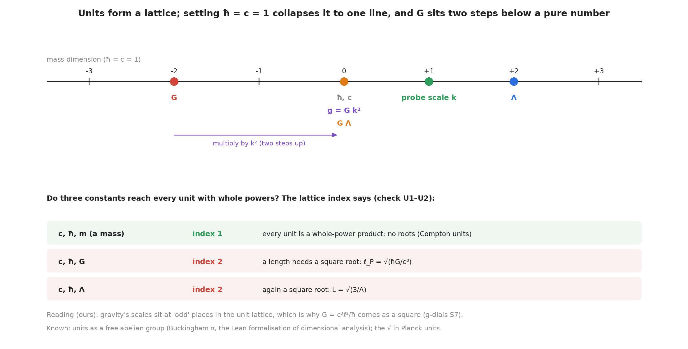
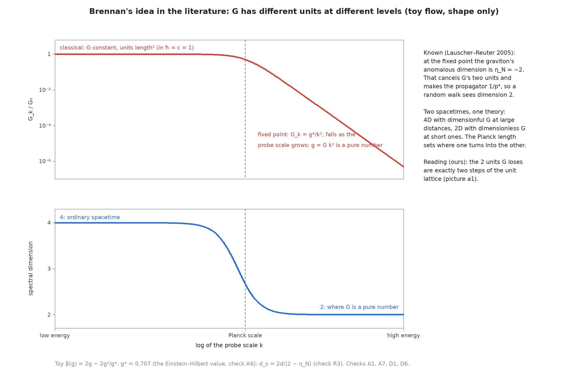
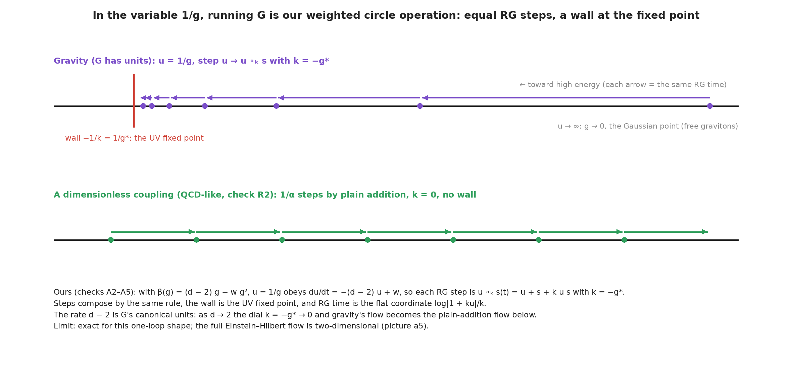
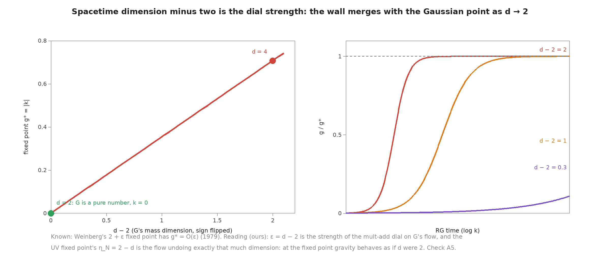
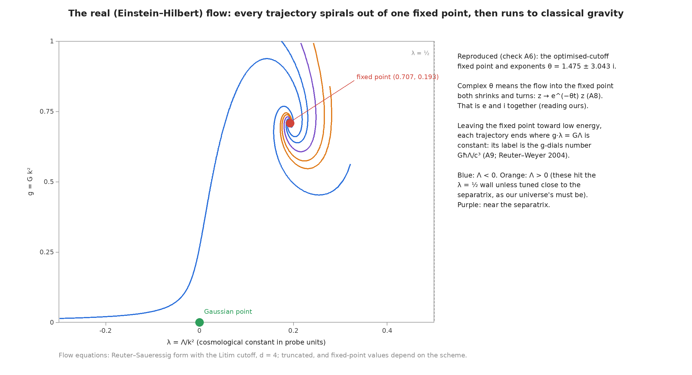
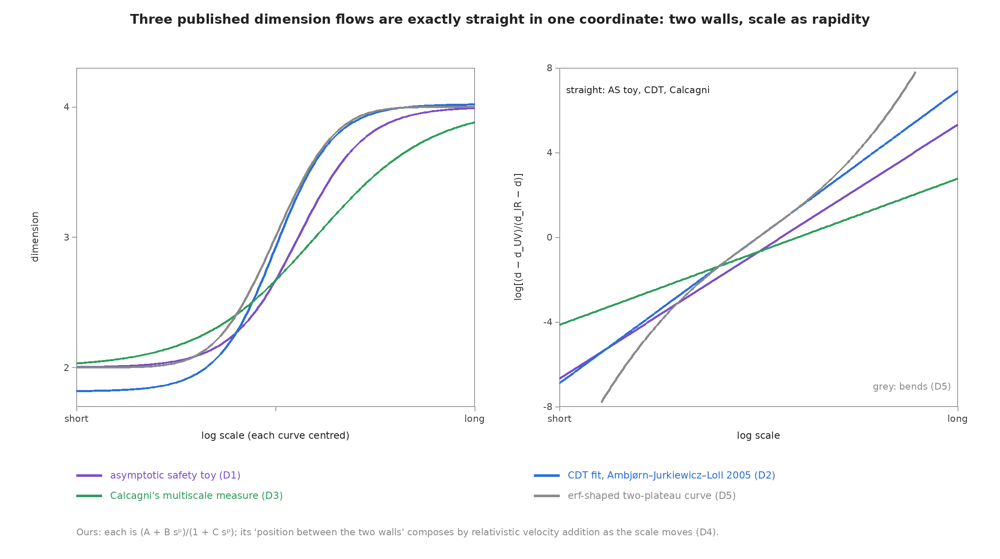
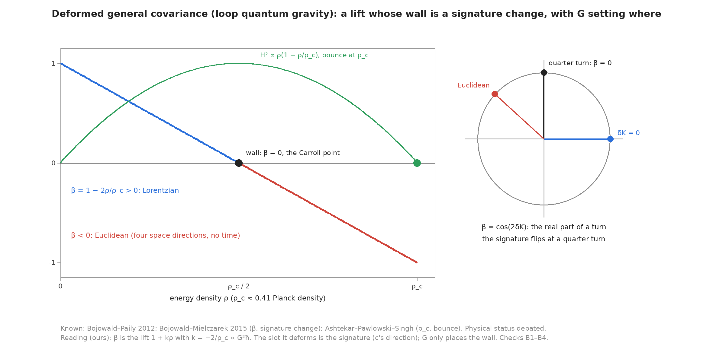

# Units at different levels: asymptotic safety, dimension flow and G

> **Names:** some words or symbols on this page (mult-add, wall) also mean something else in standard math, physics or computing, or inside this project. [NAMING-COLLISIONS.md](../../../../NAMING-COLLISIONS.md) says which meaning is in play.

*Nov 25, 2026. Follows [g-dials](../g-dials/README.md). Brennan's questions: (1) does viewing numbers as multidimensional lattices mean there are different units at different levels; (2) is G a deformation of a spacetime formed from anomalous dimensions. Checks: `checks.py`, 30/30 pass (`checks_output.txt`). Pictures: `figures.py`.*

## Verdict

**Yes on the first question, and it is established physics.** A quantity's units really do change with the scale you look at. In asymptotic safety, G behaves like a length² at large distances. Above the Planck scale it stops carrying units: the graviton's anomalous dimension is exactly η_N = −2, which cancels G's two units. At that level spacetime behaves as if it were two-dimensional (Lauscher–Reuter 2005).

**On the second question, half yes.** It is the standard reading of the renormalization group (RG) that the theory starts from a scale-free fixed point where G has no units and spacetime looks 2D. G (with Λ) is then the deformation that carries it out to ordinary 4D gravity, and the Planck length sets where the change happens. Calling that an Inönü–Wigner or rigidity deformation, like c and ħ, is a stretch: no symmetry algebra is contracted and there is no H² test.

**What is ours, and it is exact:**

- In the variable 1/g, the flow of G (one-loop shape) is our weighted circle operation (called mult-add before 1.0) with dial k = −g*. The wall is the UV fixed point, and the dial strength is d − 2, which is G's units. **This holds only for the one-loop shape.** The follow-up [beyond one loop](beyond-one-loop/README.md) found it exact only where gravity is one-loop exact or at large N; it breaks once graviton loops are resummed (Litim's θ = 23/11 instead of 2, and pure gravity's complex exponents). So it is a limiting result and a rewriting of known physics, not a path to new physics.
- The fixed point is approached by shrinking and turning together: e^{−θt} with θ = 1.475 ± 3.043i, which is e and i together.
- Three published dimension-flow curves (asymptotic safety, CDT, Calcagni) are exact two-wall curves. Moving the scale composes them by relativistic velocity addition, with the two dimensions as the walls.

**Tie to g-dials:** each RG trajectory is labeled by one pure number, GħΛ/c³, the same number the three G dials met in. The deformed covariance of loop quantum gravity (Bojowald–Paily) does bend a G-dependent structure, but the slot it bends is the signature (c's direction); G only places the wall. **Neither supplies the area law's 1/4.**

---

## 1. Units form a lattice (known), and gravity sits at odd places in it (ours)

- **Known.** Every quantity has units L^a T^b M^c with whole-number exponents, so the units form the lattice Z³ (Z⁷ in SI). Multiplying quantities adds exponent vectors. Buckingham's π theorem counts pure numbers as quantities minus rank. A 2025 Lean formalisation builds exactly this group on Mathlib (arXiv 2509.13142).
- **Natural units collapse the lattice.** With ħ = c = 1 only mass dimension survives: [G] = −2, [Λ] = +2, and a probe scale k has +1. So g = Gk², λ = Λ/k² and GΛ are pure numbers (U5).
- **Ours: the index.** c, ħ and a mass m reach every unit with whole powers (index 1). c, ħ and G span only an index-2 sublattice (invariant factors 1, 1, 2), and so do c, ħ and Λ (U1, U2). That is why every Planck unit carries a square root, ℓ_P = √(ħG/c³), and why g-dials found G = c³ℓ²/ħ as a square. The root itself is known; the lattice-index phrasing is ours.
- **Our Boolean cube versus this lattice.** The cube {0,1}³ sits inside Z³ with the same order. Its join (max) agrees with the lattice's group law (adding exponents) only when the supports are disjoint: 27 of 64 pairs (U4). So the cube is a slice of the unit lattice, not a copy of it.

## 2. Units change with scale (known)

- **Dimensional transmutation (known).** A dimensionless coupling that runs creates a unit: one-loop QCD's α(μ) defines Λ = μ·exp(−1/(bα)), the same at every μ (R1). In 1/α the flow is plain addition (R2).
- **Anomalous dimension (known).** At a non-trivial fixed point a field's scaling exponent is its canonical value plus η, usually a non-integer, so units leave the integer lattice. The propagator becomes 1/p^(2−η), and a random walk then sees spectral dimension d_s = 2d/(2 − η) (R3, derived).
- **Gravity (known, if the fixed point exists).** β_g = (d − 2 + η_N)g = 0 with g* ≠ 0 forces **η_N = 2 − d = −2** (A7). Then G_k = g*/k², the propagator is 1/p⁴, and d_s = 2 (D6; Lauscher–Reuter 2005, Reuter–Saueressig 2011). Litim (2004) puts it as gravity being dimensionless in two dimensions.
- **Reading (ours).** The two units G loses are exactly two steps of the lattice in picture a1. At the UV level G is a pure number, at the IR level it is a length²: Brennan's "different units at different levels", literally.

## 3. The flow of G is our weighted circle operation (ours; one-loop shape only)

Take the one-loop shape dg/dt = (d − 2)g − wg² (Weinberg 1979; Reuter 1998). Put u = 1/g. Then du/dt = −(d − 2)u + w, and:

- each RG step is **u ∘ₖ s = u + s + k·u·s with k = −g\*** and s(t) = (1 − e^{−(d−2)t})/g* (A2);
- steps compose by the same rule, s(t₁) ∘ₖ s(t₂) = s(t₁ + t₂), and the **wall −1/k = 1/g\* is the UV fixed point** (A3);
- the flow runs just past the wall (1 + ku < 0), and RG time is the flat coordinate log|1 + ku|/k (A4).

- **The dial strength is G's units.** The rate d − 2 is G's canonical dimension. As d → 2, g* = O(d − 2) (Weinberg's 2 + ε result, known), the dial k → 0, and the flow becomes the plain-addition flow of a dimensionless coupling (A5). Reading (ours): G's units are what switch the wall on, and at the fixed point the flow undoes exactly that much dimension.
- **Limit.** This is exact for the one-loop shape only. Any one-dimensional flow is a translation in *some* coordinate; what is special here is that the coordinate is 1/g and the operation is exactly ours.

## 4. The real flow: a spiral, then a label

- **Reproduced.** Einstein–Hilbert truncation, optimised cutoff, d = 4 (Reuter–Saueressig form; Litim 2004): fixed point g* = 0.707, λ* = 0.193, g*λ* = 0.137, critical exponents **θ = 1.475 ± 3.043i** (A6). These values depend on the scheme and the truncation.
- **Reading (ours).** Complex θ means the flow into the fixed point is z → e^{−θt}z: it shrinks at rate 1.475 and turns at rate 3.043 per unit of RG time (A8). That is the e and the i of e-i-pi in one map, with the wall at the fixed point.
- **The label (known in substance; link ours).** Every trajectory leaving the fixed point ends in a classical regime where gλ = GΛ (ħ = c = 1) is constant (A9). That constant is the g-dials number GħΛ/c³. In that regime λ = Λ/k² + Gk²/(8π), whose turning point sits at k_T/m_P = (8π·ℓ_P²Λ)^{1/4} ≈ 1 × 10⁻³⁰ (A10). That matches Reuter–Weyer's turning scale k_T ≈ 10⁻³⁰ m_Pl for the trajectory realized in Nature (hep-th/0410119).
- So the dimensionful G (with Λ) does two things: it picks the trajectory through one pure number, and it sets the unit of length, which is the "size is free" verdict from g-dials again.

## 5. Is G a deformation of a spacetime made of anomalous dimensions?

| Piece | Status |
|---|---|
| Short distances: a scale-free fixed point with η_N = −2, G dimensionless, d_s = 2 | Known, *if* the fixed point exists (evidence strong in truncations, not proven) |
| G and Λ label the trajectory from there to 4D GR; ℓ_P sets the crossover | Known RG reading (a relevant deformation of a fixed point) |
| The label is GħΛ/c³, the g-dials number | Known in substance; link ours |
| This is a deformation like c and ħ (Inönü–Wigner, rigidity, H²) | **A stretch.** An RG flow deforms a theory, not a symmetry algebra; there is no H² to compute |
| The parallel that does hold | Ours, an analogy: RG fixed points play the role of stable endpoints. g = Gk² has two of them, the Gaussian point (free gravitons, the same end as the spin-2 bootstrap dial) and the UV fixed point |

The same short-distance dimension 2 shows up in other programs, which is part of why the reading is taken seriously (Carlip's review, arXiv 1904.04379): CDT measures 4.02 at large scales and 1.80 ± 0.25 at small ones (Ambjørn–Jurkiewicz–Loll 2005), and Hořava gravity and causal sets give similar reductions.

## 6. Dimension flows are two-wall curves (ours)

Write the "position between the two dimensions" as log[(d − d_UV)/(d_IR − d)]. Three published flows are exactly straight lines in log scale:

- **Asymptotic safety (toy flow):** (d_s − 2)/(4 − d_s) = y/2 with y ∝ e^{−2t} (D1).
- **CDT fit** D_S = 4.02 − 119/(54 + σ): (D − D₀)/(4.02 − D) = σ/54 exactly, D₀ = 1.82 (D2). The paper quotes 1.80 ± 0.25.
- **Calcagni's multiscale measure** q(x) = x + (ℓ*/α)(x/ℓ*)^α: (d_H − α)/(1 − d_H) = α(x/ℓ*)^{1−α} (D3).

So with v = d − 3 and walls at 2 and 4, moving the scale composes v by **relativistic velocity addition**, with log-scale playing rapidity (D4). This is a real constraint: an erf-shaped two-plateau curve is not straight (D5). Honest scope: it holds because each published form is (A + B·sᵖ)/(1 + C·sᵖ), the simplest curve with two fixed dimensions and one power law.

Calcagni's complex dimensions (log-oscillations from discrete scale invariance, arXiv 1705.01619) are the same complex wall points our zoom dial gives through Moran's equation (`zoom-dial/`).

## 7. Deformed general covariance (Bojowald–Paily): a candidate G deformation

- **Known.** Loop quantum gravity's holonomy corrections deform the hypersurface-deformation algebroid: the bracket of two time-steps picks up a function β (Bojowald–Paily 2012). In cosmology β = cos(2δK) = 1 − 2ρ/ρ_c on the effective solutions (B1; Bojowald–Mielczarek 2015). β < 0 above ρ_c/2 makes the signature Euclidean. ρ_c ≈ 0.41 of the Planck density (B3; Ashtekar–Pawlowski–Singh). Whether the signature change is physical is debated.
- **Reading (ours).** β = 1 + kρ with k = −2/ρ_c is our lift. Its wall at ρ_c/2 is the signature change, and β = 0 there is the Carroll point, where time-steps commute (B2). β = cos(2δK) is the real part of a turn, flipping at a quarter turn. The effective Friedmann equation carries a second lift with its wall at ρ_c, the bounce (B4).
- **Is it a G dial?** It answers the dependency map's caveat: "G has no dial" was tested only on finite Lie algebras, and this algebroid deformation does bend a G-dependent structure. But the slot it bends is the signature (c's Cayley–Klein direction). G enters only through ρ_c ∝ 1/(γ³ħG²), which places the wall. So it is a c-like dial run by a density in Planck units, the same pattern as the horizon in g-dials.

## 8. Does any of this supply the area law S = A/(4Għ)?

**No.**

- Asymptotic safety RG-improves black-hole thermodynamics (Bonanno–Reuter; Falls–Litim 2012): corrections at small mass, and the classical area law back at large mass. The large-mass 1/(4G₀) is the trajectory's IR label, so it is inherited, not derived.
- Ours, a small result: at the fixed point the entropy per area in units of the probe scale is a fixed pure number, 1/(4g*) ≈ 0.35 in this scheme (E1). That is scale-free, but it is not the 1/4 of the area law.
- The 2D short-distance picture suggests Cardy-formula counting (Carlip's near-horizon argument). That is a suggestion, not a derivation.

## 9. The string-theory lead (1/N)

- The short-distance limit is effectively two-dimensional. In two dimensions quantum gravity is solved by matrix models: the double-scaling limit takes N → ∞ while the coupling approaches a critical point, and pure 2D gravity has string susceptibility γ_str = −1/2 (K1; KPZ 1988; Brézin–Kazakov, Douglas–Shenker, Gross–Migdal 1990).
- **Link (ours, untested).** That is the string page's 1/N lead meeting a fixed point: a handle-counting dial whose limit is taken *at* a critical point. If the matrix-chain experiment is done, it should be run near criticality, not only at small k.

---

## Assumptions

- The UV fixed point of asymptotic safety exists. Evidence comes from truncated flows (here Einstein–Hilbert); it is not proven, and all fixed-point numbers depend on the scheme.
- The one-loop flow β = (d − 2)g − wg² is a toy for the shape. The exact circle-operation result (section 3) holds for that shape only; [beyond one loop](beyond-one-loop/README.md) shows where it breaks.
- d_s = 2d/(2 − η) is derived from a propagator 1/p^(2−η) and the heat-kernel return probability; the η = −2 case matches Lauscher–Reuter.
- A9 shows the constant gλ plateau on Λ < 0 trajectories, which need no tuning. Λ > 0 trajectories need tuning close to the separatrix, as Reuter–Weyer discuss; I did not integrate one to 10⁻¹²².
- Λ = 1.1056 × 10⁻⁵² m⁻², CODATA G, ħ, c. γ = 0.2375 for ρ_c.
- The CDT curve is the paper's fit to Monte Carlo data, not a derived law.

## Known vs new

| Item | Status |
|---|---|
| Units as the lattice Z^n; Buckingham π; natural units | Known |
| Index 2 of (c, ħ, G) and (c, ħ, Λ) in the unit lattice, index 1 for (c, ħ, m) | Computed by us (the √ in Planck units is known) |
| Dimensional transmutation; anomalous dimensions | Known |
| η_N = 2 − d at the fixed point; d_s = 2 at short distances | Known (Lauscher–Reuter 2005; Litim 2004) |
| Fixed point (0.707, 0.193), θ = 1.475 ± 3.043i | Known, reproduced |
| One-loop flow in 1/g is exactly ∘ₖ with k = −g*, wall = fixed point, RG time = flat coordinate | **Ours** |
| d − 2 as the dial strength (k → 0 as d → 2) | **Ours** (reading; g* = O(ε) known) |
| Complex exponents as e and i together | **Ours** (reading) |
| Trajectory label is GΛ; Reuter–Weyer turning scale | Known in substance; **link to g-dials ours** |
| "G deforms a fixed-point spacetime" as an RG relevant deformation | Known reading |
| ... in the Inönü–Wigner / rigidity sense | **A stretch** |
| AS, CDT and Calcagni dimension flows as exact two-wall (rapidity) curves | **Ours** |
| β = cos(2δK) = 1 − 2ρ/ρ_c; signature change; ρ_c; bounce | Known |
| β as our lift with the Carroll point as its wall; a c-like dial placed by G | **Ours** (reading) |
| Entropy per area at the fixed point = 1/(4g*) in probe units | **Ours** (small) |
| 2D gravity via matrix models; γ_str = −1/2 | Known |
| Matrix-chain 1/N lead should be run near criticality | **Ours**, untested |

## Checks

`python3 checks.py` (numpy only) prints 30 checks and writes `checks_output.txt`. Groups: U (unit lattice), R (running units), A (asymptotic safety), D (dimension flow), B (deformed covariance), E (entropy), K (2D link). Result: **30/30 pass.**

## Files

- `README.md` (this page)
- `checks.py`, `checks_output.txt`
- `figures.py` (uses `../svgkit.py`), `figures/a1`–`a8` as SVG and PNG

## Sources

Checked by search or fetch this session:

- D. Litim, *Fixed points of quantum gravity*, PRL 92, 201301 (2004), hep-th/0312114.
- O. Lauscher, M. Reuter, *Fractal spacetime structure in asymptotically safe gravity*, JHEP 0510:050 (2005), hep-th/0508202; review hep-th/0511260; M. Reuter, F. Saueressig, arXiv 1110.5224.
- M. Reuter, H. Weyer, *Quantum gravity at astrophysical distances?*, hep-th/0410119.
- J. Ambjørn, J. Jurkiewicz, R. Loll, *Spectral dimension of the universe is scale dependent*, PRL 95, 171301 (2005), hep-th/0505113.
- S. Carlip, *Dimension and dimensional reduction in quantum gravity*, Universe 5, 83 (2019), arXiv 1904.04379 (earlier 1705.05417).
- G. Calcagni, arXiv 1106.0295, 1107.5041, 1612.05632, 1705.01619, 1709.07844.
- M. Bojowald, G. Paily, PRD 86, 104018 (2012), arXiv 1112.1899; M. Bojowald, J. Mielczarek, arXiv 1503.09154; Bojowald–Brahma, arXiv 1610.08840.
- K. Falls, D. Litim, *Black hole thermodynamics under the microscope*, arXiv 1212.1821.
- Gravity in 2 + ε: arXiv 2103.12421, 1208.0031.
- Matrix models and 2D gravity: hep-th/9206035, hep-th/9112013.
- Lean formalisation of dimensional analysis: arXiv 2509.13142.

Textbook or not re-fetched: Weinberg (1979); Reuter (1998); Reuter–Saueressig, hep-th/0110054 (flow-equation form used in checks A6–A10); Coleman–Weinberg (1973); Gross–Wilczek (1973); Ashtekar–Pawlowski–Singh (2006); Bonanno–Reuter (2000); KPZ (1988); Brézin–Kazakov, Douglas–Shenker, Gross–Migdal (1990); Hořava (2009); Moran (1946).

Builds on: [g-dials](../g-dials/README.md), [dial-map](../../dial-map/), [zoom-dial](../../../zoom-dial/), [string-theory](../../../string-theory/), [dependency-map](../../../dependency-map/).
