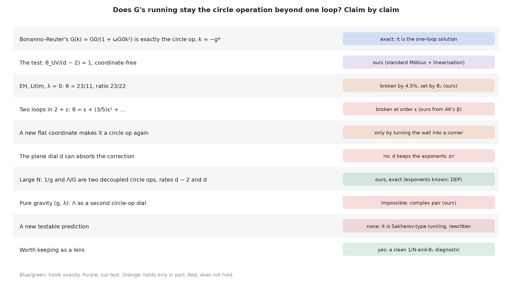
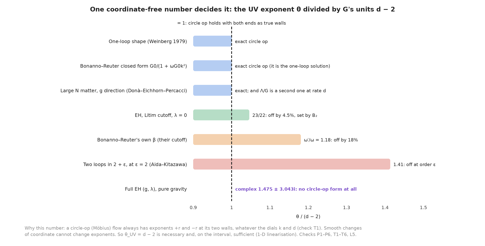
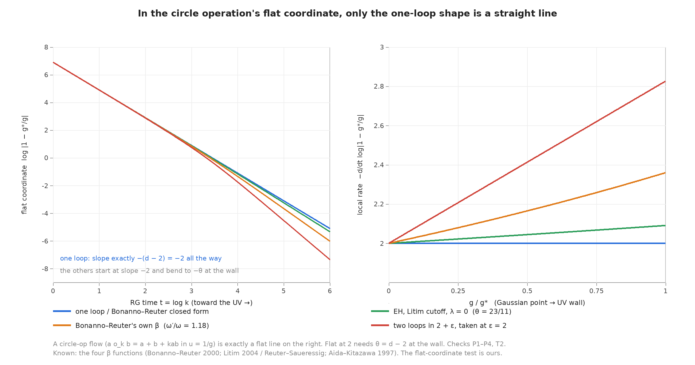
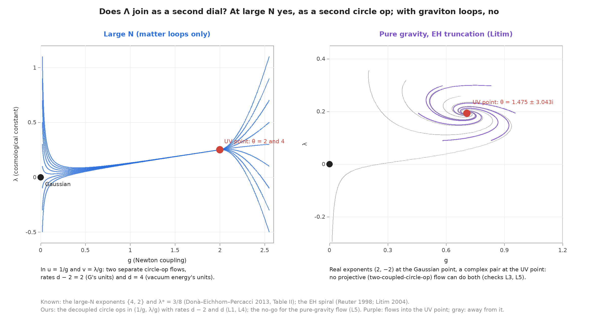
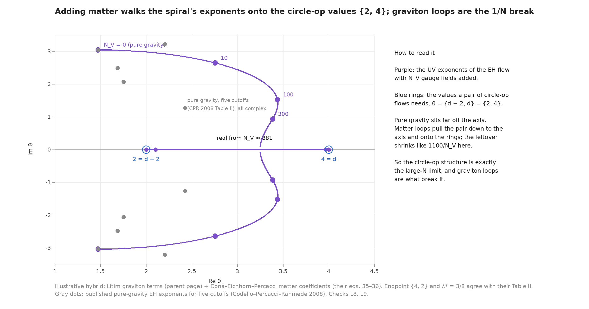

# Beyond one loop: does G's running stay the circle operation?

*Nov 25, 2026. Follows [asymptotic-safety](../README.md), whose strongest lead was that in 1/g the one-loop flow of g = G k² is exactly a ∘ₖ b = a + b + k·ab with k = −g\*. Brennan's ask: follow that lead and make sure it holds. Checks: `checks.py`, 23/23 pass (`checks_output.txt`). Pictures: `figures.py`. Lean: `lean/BeyondOneLoop.lean` (exact identities only; not yet compiled, see below).*

## Verdict

**The circle operation holds exactly only where the physics is one-loop exact, and breaks as soon as graviton loops are resummed.** It is exact for the one-loop shape, for Bonanno–Reuter's closed form G(k) = G0/(1 + ωG0k²) (which *is* the one-loop solution), and in the large-N limit, where the cosmological constant joins as a second, independent circle op. With graviton loops it breaks: by 4.5% in g alone (Litim cutoff, λ = 0), at order ε at two loops, and completely once λ is included, because the spiral's complex exponents cannot come from any circle-op flow.

As a lead, it stays worth keeping as a **diagnostic lens**, but not as a path to new physics. Where it is exact, it is a rewriting of known physics: 1/G and the vacuum energy Λ/G shift additively with k² and k⁴ (Sakharov-type running). It makes no new testable prediction.

---

## 1. One number decides it (ours, from standard math)

- **Known math.** A circle-op flow is a Möbius flow. Every Möbius flow, including the plane law a ∘ₖ,d b = (a + b + kab)/(1 − dab), has exponents **+r and −r** at its two walls (check T1). Smooth changes of coordinate cannot change exponents, and in one dimension a hyperbolic fixed point is smoothly linearizable (Sternberg).
- **So (ours):** the flow of g is a circle-op flow with *both* ends as honest walls exactly when the UV exponent equals G's units: **θ_UV = d − 2**. That makes θ/(d − 2) a coordinate-free test of the lead.
- **The plane dial d cannot rescue it.** d moves the walls around but always keeps the exponents ±r (T1). The correction changes their ratio, which d cannot do.

## 2. The published flows, one by one

In the circle op's flat coordinate log|1 − g\*/g| a circle-op flow is a straight line. Its local rate is flat at 2. Only the one-loop shape stays flat.

| Flow (source) | θ_UV | θ/(d − 2) | Status |
|---|---|---|---|
| One-loop shape (Weinberg 1979; Reuter 1998) | 2 | 1 | exact circle op (parent page) |
| Bonanno–Reuter 2000 closed form G0/(1 + ωG0k²) | 2 | 1 | exact; it is the solution of β = 2g(1 − ωg) (P1) |
| Bonanno–Reuter's own β = 2g(1 − ω′g)/(1 − B₂g) | 2ω′/ω ≈ 2.36 | ω′/ω ≈ 1.18 | broken (P2). BR set ω′ = ω to get the closed form |
| EH, Litim cutoff, λ = 0 (parent page's equations) | **23/11** | **23/22** | broken by 4.5% (P3) |
| Two loops in 2 + ε (Aida–Kitazawa 1997, eq. 4.18) | ε + (3/5)ε² + … | 1 + (3/5)ε | broken at order ε; 1.41 at ε = 2 (P4, T6) |
| Full EH (g, λ), pure gravity | 1.475 ± 3.043i | complex | no circle-op form at all (L5) |

What the numbers mean:

- **Litim, λ = 0, exactly (ours).** B₁ = −11/(3π), B₂ = 1/(12π), g\* = 12π/23, θ = 23/11. The mismatch is 1/(d−2) − 1/θ = B₂g\*/2 = **1/46**. It is set entirely by B₂, the resummation term in η_N = gB₁/(1 − gB₂), which is exactly the term Bonanno–Reuter dropped (P3, T5).
- **The exact solution (implicit form known in substance from BR 2000; reading ours).** g^(1/2)·(1 − g/g\*)^(−1/θ) = C·e^t. It is multiplication in a product of two lifts with **unequal exponents** 1/2 and 11/23. At one loop the two exponents are equal and the product collapses to the Möbius coordinate g/(1 − g/g\*) (T3).
- **A different flat coordinate? Yes, but only on one side (ours).** In x = g(1 − g/g\*)^(−2/θ) the flow is plain multiplication, dx/dt = 2x. But that sends the wall to x = ∞ with 1/x ~ (g\* − g)^(22/23), which is not differentiable. The UV fixed point survives only as a corner, not as a wall (T4).
- **Two loops (ours, from AK's β).** The cubic β has a third zero at negative G. The exact flow is a product of three lifts whose exponents sum to zero. AK caution that the physical O(ε²) exponent needs more operators renormalized, so treat the 3/5 as the exponent of their β, not a settled universal number.
- **How big is the break in G(k)? (ours)** With the same G0 and g\*, the Litim λ = 0 curve and the circle-op curve differ by at most **1.6%**, near the crossover (E1).

## 3. Does Λ join as a second dial?

**At large N, yes (ours, exact).** With only matter loops, η_N = −ag has no B₂ and the vacuum term is bg. Then:

- In **u = 1/g and v = λ/g** the flow is two *decoupled* circle-op flows: du/dt = −(d−2)u + a and dv/dt = −d·v + b. Checked in d = 3, 4, 5, 6 (L1).
- **Each rate is that coupling's units:** d − 2 for G, and d for the vacuum energy Λ/G. This is the parent page's "the dial strength is G's units" pattern, now twice.
- In dimensionful form this is plain addition: 1/G shifts with k^(d−2) and Λ/G with k^d. That is the known Sakharov-type running (L2).
- **The exponents match the literature.** The large-N flow is projective (a 3×3 linear flow on the plane's projective completion, the 2-D version of a Möbius flow). That predicts θ = {d − 2, d} = **{2, 4}**, exactly Donà–Eichhorn–Percacci's large-N_V result, with λ\* = 3/8 (their Table II; L3, L4, P6).

**For pure gravity, no (ours, a no-go).** A projective flow with a complex pair at a real fixed point has no other real fixed point (L3). The EH flow has real exponents (2, −2) at the Gaussian point and the complex pair at the UV point, so no smooth coordinates make it two coupled circle ops (L5).

**The plane-type reading (ours).** Write each fixed point's stability matrix as (tr/2) + j with j² = Δ:

- **Gaussian:** J² = 4 exactly, a pure boost (hyperbolic).
- **EH UV point:** Δ = −9.26, elliptic. This is the shrink-and-turn.
- **Large-N UV point:** Δ = +1, hyperbolic.

So graviton loops are what turn the plane elliptic (L7). Λ is not the plane's dial d. It is a second circle-op coordinate, and only at large N.

**Donà–Eichhorn–Percacci's perturbative system (eqs. 35–36, known) in (1/G, Λ/G), ours:** du/dt is exactly circle-op. dv/dt = −4v + b + (5/π)Λ has **one** extra term, and its coefficient 5/π is the same for any matter content. It is the graviton's own GΛ piece, so its relative weight dies as 1/N (L6).

**Walking from pure gravity to large N (ours, illustrative hybrid).** This uses the Litim graviton terms plus DEP's matter coefficients for N_V gauge fields:

- The exponents start at 1.475 ± 3.043i, turn real near N_V ≈ 870, and land on {2, 4} (L8).
- The leftover shrinks like 1/N_V, but with a large coefficient (≈ 1100/N_V), because near λ\* = 3/8 the graviton terms carry powers of 1/(1 − 2λ\*) = 4 (L9).
- The hybrid mixes two cutoff schemes, so the crossing point is illustrative. The endpoint matches DEP's own full result.

## 4. Testable, new, or a rewriting?

- **A rewriting, where it is exact.** The exact cases are the one-loop-exact ones. There the dimensionful 1/G and Λ/G shift additively, and the circle op with k = −g\* is what plain addition looks like after dividing by the canonical scaling k^(d−2). That is known physics (Sakharov 1967; large-N gravity; Bonanno–Reuter).
- **No new prediction.** θ itself depends on the truncation and the scheme. Pure-gravity EH values alone range 1.48–2.43 in real part across cutoffs (Codello–Percacci–Rahmede 2008, Table II), so no published number can confirm or refute θ = d − 2 for real gravity.
- **What is genuinely ours and useful:**
  1. θ/(d − 2) as a coordinate-free measure of departure from one-loop running.
  2. The B₂ formula for that departure (θ/(d−2) = 1/(1 − B₂g\*) = ω′/ω).
  3. The decoupled (1/g, λ/g) pair of circle ops at large N, with rates equal to the units.
  4. The no-go for pure gravity.
  5. The picture of graviton loops as the 1/N break that turns the plane elliptic.
- **Tie to other pages.** The circle op is exact at N = ∞ and broken at 1/N. That matches the string page's 1/N lead, where the parent page already suggested running the matrix-chain experiment near criticality.
- **Should we keep following it?** As a lens, yes. It cleanly sorts flows by how far they are from one loop, and it predicts the large-N exponents. As a road to new gravity physics, no. Nothing here goes beyond what the RG already says.

## Assumptions

- The UV fixed point exists. All fixed-point numbers are truncation- and scheme-dependent.
- Bonanno–Reuter's ω′/ω ≈ 1.18 is as quoted in their text. Their eq. (2.19) has a sign inconsistency that we did not resolve; only the ratio is used.
- The Aida–Kitazawa β is their eq. (4.18). The ε² exponent is ours from that β.
- The matter hybrid (L8, L9) mixes the Litim graviton part with DEP's type-II matter coefficients. Its normalizations match DEP's (scalar terms agree), but the crossing point is illustrative.
- "Smoothly conjugate" means C^∞ coordinates. A merely continuous change of coordinate can straighten any 1-D flow, which is why the test is about smooth walls.

## Known vs ours

| Item | Status |
|---|---|
| BR's G(k) = G0/(1 + ωG0k²); β = 2g(1 − ω′g)/(1 − B₂g); ω′/ω ≈ 1.18 | Known (Bonanno–Reuter 2000) |
| BR's G(k) is exactly the circle op, k = −g\* | **Ours** (reading of a known formula) |
| Möbius flows have ±r exponents; 1-D smooth linearization | Known math |
| θ/(d − 2) = 1 as the exact test for the lead | **Ours** |
| Litim λ = 0: θ = 23/11, mismatch 1/46 = B₂g\*/2 | **Ours** (computed from the parent page's known equations) |
| Two-lift exact solution with exponents 1/2, 1/θ | Known in substance (BR solve it implicitly); reading **ours** |
| A flat coordinate exists but turns the wall into a corner | **Ours** |
| AK two-loop β; G\* = 24πε/(25 − c) | Known (Aida–Kitazawa 1997) |
| θ = ε + 15ε²/(25 − c) from that β | **Ours** (AK caution on the physical exponent) |
| DEP perturbative β's; large-N_V θ = {4, 2}, λ\* = 3/8 | Known (Donà–Eichhorn–Percacci 2013) |
| Large N: (1/g, λ/g) are two decoupled circle ops, rates d − 2 and d; projective structure | **Ours** |
| Pure-gravity EH flow cannot be projective (no-go) | **Ours** |
| DEP's extra term (5/π)Λ is the same for all matter | **Ours** (from their equations) |
| Plane type: boost at the Gaussian, elliptic at the EH UV point, hyperbolic at large N | **Ours** (reading) |
| Additive running of 1/G (k²) and vacuum energy (k⁴) | Known (Sakharov 1967; standard) |

## Checks

`python3 checks.py` (numpy only) prints 23 checks and writes `checks_output.txt`. Groups: P (published flows), T (tests against the circle op), L (Λ as a second dial), E (size of the break). Result: **23/23 pass.** Shared flow code is in `flows.py`.

## Lean

`lean/BeyondOneLoop.lean` holds exact Int identities: the plane law's generator and its ± exponents, Litim's partial fractions and the 1/46 mismatch, the large-N decoupling in (1/g, λ/g), DEP's extra term with C − A = 30, and the Gaussian boost J² = 4. Proofs use `grind`/`omega`/`decide`, as in `EIPi.lean`. **Not yet compiled:** this session could not download the Lean toolchain, so the repo thread should compile it before adding it to `build.sh`.

## Files

- `README.md` (this page)
- `checks.py`, `checks_output.txt`, `flows.py`
- `figures.py`, `figures/b1`–`b5` (SVG and PNG)
- `lean/BeyondOneLoop.lean`

## Sources

Checked by fetch this session:

- A. Bonanno, M. Reuter, *Renormalization group improved black hole spacetimes*, PRD 62, 043008 (2000), hep-th/0002196.
- T. Aida, Y. Kitazawa, *Two-loop prediction for scaling exponents in (2+ε)-dimensional quantum gravity*, Nucl. Phys. B 491, 427 (1997), hep-th/9609077 (eq. 4.18).
- P. Donà, A. Eichhorn, R. Percacci, *Matter matters in asymptotically safe quantum gravity*, PRD 89, 084035 (2014), arXiv 1311.2898 (eqs. 35–38, Table II).
- A. Codello, R. Percacci, C. Rahmede, *Investigating the ultraviolet properties of gravity with a Wilsonian renormalization group equation*, Annals Phys. 324, 414 (2009), arXiv 0805.2909 (Table II).

From the parent page or textbook: Weinberg (1979); Reuter (1998); Litim (2004), hep-th/0312114; Reuter–Saueressig, hep-th/0110054; Sakharov (1967); Sternberg linearization; Coleman–McGuinness, Pacific J. Math. 147 (1991) for the plane law.

Builds on: [asymptotic-safety](../README.md), [g-dials](../../g-dials/README.md).

## Follow-up: e at a different rung height

Does using e at height s (e_s) close the 4.5% gap? No: s = 1.101 fits 23/11 but misses every second published number, and only s = 1 keeps G constant at low energy. See [`height-dial/README.md`](height-dial/README.md).
