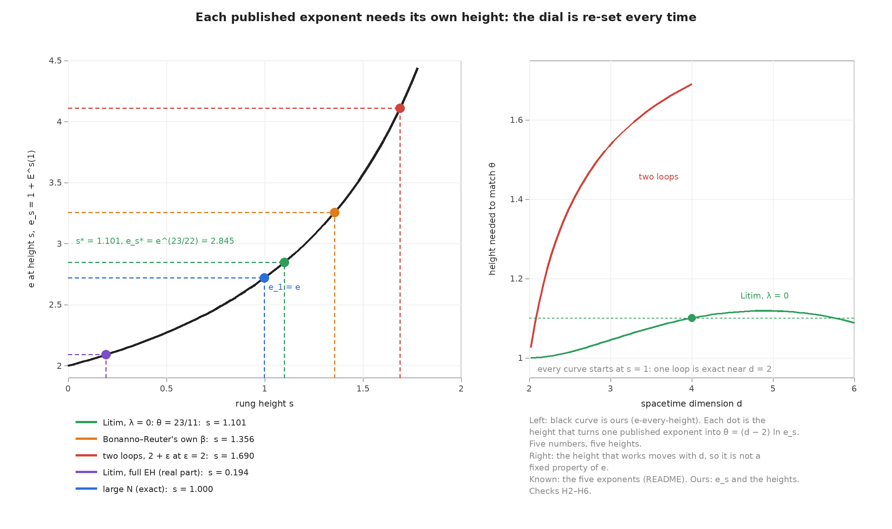
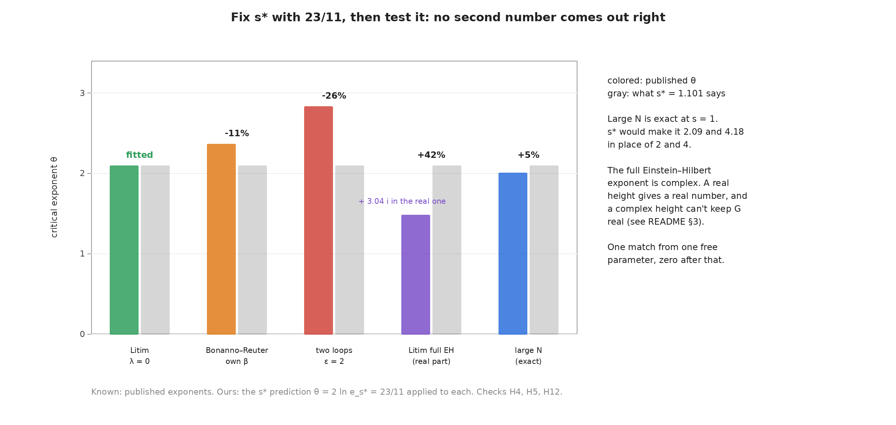
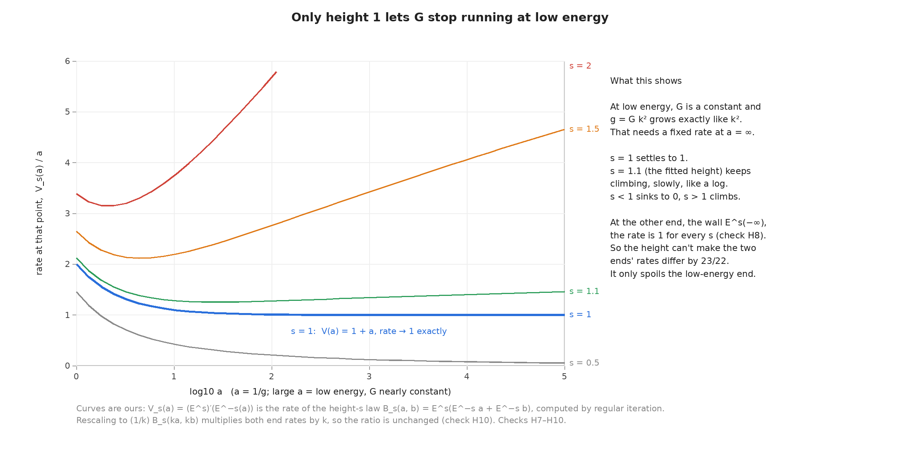

# Does e at a different rung height close the 4.5% gap?

**Verdict: no.** Swapping e for e at height s can hit 23/11, at s* = 1.101 (e_s* = e^(23/22) = 2.8447),
but that is one free number matching one number. With s* held fixed it gets no second published
number right: Bonanno–Reuter is off by 11%, two loops by 26%, the full Einstein–Hilbert real part by 42%,
and the exact large-N exponents come out 2.09 and 4.18 instead of 2 and 4. Using the height-s law itself
(not only its e) is worse: only s = 1 lets G stop running at low energy. The 4.5% is the size of one
graviton-loop term in one scheme, not a slightly wrong e.

Parent: [`../README.md`](../README.md) (beyond one loop). Machinery: `fractional-rungs/regular_iteration.py`
(E^s by regular iteration) and `fractional-rungs/e-every-height/` (e_s = 1 + E^s(1)).
Run `python3 checks.py` (12 checks, all pass, output in `checks_output.txt`) and `python3 figures.py`.

## The idea being tested

Brennan's idea: e_s changes smoothly with height (e_1 = 2.718, e_1.1 = 2.844), so if the flow of G
really lives at a slightly different height, using plain e would leave a small error, like 4.5%.

Two ways to put a height into the G flow, both tested:

- **A. Swap the base only.** Read every rate as (d − 2) ln e_s instead of (d − 2). Then θ = (d − 2) ln e_s.
- **B. Swap the whole law.** Use the height-s operation B_s(a, b) = E^s(E^−s(a) + E^−s(b)) on u = 1/g
  in place of the circle operation (s = 1 gives a + b + ab, the circle operation with k = 1),
  and also the rescaled (1/k) B_s(ka, kb).

## 1. Reading A: one height per number

e_s rises smoothly from 2 (s = 0) through e (s = 1), so **every** ratio θ/(d − 2) above ln 2 has exactly
one height that fits it (H3). That is why one match means nothing here. Each published exponent picks its own:

| published exponent (known) | θ/(d − 2) | height that fits (ours) | e_s | what s* = 1.101 says |
|---|---|---|---|---|
| Litim cutoff, λ = 0: θ = 23/11 | 1.0455 | **1.101** | 2.8447 | fitted |
| Bonanno–Reuter's own β | 1.18 | 1.356 | 3.254 | −11% |
| two loops, 2 + ε at ε = 2 (Aida–Kitazawa) | 1.413 | 1.690 | 4.109 | −26% |
| Litim cutoff, full EH, real part (1.475 ± 3.043 i) | 0.738 | 0.194 | 2.091 | +42%, and no imaginary part |
| large N (exponents exactly 2 and 4) | 1 | 1.000 | e | 2.09 and 4.18 in place of 2 and 4 |

Right panel: the height that fits also moves with dimension. Near d = 2 one loop is exact (θ = ε), so every
curve starts at s = 1; at d = 4 Litim wants 1.101 and two loops wants 1.690 (H6). A property of e
would not depend on d or on the cutoff.

Why the base can't really change anyway: the RG uses e only through t = ln k. Changing the base
multiplies **every** exponent by the same ln e_s, including the low-energy one, which must be exactly d − 2
because G has units (G constant ⇒ g = G k^(d−2)). So a uniform swap is ruled out at once; matching 23/11 needs
e at the high-energy end and plain e at the low-energy end, which is two dials, not one.

## 2. Reading B: the height-s law has the wrong low-energy end

The law B_s has rate V_s(a) = (E^s)′(E^−s(a)); at s = 1 that is 1 + a. Its two ends:

- **Finite wall** w_s = E^s(−∞) (−1 at s = 1, −0.94 at s = 1.1, −0.63 at s = 2): rate exactly 1 for every s (H8),
  because E^s = E^(s−1)∘E and E(x) + 1 = e^x.
- **a → ∞ (low energy):** V_s(a)/a settles to 1 only at s = 1. For s < 1 it drifts to 0, for s > 1 it keeps
  growing like a log (H7, H9: at s = 1.1 still drifting 3.9% between a = 10⁴ and 10⁵).

So under the law itself the ratio of the two end rates is 1 at s = 1 and not a number otherwise;
it never equals 23/22. Off s = 1, G would keep creeping at low energy, against its classical constancy.
The extra dial k in (1/k) B_s(ka, kb) multiplies both rates by k and moves the wall to w_s/k (H10),
so it changes nothing about the ratio.

## 3. Complex heights and the spiral

The full Einstein–Hilbert fixed point spirals: θ = 1.475 ± 3.043 i (Litim cutoff, reproduced in H5).

- A real coupling g with one real law has a real exponent. Reading A gives θ = (d − 2) ln e_s, real for real s.
- A complex s makes e_s and B_s complex on real inputs, so G stops being real.
- Treating g as complex and the flow as holomorphic gives a conjugate pair at **every** fixed point,
  including the Gaussian one, which must be a real saddle (exponents of opposite sign for g and λ). A holomorphic
  2-D flow can't have that. And the wall rate is 1 for every s anyway (H8).

So the spiral is out of reach of any fixed height, real or complex. This is structural, not a numerical miss.

## 4. Is s* natural, and is there a natural second dial?

- **s* = 1.1007 is a fit parameter.** It satisfies ln e_s* = 1/(1 − B₂ g*), where B₂ g* = 1/23 is the
  graviton anomalous-dimension denominator at the Litim λ = 0 fixed point. That number depends on the cutoff,
  the truncation, d and the matter content; s* inherits all of it. At large N, B₂ g* → 0 and s* → 1.
- **The second dial that fits exactly** is the lift power p in u^p(1 + k u), with p = θ/(d − 2) − 1 = 1/22
  (from the parent study, H11). It fits because it **is** θ, restated. It predicts nothing and has nothing to do
  with rung heights.
- **What the 4.5% is:** 23/22 − 1 = 1/22, set by B₂ g* = 1/23, a single resummed graviton-loop term. It isn't
  small because the theory is close; in other published schemes the same gap is 18% (Bonanno–Reuter), 41% (two loops)
  or the exponent turns complex.

## Assumptions

- θ/(d − 2) is the scheme-free quantity being matched (from the parent study: circle-op flow with both
  ends smooth ⟺ θ_UV = d − 2).
- e_s and E^s are the regular-iteration ones from `fractional-rungs/` (the only fractional heights we have).
  Another fractional iterate would change the numbers in the table, not the conclusions in §1–§3:
  §1 uses only that e_s is continuous and monotone, §2 only E^s = E^(s−1)∘E and growth at ∞, §3 nothing about E.
- Large N follows Donà–Eichhorn–Percacci's coefficients as in the parent study.

## Known vs ours

| | known (published) | ours |
|---|---|---|
| θ = 23/11 (Litim, λ = 0), 1.475 ± 3.043 i (Litim, full EH) | Litim 2004; Reuter–Saueressig | reproduced (H2, H5) |
| Bonanno–Reuter ω′/ω = 1.18 | Bonanno–Reuter 2000 | used |
| two-loop 2 + ε | Aida–Kitazawa 1997 | evaluated at ε = 2 and vs d (H4, H6) |
| large-N exponents 2 and 4 | Donà–Eichhorn–Percacci 2013 setting | used (H12) |
| e_s, E^s, B_s | — | fractional-rungs work |
| s* = 1.1007, e_s* = 2.8447, the height table, the d-curves | — | this study |
| only s = 1 has a constant low-energy rate; wall rate 1 for all s | — | this study (H7–H9) |
| no fixed height reaches the spiral | — | this study (§3) |

## Checks (python3 checks.py)

H1 e_s values · H2 s* and e_s* · H3 e_s monotone, so one match is free · H4 s* vs four second numbers ·
H5 full EH exponent complex · H6 needed height vs d · H7 low-energy rate per s · H8 wall rate 1 for all s ·
H9 low-energy drift · H10 k dial is a linear change of variable · H11 the dial that fits is θ restated ·
H12 large N needs s = 1.

## Files

`hd.py` shared functions · `checks.py` · `checks_output.txt` · `figures.py` · `figures/h1..h3` (SVG + PNG).
