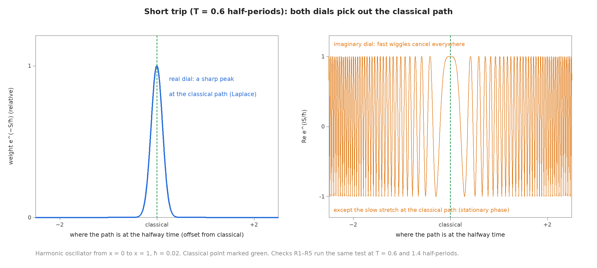
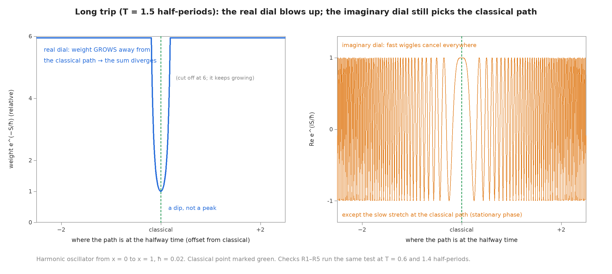
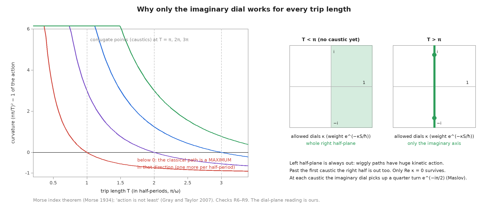
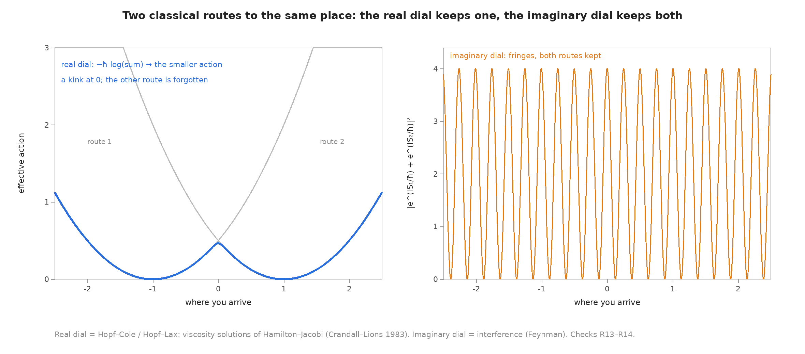
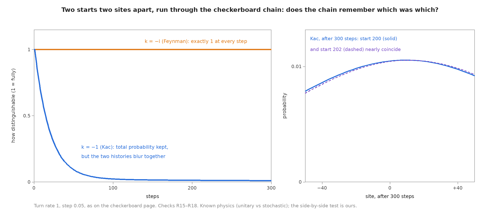
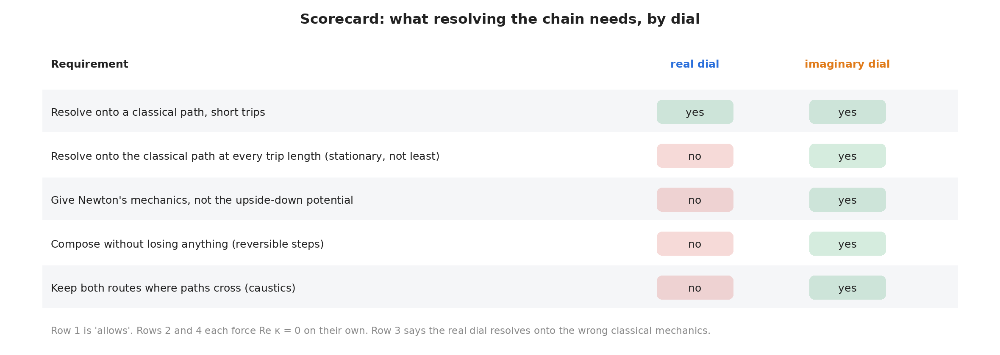

# Does resolving the chain force the turn? (Nov 25, 2026)

**Verdict.** Resolving the chain *allows* the rotation but does not *force* it. On short trips both the real dial and the imaginary dial resolve onto the classical path. Two separate requirements each force the imaginary dial:

1. **Steps that lose nothing.** The checkerboard at k = −i keeps two different starts perfectly distinguishable forever. At k = −1 (Kac) the histories blur together and the step can't be run backward.
2. **Picking out the classical path at every trip length.** Past the first caustic the classical path is a saddle of the action, not a minimum. Any dial with a real part then diverges, and only the imaginary axis survives.

Run the real dial anyway, where it converges, and the chain resolves onto the wrong mechanics: Newton's laws for the upside-down potential.

Brennan's hunch was "classical physics is a composition chain that's been resolved, and quantum physics is steps along that chain." It survives in this sharpened form: classical physics is what the *imaginary-dial* chain resolves to, and the turn is what keeps the steps reversible and the resolution valid at all durations.

Checks: `checks.py` writes `checks_output.txt`, **18/18 pass** (numpy only). The test system is the harmonic oscillator (ω = 1, from x = 0 to x = 1), plus the checkerboard chain from [../../checkerboard/](../../checkerboard/).

---

## 1. Short trips: both dials resolve

Take the action as a function of where the path is halfway along the trip. It is stationary at the classical path, with curvature 2 cot(T/2) (check R1).

- **Real dial, e^{−S/ħ}:** the weight piles up on the classical point. Its width halves when ħ quarters, which is Laplace's method (R2).
- **Imaginary dial, e^{iS/ħ}:** a window round the classical point gives the whole answer and a window away from it gives about zero. This is stationary phase (R3).

So on short trips, resolution alone is happy with either dial.

## 2. Long trips: only the imaginary dial resolves

Past T = π (half a period) the curvature 2 cot(T/2) turns negative. The classical path becomes a *maximum* along that direction.

- **Real dial:** the weight grows away from the classical point and the sum diverges (R5).
- **Imaginary dial:** it does not care whether the stationary point is a minimum or a maximum, and still resolves (R4).

Three facts sit behind the dial-plane pictures:

- **Morse index:** the number of directions in which the classical path is a maximum equals the number of half periods passed, floor(T/π) (R6).
- **The left half-plane is always out:** wiggly paths cost huge kinetic action, so the top curvature grows as the slicing refines, and any dial with Re κ < 0 diverges at every T (R7).
- **What remains:** the dials κ = e^{iα} that keep the path sum finite fill the whole half-plane |α| ≤ 90° for T < π, but only α = ±90° for T > π (R8).

At each caustic the imaginary dial picks up one quarter turn, e^{−iπ/2}. That is the Maslov phase: i again, once per caustic (R9).

## 3. Which mechanics does each dial resolve onto?

- **Imaginary dial:** as ħ → 0 the phase obeys the Hamilton–Jacobi equation ∂S/∂t + (∂S/∂x)²/2 + x²/2 = 0, which is Newton's oscillator (R10; Madelung, WKB).
- **Real dial**, run in Wick-rotated time where it converges at every duration: it obeys ∂S/∂τ + (∂S/∂x)²/2 − x²/2 = 0, Hamilton–Jacobi for the **upside-down** potential (R11; Hopf–Cole, Freidlin–Wentzell). It has no caustics at all (R12), so it converges, but onto the wrong physics.

## 4. Two routes: one forgotten, or both kept

- **Real dial:** −ħ log(e^{−S₁/ħ} + e^{−S₂/ħ}) tends to min(S₁, S₂). One route is kept and the other is forgotten. This is the viscosity solution of Hamilton–Jacobi (R13; Crandall–Lions).
- **Imaginary dial:** |e^{iS₁/ħ} + e^{iS₂/ħ}|² swings between 0 and 4, with fringe spacing 2πħt/d. Both routes are kept (R14).

## 5. Reversibility: does the chain remember?

- **k = −i (Feynman):** two different starts stay exactly as distinguishable after 300 steps (R15). The step's inverse is its conjugate transpose (R17).
- **k = −1 (Kac):** total probability is kept, but the distance between the two starts falls from 2.00 to 0.021 (R16). The step's inverse has negative entries, so it can't be run as a process (R17). Entropy rises at every step (R18).

## 6. Scorecard

Row 1 is "allows". Rows 2 and 4 each force Re κ = 0 on their own. Row 3 says the real dial resolves onto the wrong classical mechanics.

---

## Assumptions

1. The test is done on Gaussian (quadratic) actions: the free particle, the harmonic oscillator, and two straight routes. For these, the middle-point and full-path results are exact. Anharmonic systems are not tested here.
2. "Resolving" means the ħ → 0 limit picks out a classical path. "Reversible" means the one-step map has an inverse of the same kind (unitary for unitary, stochastic for stochastic).
3. The dial is applied to the action as e^{κS/ħ}, with κ on the unit circle. Its size (ħ) is not tested.
4. The checkerboard uses turn rate 1 and step 0.05 on 401 sites, as on the checkerboard page.

## Known vs new

| Known (published) | Ours |
|---|---|
| Stationary phase versus Laplace's method; Feynman's ħ → 0 limit (Dirac 1933, Feynman–Hibbs 1965) | asking the question as "allows versus forces" |
| Morse index theorem; "action is not least" (Morse 1934; Gray & Taylor 2007) | the dial-plane picture: allowed κ shrink to the imaginary axis past the first caustic |
| Maslov phase; Van Vleck determinant | reading the Maslov quarter turn as the dial reappearing at caustics |
| Hopf–Cole, Fleming, Freidlin–Wentzell, viscosity solutions (Crandall–Lions 1983) | putting the two dials side by side at two routes |
| Madelung; Nelson's stochastic mechanics | nothing |
| Kac's telegraph model (1974); unitary versus stochastic | the side-by-side distinguishability test on the same checkerboard |

## Files

- `checks.py` writes `checks_output.txt` (18/18 pass).
- `figures.py` writes `figures/r1`–`r6` as `.svg` and `.png`. It imports `../svgkit.py`.

## Sources

All textbook or standard, not re-fetched this session:
- Dirac, Phys. Z. Sowjetunion 3, 64 (1933); Feynman & Hibbs, *Quantum Mechanics and Path Integrals* (1965).
- Morse, *The Calculus of Variations in the Large* (1934); Gray & Taylor, "When action is not least", Am. J. Phys. 75, 434 (2007).
- Maslov, *Théorie des perturbations et méthodes asymptotiques* (1972); Van Vleck, PNAS 14, 178 (1928).
- Hopf, Comm. Pure Appl. Math. 3, 201 (1950); Cole, Q. Appl. Math. 9, 225 (1951); Fleming, J. Diff. Eq. 5, 515 (1969).
- Freidlin & Wentzell, *Random Perturbations of Dynamical Systems* (1984); Crandall & Lions, Trans. AMS 277, 1 (1983).
- Madelung, Z. Phys. 40, 322 (1927); Nelson, Phys. Rev. 150, 1079 (1966); Kac, Rocky Mountain J. Math. 4, 497 (1974).
