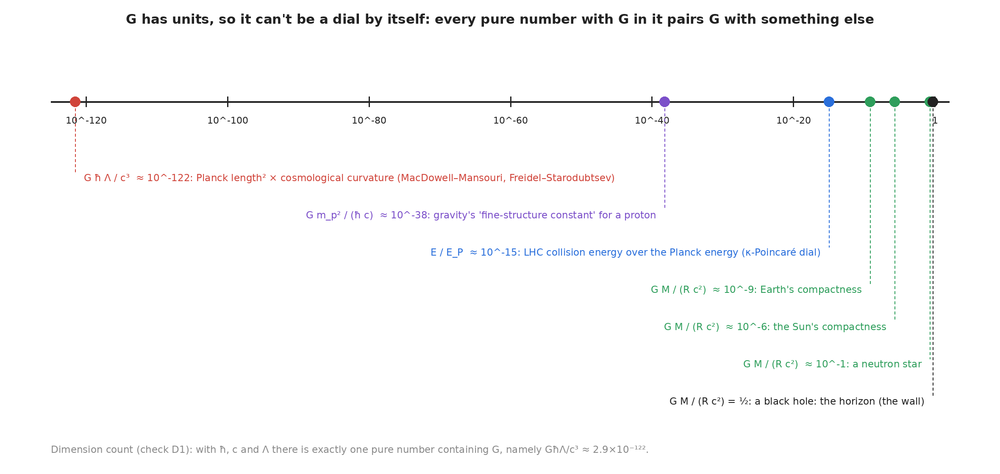
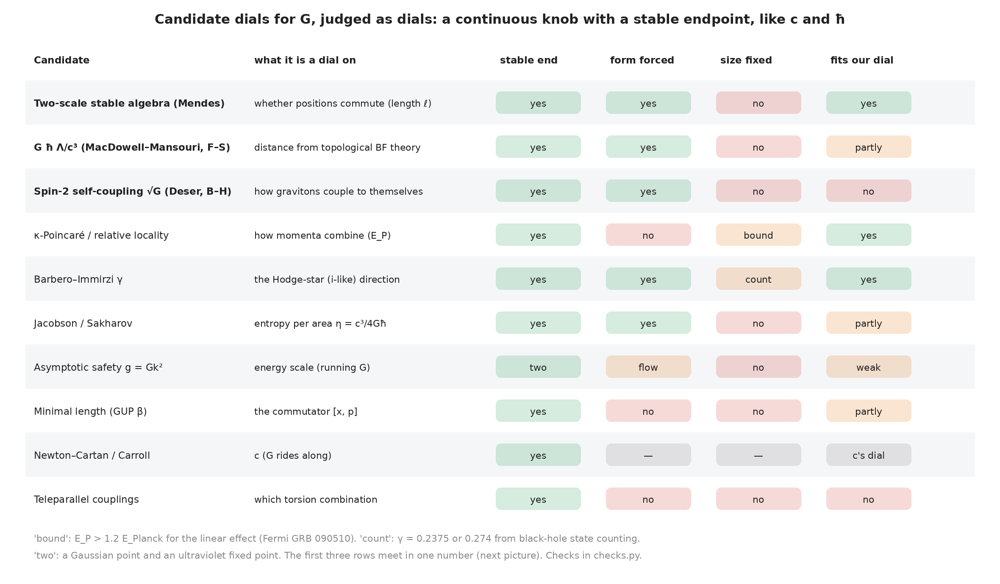
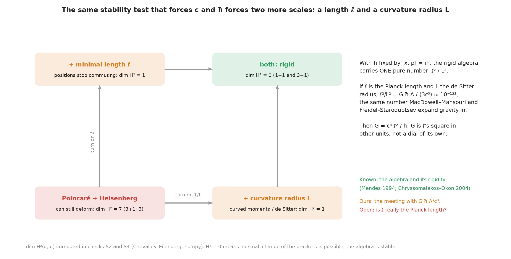
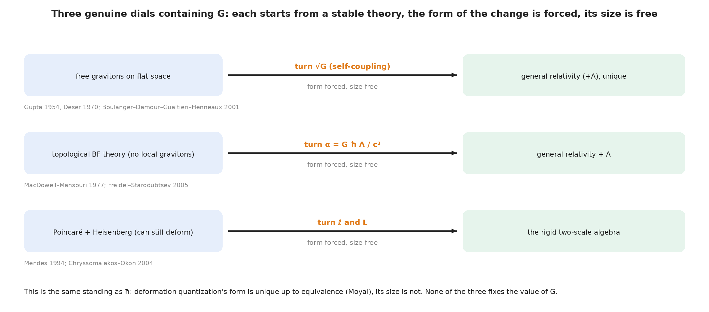
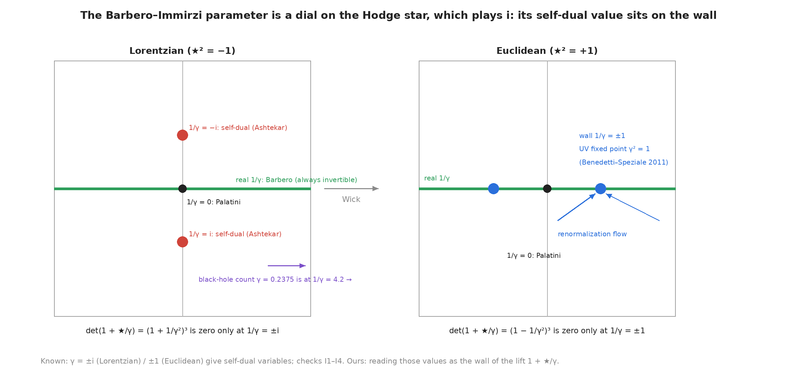
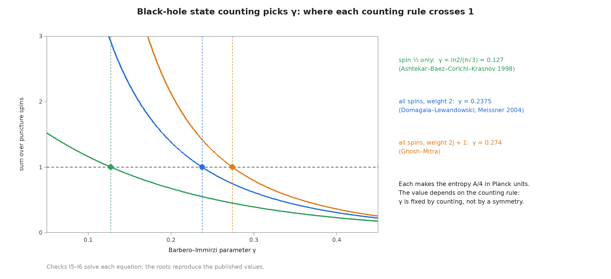
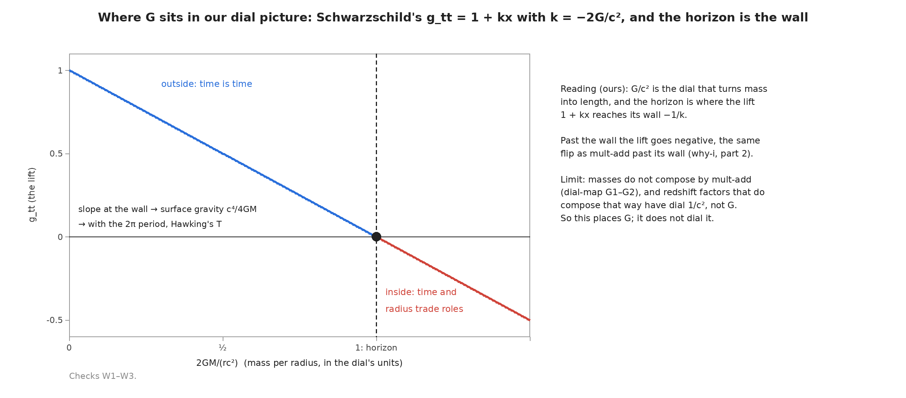
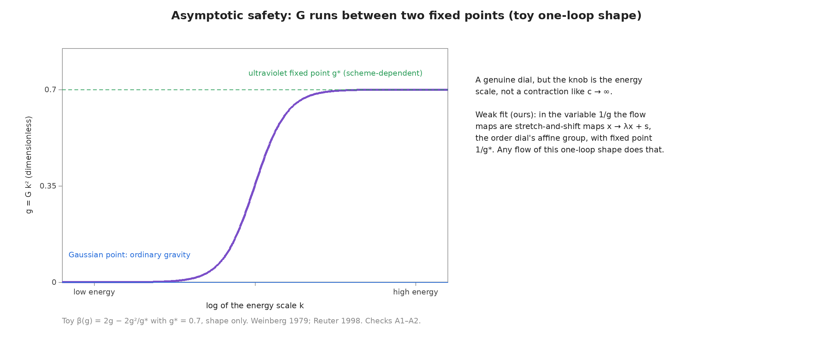

# Dials for G: what the literature offers

> **Names:** some words or symbols on this page (mult-add, wall, Tsallis q) also mean something else in standard math, physics or computing, or inside this project. [NAMING-COLLISIONS.md](../../../../NAMING-COLLISIONS.md) says which meaning is in play.

*Nov 25, 2026. Follows [e-i-pi](../README.md) and [chain-resolves](../chain-resolves/README.md), which ended with "G still has no dial". Checks: `checks.py`, 28/28 pass (`checks_output.txt`). Pictures: `figures.py`.*

## Verdict

G can never be a dial by itself, because it has units. Every pure number that contains G pairs it with something else.

The literature has three genuine dials with stable endpoints. In each one the *form* of gravity is forced and the *size* is free, which is exactly ħ's standing:

1. **The spin-2 coupling √G.** Free gravitons at one end. At the other, GR, the only consistent deformation (known: Gupta, Deser, Boulanger–Damour–Gualtieri–Henneaux 2001).
2. **α = GħΛ/c³ ≈ 10⁻¹²².** A topological BF theory at one end, GR with Λ at the other (known: MacDowell–Mansouri 1977, Freidel–Starodubtsev 2005).
3. **The stability-forced length ℓ.** Poincaré–Heisenberg is unstable. Adding two scales, a short length ℓ and a long length L, makes it rigid. This is the same test that produced c and ħ (known: Vilela Mendes 1994, Chryssomalakos–Okon 2004).

**The lead (ours):** the rigid algebra carries one pure number, ℓ²/L². If ℓ is the Planck length and L the de Sitter radius, that number is GħΛ/(3c³). That is the same coupling as dial 2. Then G = c³ℓ²/ħ: G is not a dial of its own but the square of the length that stability demands, written in other units. The open question is whether ℓ really is the Planck length. Vilela Mendes thought it probably is; a 2019 paper argues the two scales are independent.

The Barbero–Immirzi γ is a real dial, but on a different direction: the Hodge star, which plays i on curvature. Its self-dual value γ = ±i is exactly the wall of our lift (ours). It is fixed by state counting, not by a symmetry, and it rescales G's area quantum rather than G.

**No candidate fixes G's value.** Each dial explains the form gravity must take, and none says how big G is.

---

## 1. G needs a partner

c and ħ are dials because 1/c² and ħ can be sent to zero in a symmetry algebra, and the endpoints are stable. G carries units of length³/(mass·time²), so "G → 0" means nothing until you say what it is compared with.

- With ħ, c and Λ there is exactly one pure number: **GħΛ/c³ = ℓ_P²Λ ≈ 2.9 × 10⁻¹²²** (check D1, D3).
- With a mass m in place of Λ it is the gravitational fine-structure constant **Gm²/(ħc)**, 5.9 × 10⁻³⁹ for the proton (D2, D3).

So every candidate below is a dial on one of these combinations, never on G alone.

## 2. Scorecard

Four questions for each candidate:

- **Stable end:** does the dial have an endpoint that is a consistent theory in its own right?
- **Form forced:** is the deformation away from that end unique?
- **Size fixed:** does anything fix the dial's value?
- **Fits our dial:** does it compose by our weighted circle operation (called mult-add before 1.0; wall at −1/k) or sit on the dial map?

The first three rows meet in one number (section 4).

## 3. Stability forces two scales

This is the test from the dial map, now applied one level up.

- Take Poincaré–Heisenberg: Lorentz generators, positions X, momenta P and a central I, with [X, P] ~ I (ħ).
- Deform with two parameters (g2, g3). Then [X₀, X₁] = −g2·J, so positions stop commuting (a minimal length ℓ²), and [P₀, P₁] = −g3·J, so momenta curve (de Sitter, 1/L²). Jacobi holds for every (g2, g3) (S1, S3).
- Count deformations with H²(g, g), the same tool used for c and ħ (S2, S4):

| corner (g2, g3) | dim H², 1+1 | dim H², 3+1 |
|---|---|---|
| (0, 0) Poincaré–Heisenberg | 7 | 3 |
| (1, 0) one scale | 1 | — |
| (0, 1) one scale | 1 | — |
| (1, 1) two scales | 0 | 0 |
| (1, −1) two scales | 0 | — |

One scale is not enough; two make the algebra rigid. The rigidity is known (Vilela Mendes 1994; Chryssomalakos–Okon 2004). The 1+1 corner numbers are computed by us.

**The pure number.** With ħ fixed by [x, p] = iħ, rescaling positions and momenta in opposite directions leaves the algebra unchanged, so only g2·g3 = ℓ²/L² is physical (S5). Put ℓ = ℓ_P and L² = 3/Λ:

ℓ²/L² = GħΛ/(3c³) ≈ 9.6 × 10⁻¹²³ (S6, link ours)

and so G = c³ℓ²/ħ (S7).

## 4. Three dials with stable ends

- **Spin-2 bootstrap (known).** Start from free massless spin-2 fields and ask for every consistent self-interaction. The answer is the Einstein–Hilbert action, unique up to equivalence, with no cross-coupling between several gravitons (Boulanger et al. 2001, building on Gupta 1954, Deser 1970, Barnich–Henneaux 1993). The coupling √G is free. This matches ħ, where Moyal's product is the unique deformation and ħ's size is free.
- **MacDowell–Mansouri / Freidel–Starodubtsev (known).** GR with Λ is an SO(4,1) BF theory plus a perturbation in α ~ GΛ (they quote ~10⁻¹²⁰). At α → 0 the theory is topological, which is a stable end. Kowalski-Glikman and Starodubtsev note that the Immirzi parameter enters this expansion.
- **Two-scale algebra (known rigidity, link ours).** Section 3. Its one pure number equals the Freidel–Starodubtsev α if ℓ is the Planck length.

These are three routes to one number. That is the main result of this search.

## 5. The Immirzi parameter: a dial on the i direction

- On curvature 2-forms the Lorentzian Hodge star squares to −1 (eigenvalues ±i). It plays the role of i. The Euclidean star squares to +1 (I1).
- Holst's action uses 1 + ★/γ. Its determinant is (1 + 1/γ²)³ in Lorentzian signature: never zero for real γ, and zero exactly at **γ = ±i**, Ashtekar's self-dual variables (I2, I3). **Reading ours:** the self-dual point is the wall of this lift, where it collapses to a rank-3 projector.
- In Euclidean signature the determinant is (1 − 1/γ²)³, with walls at γ = ±1. Benedetti–Speziale (2011) find a UV fixed point at γ² = 1 with fermions (I4), and Daum–Reuter find an asymptotically safe Holst flow. So the flow appears to run to the wall.

- What fixes γ is black-hole state counting, chosen so the entropy is A/4. The value depends on the counting rule (I5, I6):
  - all spins, weight 2: **0.2375** (Domagala–Lewandowski; Meissner 2004);
  - all spins, weight 2j+1: **0.274** (Ghosh–Mitra);
  - spin ½ only: ln2/(π√3) = **0.127** (ABCK 1998).
- γ multiplies G in the area gap, A_min = 4√3·πγ·ħG/c³ ≈ 1.35 × 10⁻⁶⁹ m² (I7). So γ rescales G's quantum of area. It is not a dial on G.

## 6. Where G sits: the horizon is a wall

- Schwarzschild's g_tt = 1 + kx with x = M/r and k = −2G/c². **Reading ours:** the horizon is the wall −1/k of this lift, and past it the lift goes negative, where time and radius trade roles (W1).
- The slope at the wall is the surface gravity c⁴/(4GM). With the 2π period it gives Hawking's temperature, 6.17 × 10⁻⁸ K for a solar mass (W2, same as e-i-pi C23).
- Limit: redshift factors between shells do compose by the circle operation, but their dial is 1/c², not G. Masses do not compose this way (W3; dial-map G1–G2). So this places G in the picture without making it a dial.

## 7. Running G

Asymptotic safety lets the dimensionless g = Gk² run from a Gaussian point (ordinary gravity) to an ultraviolet fixed point (A1; Weinberg 1979, Reuter 1998). It is a genuine dial, but its knob is the energy scale, not a contraction like c → ∞. **Weak fit, ours:** in the variable 1/g the flow maps are stretch-and-shift maps, the order dial's affine group (A2). Any flow of this one-loop shape does that, so it says little.

## 8. The rest, briefly

- **κ-Poincaré (known, already matched).** Massless momenta compose as a + b + k·ab with k = −1/E_P (K1, from [kappa-poincare](../../kappa-poincare/)). Relative locality isolates E_P by sending ħ, G → 0 with ħ/G fixed (R1). That is a dial on E_P, where G enters only through ħ/G.
- **Jacobson (known).** Einstein's equations follow from δQ = T dS with entropy per area η = c³/(4Għ), so G = c³/(4ħη) (J1). G → 0 means infinitely many states per area. **Reading ours:** state counts multiply, so N − 1 composes by the circle operation at dial 1 and log N is the flat coordinate (J2). The general version is Tsallis composition, which leaves the local equations unchanged (gr-bridges J5). It moves the question to a state count; it does not dial G.
- **Generalized uncertainty (known).** [x, p] = iħ(1 + βp²) gives Δx_min = ħ√β (U1). β ~ ℓ_P²/ħ² inherits G through ℓ_P. It is the ℓ of section 3 seen from one side.
- **Newton–Cartan / Carroll (known).** Ehlers' frame theory dials λ = 1/c² with G held fixed, and G survives the Newtonian end (E1). These are dials on c.
- **Teleparallel (known).** It dials combinations of torsion, not G. Covered in gr-bridges.

---

## Assumptions

- A "dial" means a continuous parameter in an algebra or action whose endpoint is itself a consistent theory, judged by the same test used for c and ħ (H² for algebras, uniqueness of the deformation for actions).
- L² = 3/Λ for the de Sitter radius. Λ ≈ 1.1 × 10⁻⁵² m⁻², with CODATA values for G, ħ and c.
- The identification ℓ = ℓ_P is a hypothesis, not a result. Without it the rigid algebra only says there is *some* short length.
- The 1+1 H² dimensions use our own vectorized cochain code (`H2_dim` in `checks.py`). The 3+1 numbers match the published rigidity result.
- The asymptotic-safety flow is a toy one-loop β-function used for shape only. Real fixed-point values depend on the scheme.
- Black-hole counting values are reproduced from each paper's equation; which counting rule is right is still debated.

## Known vs new

| Item | Status |
|---|---|
| Poincaré–Heisenberg is unstable; the two-scale algebra is rigid | Known (Vilela Mendes 1994; Chryssomalakos–Okon 2004) |
| Corner-by-corner H² dimensions in 1+1 (7, 1, 1, 0, 0) | Computed by us |
| ℓ²/L² is the only invariant once ħ is fixed | Implicit in the literature; stated and checked here |
| ℓ²/L² = GħΛ/(3c³) is the Freidel–Starodubtsev coupling, so G = c³ℓ²/ħ | **Ours** (the link) |
| GR as BF theory plus α ~ GΛ | Known (MacDowell–Mansouri; Freidel–Starodubtsev) |
| GR as the unique deformation of free spin-2 | Known (Gupta; Deser; Boulanger et al.) |
| γ = ±i is the wall of 1 + ★/γ | **Ours** (reading) |
| γ² = 1 UV fixed point in Euclidean signature | Known (Benedetti–Speziale 2011) |
| γ values from state counting | Known (Meissner; Ghosh–Mitra; ABCK) |
| Horizon as the wall of g_tt = 1 + kx | **Ours** (reading) |
| Horizon state counts compose by the circle operation | **Ours** (reading); Tsallis version known |
| Affine flow maps in 1/g | **Ours** (weak fit) |
| Jacobson, κ-Poincaré, relative locality, GUP, Ehlers, teleparallel | Known |

## Checks

`python3 checks.py` (numpy only, about a minute) prints 28 checks and writes `checks_output.txt`. Groups: D (dimensions), S (stability algebra), I (Immirzi), J (Jacobson), W (horizon wall), E (Ehlers), R (relative locality), K (κ-Poincaré), U (GUP), A (asymptotic safety). Result: **28/28 pass.**

## Files

- `README.md` (this page)
- `checks.py`, `checks_output.txt`
- `figures.py` (uses `../svgkit.py`), `figures/g1`–`g8` as SVG and PNG

## Sources

Checked by search this session:

- Freidel, Starodubtsev, *Quantum gravity in terms of topological observables*, hep-th/0501191.
- Vilela Mendes, J. Phys. A 27, 8091 (1994); Chryssomalakos, Okon (2004); related: arXiv 1111.5576, 1112.3246, hep-th/0505124, hep-th/0611034; independence of the two scales: arXiv 1901.01613.
- Boulanger, Damour, Gualtieri, Henneaux, Nucl. Phys. B 597, 127 (2001), hep-th/0007220.
- Meissner, gr-qc/0407052; review gr-qc/0409061; Ghosh, Mitra, gr-qc/0411035; arXiv 2001.03440.
- Benedetti, Speziale, arXiv 1104.4028; Daum, Reuter, arXiv 1012.4280.
- Amelino-Camelia, Freidel, Kowalski-Glikman, Smolin, arXiv 1101.0931 and 1106.0313.
- Jacobson, PRL 75, 1260 (1995), gr-qc/9504004.
- Ehlers' frame theory (editorial, arXiv 1910.12106).
- Asymptotic safety reviews: arXiv 1202.2274, gr-qc/0610018.

Textbook or not re-fetched: MacDowell–Mansouri (1977); Gupta (1954); Deser (1970); Barnich–Henneaux (1993); Ashtekar–Baez–Corichi–Krasnov (1998); Kempf–Mangano–Mann (1995); Weinberg (1979); Reuter (1998); Sakharov (1967); Hayashi–Shirafuji (1979); Fermi GRB 090510 bound on linear Planck-scale dispersion.

Builds on: [dial-map](../../dial-map/), [kappa-poincare](../../kappa-poincare/), gr-bridges.
