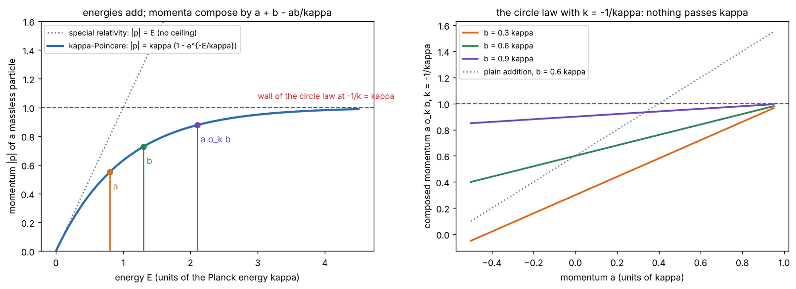
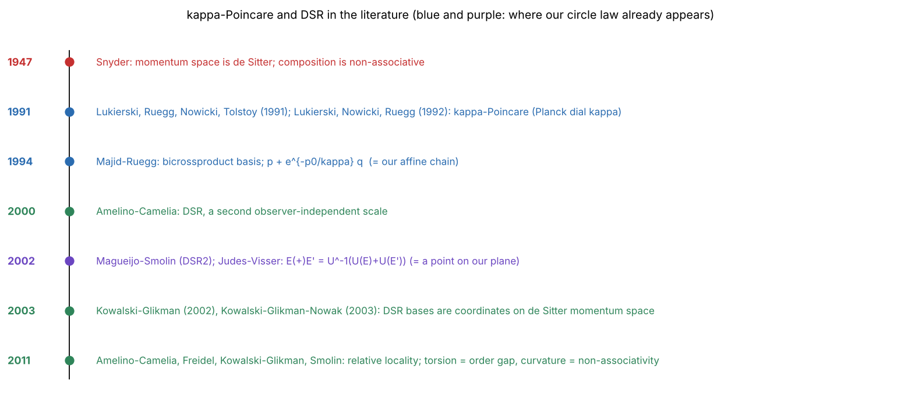
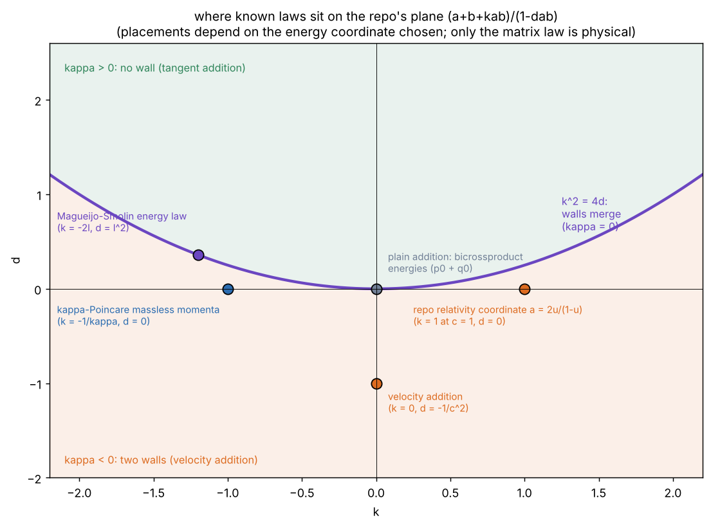
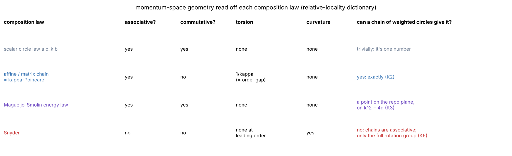
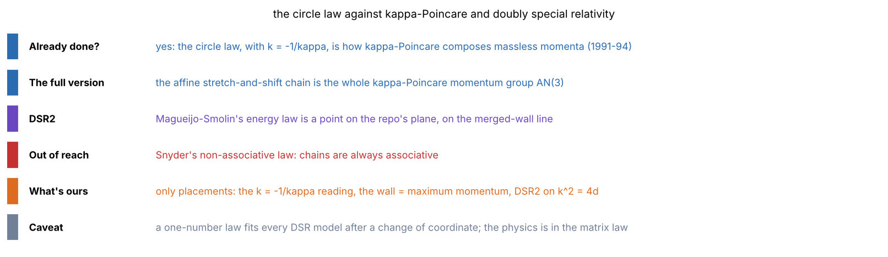

# Is the weighted circle operation already a κ-Poincaré / DSR composition law?

> **Names:** some words or symbols on this page (⊕, wall, Tsallis q) also mean something else in standard math, physics or computing, or inside this project. [NAMING-COLLISIONS.md](../../../NAMING-COLLISIONS.md) says which meaning is in play.

Nov 25, 2026. Part of topics/why-i.

**Verdict.** Yes, Brennan's hunch is right: this has already been done.

With k set to minus one over the Planck energy, a ∘ₖ b = a + b + k·ab is exactly how κ-Poincaré combines the momenta of two massless particles moving the same way. The wall at −1/k is κ-Poincaré's known maximum momentum. The full stretch-and-shift version of the chain is the whole κ-Poincaré momentum group, which goes back to Lukierski and colleagues (1991–92) and to Majid and Ruegg (1994).

What's ours is only where things sit on the repo's own map. The one physics limit is that our chains are always associative, so they can't reach Snyder's non-associative law.

## 1. What the literature says

- **Snyder (1947)** was the first to make momentum space curved, a de Sitter space. His momentum composition is non-associative because his momentum space is a coset, not a group (Girelli–Livine 2010).
- **κ-Poincaré** (Lukierski, Ruegg, Nowicki, Tolstoy 1991; Lukierski, Nowicki, Ruegg 1992) deforms the Poincaré algebra with a Planck-energy dial κ.
  - In the Majid–Ruegg bicrossproduct basis (1994), energies add and spatial momenta combine as p + e^(−p₀/κ) q.
  - The mass formula is (2κ sinh(p₀/2κ))² − e^(p₀/κ) p² = m².
- **Doubly special relativity (DSR)** is the idea that there is a second observer-independent scale beside c.
  - Amelino-Camelia, 2000–02: gr-qc/0012051; Phys. Lett. B 510, 255 (2001).
  - Magueijo–Smolin (DSR2): PRL 88, 190403 (2002), arXiv hep-th/0112090. It uses a nonlinear map U(p) = p/(1 − l·p₀).
  - Judes–Visser (2002) gave its composition law as p ⊕ q = U⁻¹(U(p) + U(q)).
- **DSR as de Sitter momentum space.** Kowalski-Glikman (2002) and Kowalski-Glikman–Nowak (2002–03) showed that the different DSR versions are different coordinate choices on one de Sitter momentum space. DSR1 and DSR2 are bases of κ-Poincaré.
- **Relative locality** (Amelino-Camelia, Freidel, Kowalski-Glikman, Smolin 2011) reads geometry off the composition law:
  - its bilinear term gives a connection;
  - the failure to commute is torsion;
  - the failure to associate is curvature.
- **Nearby 1D laws.** The scalar ∘ₖ is the Tsallis q-sum. Kaniadakis' κ-sum (PRE 66, 056125, 2002) is relativistic momentum addition along a line. Both are one-number laws, related by a ruler change.

## 2. The match, exactly (checks K1, K2)

- **Massless momenta (K1).** For a massless particle the mass formula gives |p| = κ(1 − e^(−p₀/κ)), which never passes κ.
  - Put two such particles moving the same way together. The energies add, and the momenta combine as a + e^(−p₀/κ)·b = a + b − ab/κ.
  - That is a ∘ₖ b with **k = −1/κ**, and the combined momentum is again massless.
  - The wall −1/k = κ is κ-Poincaré's maximum momentum: κ ∘ₖ anything = κ.
  - This follows in one line from Majid–Ruegg. We didn't see it written as a + b + k·ab in what we read, but it's a restatement, not a discovery.
- **The whole momentum group (K2).** The 3+1 composition (p₀ + q₀, p⃗ + e^(−p₀/κ) q⃗) is a matrix chain A ∘ₖ B = A + B + k·AB, with lift I + kA = [[e^(−p₀/κ), p⃗], [0, 1]].
  - This is the order-dial page's affine stretch-and-shift law with a vector shift.
  - It is the group AN(3) that Kowalski-Glikman identifies as κ-Poincaré momentum space.

## 3. Where the known laws sit on the repo's plane (K3, K4)

- **Magueijo–Smolin's energy law** works out to (E + E' − 2l·EE')/(1 − l²·EE').
  - That is the repo's (a + b + kab)/(1 − dab) with k = −2l and d = l². It sits on the line k² = 4d, where the plane's two walls merge into one, i.e. the discriminant Δ = k² − 4d is 0.
  - The double wall sits at E = 1/l, so the invariant Planck energy is exactly the merged wall: E ⊕ 1/l = 1/l. This placement is ours; the formula is Judes–Visser's.
- **The other placements.**
  - κ-Poincaré massless momenta sit at (k, d) = (−1/κ, 0).
  - Velocity addition sits at (0, −1/c²), two walls at ±c.
  - Bicrossproduct energies sit at the origin, plain addition.
- **The caveat that matters (K4).** Every one-number law is plain addition after a change of ruler. So where a law sits on the plane depends on which energy coordinate you pick, the "DSR basis".
  - Matching ∘ₖ in one dimension is therefore not model-specific.
  - The physical content is in the matrix law and in the geometry of momentum space.

## 4. Geometry: what chains can and can't reach (K5, K6)

- **Scalar ∘ₖ (K5a):** connection −k, no torsion, no curvature. One number carries no momentum-space geometry.
- **The affine/matrix chain, i.e. κ-Poincaré (K5b):** torsion 1/κ and zero curvature.
  - The torsion is exactly the order gap from the order-dial page: p ⊕ q − q ⊕ p ≈ −T·pq.
  - Zero curvature is what you expect for a group: a flat connection with torsion.
- **Snyder (K6):** non-associative, so it has curvature, and no torsion at leading order.
  - Chains of ∘ₖ are always associative, so no chain gives Snyder's law.
  - The matrix chain reaches it only by keeping the leftover rotation, i.e. by working in the full rotation group. That's the same move as Thomas–Wigner on the relativity page.

## 5. How this sits with k and the signature dial (K7)

- **The same algebra carries two different physical dials.**
  - On spacetime, ∘ₖ is velocity addition: the signature label κ₂ = −1/c² (repo coordinate a = 2u/(1 − u), k = 1 at c = 1).
  - On momentum space, ∘ₖ is κ-Poincaré's law with k = −1/κ.
- **DSR keeps the first dial and adds the second,** which amounts to a curvature dial for momentum space (de Sitter, radius κ). So DSR is a third Cayley–Klein-style dial, sitting on momentum space instead of spacetime. That reading is the published one (Kowalski-Glikman), not ours.

## 6. What's ours, and is it a lead?

- **Ours.**
  - The plain statement that collinear massless κ-Poincaré momenta compose by a + b + k·ab with k = −1/κ, with the wall as the maximum momentum.
  - The placement of Magueijo–Smolin's energy law on the repo's merged-wall line, with the Planck energy as the double wall.
  - The reading of the order gap as relative-locality torsion.
  - All three are restatements of known formulas in the repo's language.
- **Not a lead by itself.** The structure is fully known. It does tie the framework to a live research line, Planck-scale kinematics, in a clean way.
- **The one sharp edge.** Curvature of momentum space (Snyder, non-associativity) is outside what chains can produce. Anyone wanting to push the framework toward quantum-gravity kinematics would have to go beyond associative chains.

## 7. Checks

`python3 checks.py` gives 10/10 pass (checks_output.txt).

- **K1a–c:** massless momenta, the circle law with k = −1/κ, the wall as maximum momentum.
- **K2:** the 3+1 momentum group as a matrix chain.
- **K3:** Magueijo–Smolin on the merged-wall line (symbolic).
- **K4:** every 1D law is a ruler change.
- **K5a–b:** torsion and curvature from the composition (numerical second and third derivatives).
- **K6:** Snyder's non-associativity versus the associative group.
- **K7:** velocity addition with the same law.

## 8. Assumptions

- κ-Poincaré is used in the Majid–Ruegg bicrossproduct basis, with coproduct Δpᵢ = pᵢ ⊗ 1 + e^(−p₀/κ) ⊗ pᵢ. Other bases give different-looking formulas for the same algebra.
- "Massless, moving the same way" means one spatial direction and the positive-momentum branch.
- The Magueijo–Smolin composition is the U-map law of Judes–Visser. Whether that law is the "right" DSR2 composition was debated at the time.
- Snyder's law is modelled on the spatial slice (a sphere with Beltrami coordinates and minimal rotations), not the full de Sitter space. Associativity and torsion properties are what the check uses.
- Torsion and curvature are read off numerically at the origin, following the relative-locality dictionary.
- The normalisation of k is a choice of units. The repo's a = 2u/(1 − u) uses k = 1 at c = 1.
- Citations checked by search this session: Magueijo–Smolin 2002, Judes–Visser 2002, Majid–Ruegg 1994, Lukierski–Nowicki–Ruegg 1992, Amelino-Camelia 2001, Kowalski-Glikman 2002, Kowalski-Glikman–Nowak, relative locality 2011, Girelli–Livine 2010, Kaniadakis 2002. Not freshly searched: Snyder 1947, Lukierski–Ruegg–Nowicki–Tolstoy 1991.
- One gap: we did not search exhaustively for a paper writing the collinear massless law literally as a + b + k·ab.

## 9. Files

- `checks.py`, `checks_output.txt`
- `figures.py` → `figures/k1` to `k5`

## Sources

- H. Snyder, Phys. Rev. 71, 38 (1947).
- J. Lukierski, H. Ruegg, A. Nowicki, V. Tolstoy, Phys. Lett. B 264, 331 (1991); J. Lukierski, A. Nowicki, H. Ruegg, Phys. Lett. B 293, 344 (1992).
- S. Majid, H. Ruegg, Phys. Lett. B 334, 348 (1994), hep-th/9405107.
- G. Amelino-Camelia, Phys. Lett. B 510, 255 (2001), hep-th/0012238; gr-qc/0012051.
- J. Magueijo, L. Smolin, PRL 88, 190403 (2002), hep-th/0112090.
- S. Judes, M. Visser, "Conservation laws in doubly special relativity", gr-qc/0205067.
- J. Kowalski-Glikman, Phys. Lett. B 547, 291 (2002), hep-th/0207279; J. Kowalski-Glikman, S. Nowak, hep-th/0203040 and hep-th/0304101.
- G. Amelino-Camelia, L. Freidel, J. Kowalski-Glikman, L. Smolin, Phys. Rev. D 84, 084010 (2011), arXiv:1101.0931.
- F. Girelli, E. Livine, JHEP 03 (2011) 132, arXiv:1004.0621.
- G. Kaniadakis, Phys. Rev. E 66, 056125 (2002), cond-mat/0210467.
