# Path integrals in a stronger sense: the extra bit

> **Names:** some words or symbols on this page (twist) also mean something else in standard math, physics or computing, or inside this project. [NAMING-COLLISIONS.md](../../../NAMING-COLLISIONS.md) says which meaning is in play.

Nov 25, 2026. Part of topics/why-i.

**Verdict.** Path integrals become a real case of the weighted circle operation once three published pieces are added. The first is a fixed twist size, which plays the role of mass and ħ. The second is the rule that only quadratic generators keep the chain exact. The third is Daubechies and Klauder's Brownian measure, which already lives on the order dial's own half-plane. No published structure fixes the number ħ. The best on offer, our curvature check included, fixes only ratios like area over ħ.

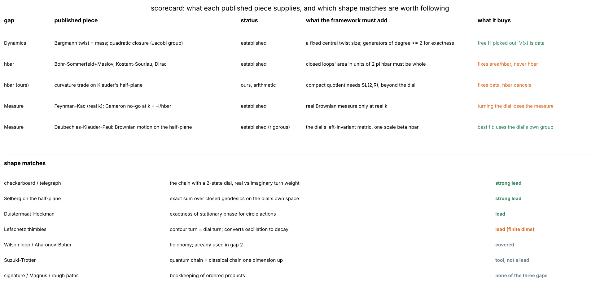

## 0. What "stronger sense" means here

The earlier write-up (`../README.md`, section 5) found the **weak sense**. A chain of ∘ₖ steps is a product integral, which is a sum over paths, and the dial value k = −i/ħ gives Feynman's weights. The framework did not supply the three things a physicist needs to get an answer out:

1. **Dynamics:** which generator H the dial carries.
2. **ħ:** what sets the size of the dial value.
3. **Measure:** what "sum over all paths" means once paths are continuous.

**Strong sense** here means that each of the three comes from a structure the framework can hold, with a published theorem behind it, rather than being typed in by hand. Each candidate below says what it asks of the framework, whether it is **established** or **debated**, and whether a step is **ours**.

Conventions are as before: (a, c) is the map x ↦ (1 + a)x + c, the order gap is the wedge ad − bc, and as a point of the upper half-plane the map x ↦ αx + β sits at z = β + iα.

## 1. Gap 1: the dynamics

### 1a. Bargmann: the boost/shift twist has a size, and the size is the mass (established)

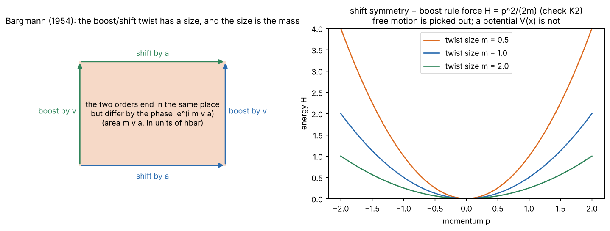

- **What it says.** In quantum mechanics a shift by a and a boost by v commute only up to the phase e^{imva} (check K1). Bargmann (1954) showed this central twist cannot be removed for the Galilei group, and its size is the mass. Lévy-Leblond (1963) then showed that shift symmetry plus the boost rule [K, H] = iP force the free Hamiltonian H = P²/2m (checks K2, K3).
- **What it asks of the framework.** The order gap between a shift and a boost must be a fixed central number, not a free wedge. In our language that is the order dial with its twist fixed to one size m/ħ.
- **What it buys.** The free motion is picked out by structure alone. A potential V(x) is not. It stays an input, exactly as in physics.

### 1b. Groenewold–van Hove: only quadratic generators keep the chain closed (established)

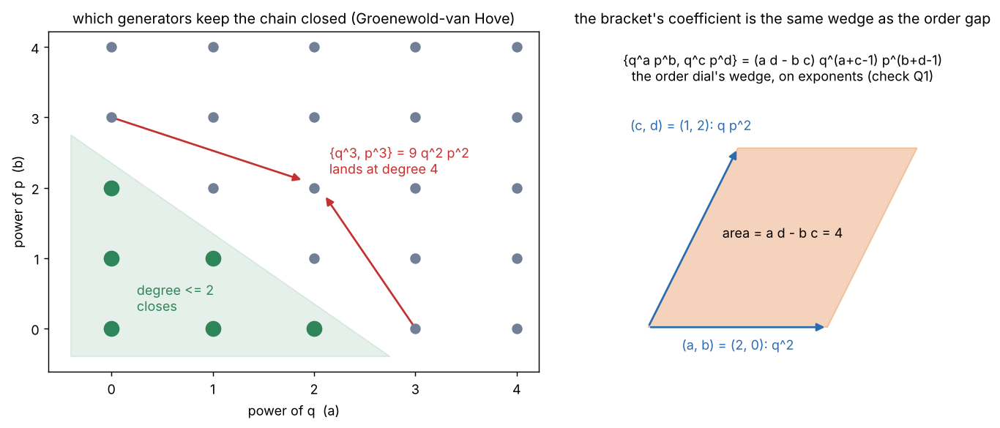

- **What it says.** The Poisson bracket of q^a p^b with q^c p^d has coefficient ad − bc (check Q1). That is the order dial's wedge again, now on exponents. *(That reading is ours. The bracket formula is textbook.)* Brackets of polynomials of degree ≤ 2 stay of degree ≤ 2 (Q2). That small closed world is the Heisenberg algebra plus sp(2), called the Jacobi group. Cubics escape: {q³, p³} = 9q²p² (Q3). Groenewold (1946) and van Hove (1951) proved that no quantization can respect brackets beyond this world.
- **What it buys.** Inside the quadratic world the chain is exact. Each time slice is a 2×2 area-keeping matrix, and the product converges to the exact flow with no measure needed (Q5, Q6). This is the metaplectic representation, which is why oscillator and free-particle path integrals are computed exactly.

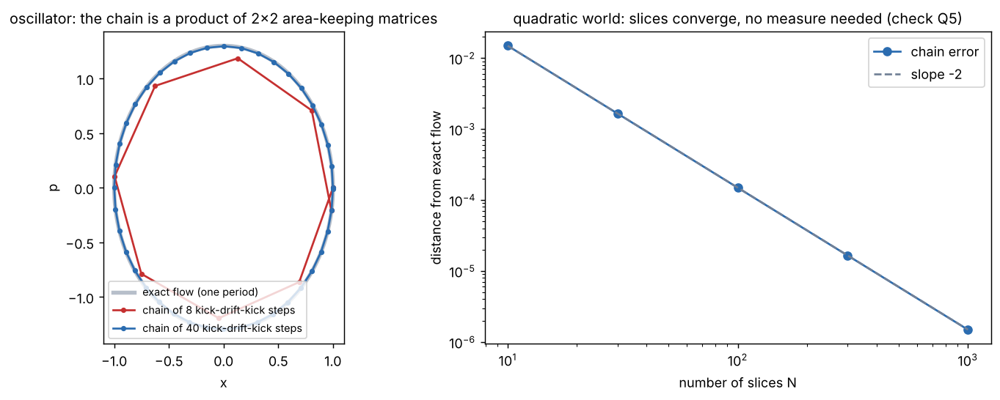

- **What it asks of the framework.** Restrict the generators the dial may carry to degree ≤ 2 when you want exact answers. Beyond that you need gap 3's measure.

### 1c. Klauder's affine variables are the order dial's own algebra (established)

The order dial's Lie algebra is the affine rule [X, Y] = Y. Klauder's affine quantization uses exactly that pair, dilation D = (QP + PQ)/2 with [Q, D] = iħQ, for systems where q stays positive (check Q4). Daubechies and Klauder (1985) proved path-integral formulas for polynomial Hamiltonians in these variables. This fits the framework's own group, but it does not choose H either.

### 1d. Gap 1 verdict

The framework can supply the free part of the dynamics if it fixes the twist size (1a) and keeps to quadratic generators for exactness (1b). Interactions stay input. No published structure derives V(x), so this is the honest ceiling.

## 2. Gap 2: what fixes ħ

### 2a. Bohr–Sommerfeld with the Maslov half (established, approximate)

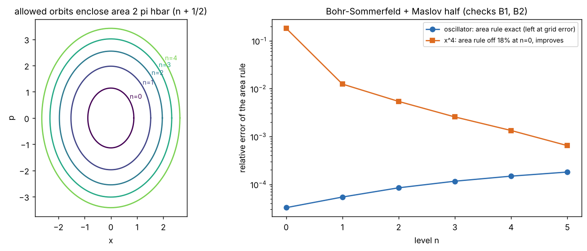

Allowed orbits enclose area 2πħ(n + ½). For the oscillator this is exact (B1). For x⁴ it is off by 18% at n = 0 and improves fast with n, because it is only the leading semiclassical term (B2).

### 2b. Kostant–Souriau integrality, and holonomy (established)

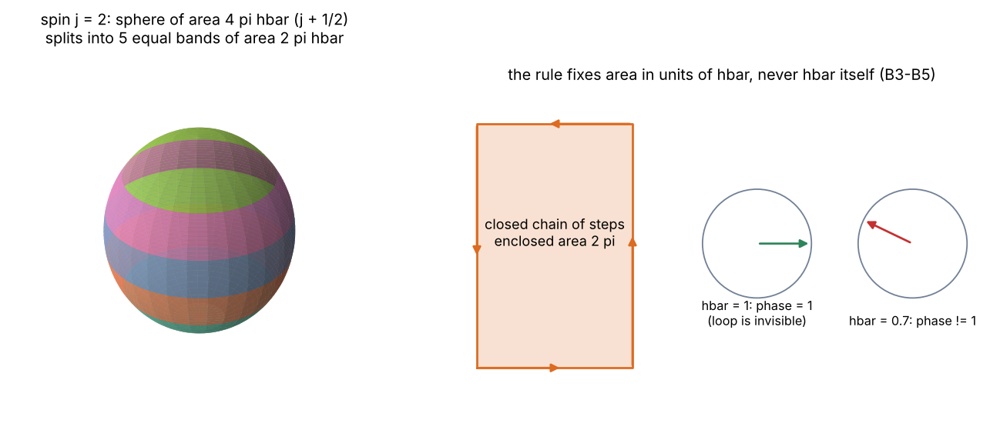

- **Spin:** a sphere of area 4πħ(j + ½) splits into exactly 2j + 1 cells of area 2πħ (B3). Kostant–Souriau prequantization asks that every closed surface carry a whole number of cells.
- **Loops:** a closed chain of steps returns shifted only by its enclosed area. With ħ = 1, a loop of area 2π has phase 1. With ħ = 0.7 the same loop does not (B4, B5). Dirac's monopole condition is the same rule for flux.
- **What it asks of the framework.** Closed chains must compose to the identity. That ties loop area to ħ.
- **What it buys.** A rule on area divided by ħ. It never fixes ħ itself, since scaling all areas and ħ together changes nothing. In physics ħ is a unit, and the fine-structure constant, the dimensionless number, is not derived by any of this.

### 2c. The curvature trade on the half-plane (ours, arithmetic on established pieces)

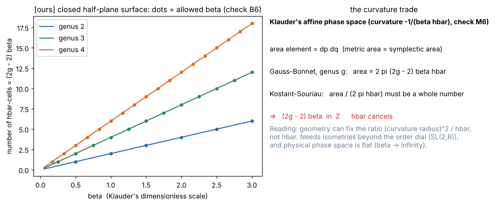

- Klauder's affine phase-space metric is (βħ)⁻¹q²dp² + βħ q⁻²dq². Pulled to (a, b) = (1/q, p), it is the Poincaré metric on our half-plane (M2), scaled.
- Its Gaussian curvature is −1/(βħ) (M6). Klauder quotes −2/(βħ). That figure is the scalar curvature, which is twice the Gaussian one, so the two agree.
- Its area element is exactly dp dq, so metric area equals symplectic area (B6).
- *Ours:* on a closed surface of genus g with that curvature, Gauss–Bonnet gives area 2π(2g − 2)βħ. Kostant–Souriau asks for a whole number of 2πħ cells, so (2g − 2)β must be a whole number. **ħ cancels.** Geometry fixes the dimensionless ratio β, which is curvature radius squared over ħ, and never ħ itself.
- Caveats. A closed surface needs a lattice in SL(2,R), and that is more than the order dial's own group (the ax + b subgroup has no such lattice). Physical phase space is flat, which is the limit β → ∞. Berezin's quantization of the Lobachevsky plane (1975) and Klimek–Lesniewski's quantum Riemann surfaces (1992) are the established work this should be checked against.

### 2d. Gap 2 verdict

Every published route fixes area in units of ħ, not ħ. The framework can carry that rule as "closed chains compose to the identity". The curvature trade is our one new observation, and it confirms the same limit from a new side.

## 3. Gap 3: the measure

### 3a. Real dial: Wiener measure and Feynman–Kac (established, rigorous)

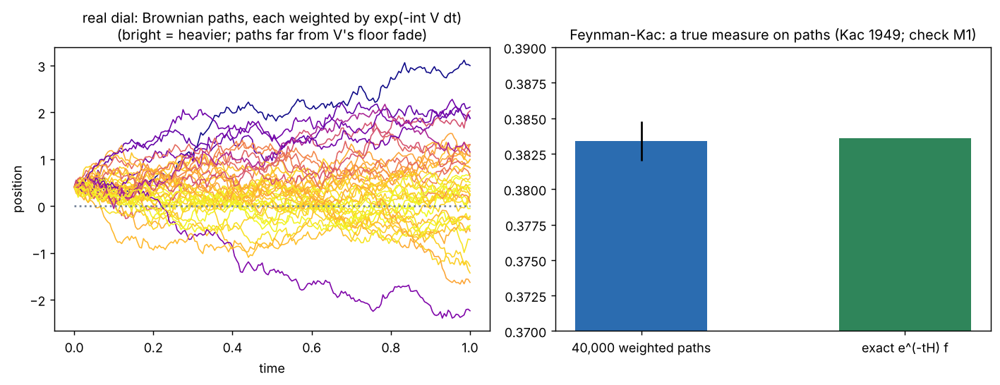

At real k the sum over paths is a true probability measure. 40,000 Brownian paths weighted by exp(−∫V dt) give 0.3834 ± 0.0014 against the exact 0.3836 (M1; Kac 1949).

### 3b. Imaginary dial: no measure, three ways round (established)

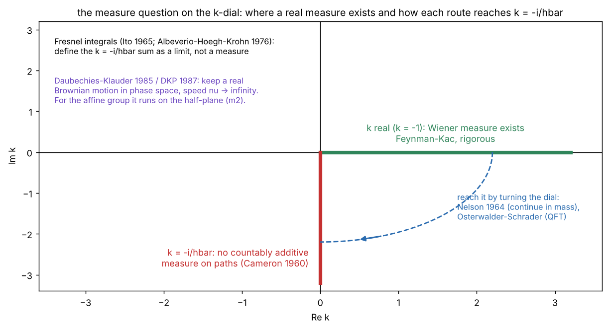

- **No-go:** at k = −i/ħ there is no countably additive measure on paths (Cameron 1960).
- **Turn the dial:** compute at real k and continue (Nelson 1964, continuing in mass; Osterwalder–Schrader for field theory). This is the Wick rotation the earlier write-up drew as a dial turn.
- **Limit, not measure:** Fresnel integrals (Itô 1965; Albeverio–Høegh-Krohn 1976) define the imaginary-k sum as a limit for a class of potentials.

### 3c. Daubechies–Klauder–Paul: Brownian motion on the order dial's half-plane (established, rigorous; best fit)

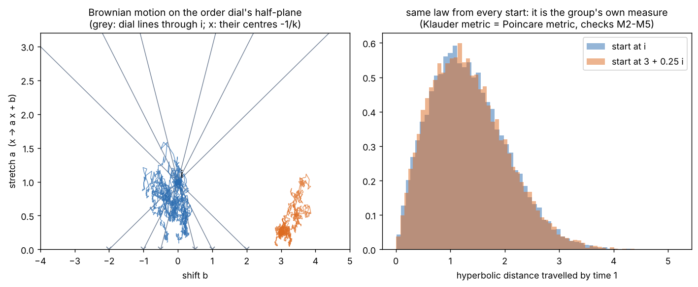

- **What it says.** Daubechies and Klauder (1985) kept a real Brownian motion in phase space with diffusion speed ν, and recovered the quantum evolution as ν → ∞. For affine coherent states, Daubechies, Klauder and Paul (1987) ran that Brownian motion on the Lobachevsky half-plane.
- **Why it fits.** That half-plane is the order dial's group with its Poincaré metric (M2, M3). Its Brownian motion has the same law from every starting point (M4) and the right drift in the stretch coordinate (M5). By Milnor's theorem, every left-invariant metric on this group is hyperbolic, so the measure is fixed by the group up to one scale βħ.
- **What it asks of the framework.** One scale and a ν → ∞ limit. The rest is the group the framework already has.
- **Caveat.** It is a regularization of the imaginary-k sum, not a measure at k = −i/ħ. Cameron's no-go still holds.

### 3d. Other routes (established, but they add nothing for the framework)

Rough paths, regularity structures and stochastic quantization (Lyons 1998; Hairer 2014) build measures at real k, and Osterwalder–Schrader turns the dial for field theory. They ask for real k plus reflection positivity, which the framework does not have yet.

### 3e. Gap 3 verdict

At real k the measure is established and the framework already has it. At imaginary k, Daubechies–Klauder–Paul is the closest published fit, because it uses the dial's own geometry. No construction gives a true measure at k = −i/ħ.

## 4. Signature, rough-path and path-algebra sources

The coordinator's claim, proved in Lean on the checklist thread, is that a chain composed with ∘ₖ gives every ordered sub-chain once, which is the discrete Chen/Lyons signature, and that k is a scaling rough-path theory already uses. Here is what that body of work supplies for the three gaps.

| Source | What it is | Dynamics | ħ | Measure |
|---|---|---|---|---|
| Chen 1957 | iterated integrals; the ordered product is a sum over ordered sub-chains | no | no | no |
| Dyson 1949 | time-ordered exponential expanded in nested integrals | no (needs H given) | no | no |
| Magnus 1954 | log of the ordered product as nested twists; Trotter error led by [A, B] (S7) | no | no | no |
| Lyons 1998 | solutions of driven equations depend continuously on the signature | no | no | only through the driving noise, at real k |
| Hambly–Lyons 2010 | a path is fixed by its signature, up to tree-like detours | no | no | no |
| Friz–Victoir 2010; Friz–Hairer 2014 | Brownian rough path with its Lévy area | no | no | yes, at real k |
| Diehl–Friz–Stannat 2017 | Feynman–Kac formula for rough-path PDEs | no | no | yes, at real k |
| Chevyrev 2018 (arXiv 1510.09066) | random walks and Lévy processes as rough paths, with area corrections in the limit | no | no | yes, at real k (discrete chains to continuum) |
| Hairer 2014 | regularity structures, stochastic quantization of field theories | no | no | yes, at real k (Euclidean) |

**Finding.** This line of work gives bookkeeping and real-k measures. None of it supplies H or ħ. I found no source that treats the real-time Feynman integral as a signature expansion. The discrete-chain sources (Chevyrev's) are the most useful for us, because they control how a lattice chain like ours passes to the continuum.

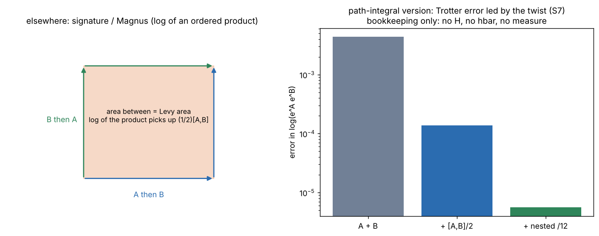

## 5. Shape matches: same geometry, not always labelled path integrals

Each panel pair puts the shape as it appears elsewhere next to its path-integral version.

### 5.1 Feynman checkerboard and Kac telegraph: **strong lead**

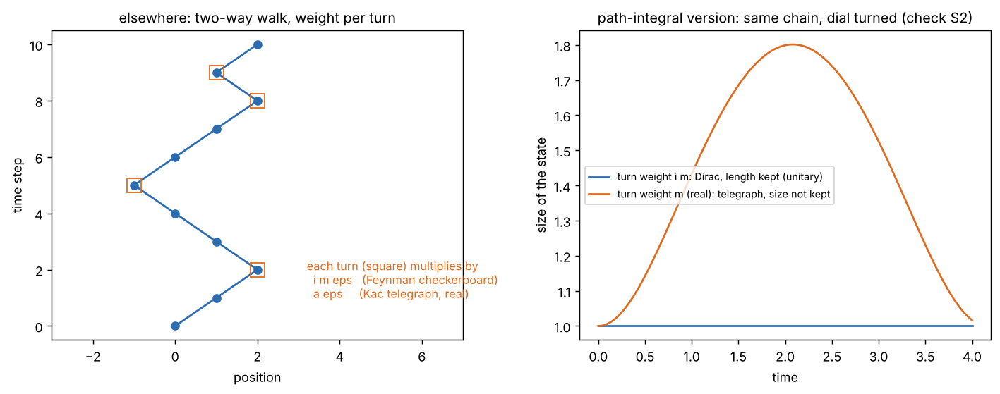

- **Shared shape:** a two-way walk with a weight at each turn. An imaginary turn weight i m ε gives the 1 + 1 Dirac propagator. A real turn rate gives Kac's telegraph process, a true probability measure (S2).
- **Why follow it:** this is our chain with a two-state dial. Both the real and the imaginary dial are rigorous, with no measure problem, and Gaveau, Jacobson, Kac and Schulman (1984) made the continuation between them explicit. It is the cleanest place to make "a ∘ₖ chain is a path integral" a theorem rather than an analogy.

### 5.2 Selberg trace formula on the half-plane: **strong lead**

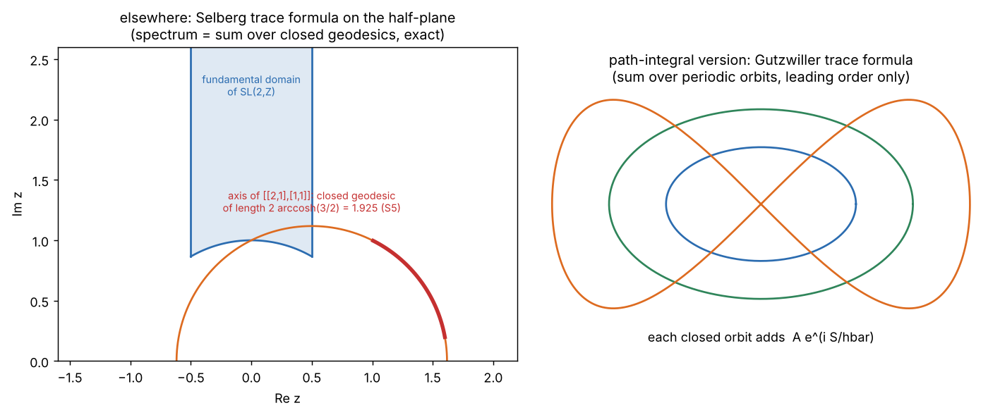

- **Shared shape:** a spectrum written as a sum over closed paths. On the half-plane, Selberg's sum over closed geodesics is exact. Gutzwiller's sum over periodic orbits is only leading order in general. A closed geodesic of [[2,1],[1,1]] has length 2 arccosh(3/2) ≈ 1.925 (S5).
- **Why follow it:** the half-plane is the dial's own space, and it is the one place the periodic-orbit sum is exact. With the curvature trade (2c), it is where a quantization condition can bite. Caveat: it needs SL(2,R) and a lattice, beyond the dial's own subgroup.

### 5.3 Duistermaat–Heckman: **lead**

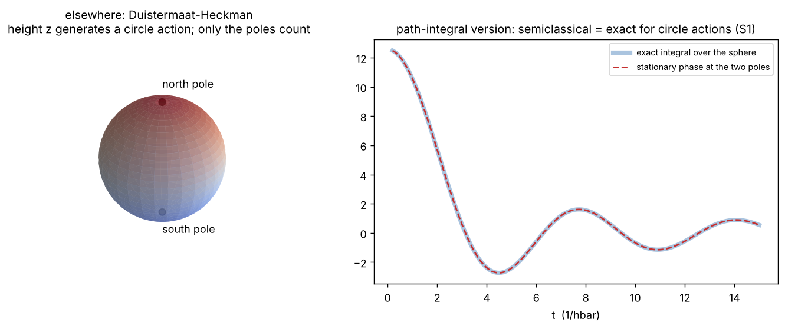

- **Shared shape:** an oscillatory integral that equals its stationary-phase answer exactly. On the sphere only the two poles count, for every t (S1).
- **Why follow it:** it explains which chains are exactly semiclassical, namely those whose flow is a circle action. That matches gap 1's exact quadratic world and gap 2's spin sphere. The loop-space version for real path integrals (Atiyah 1985) is formal and still debated.

### 5.4 Lefschetz thimbles: **lead, in finite dimensions**

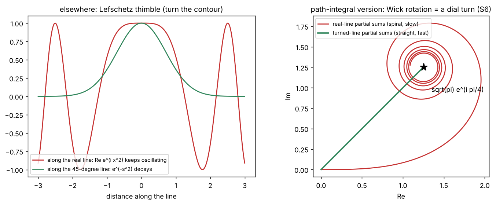

- **Shared shape:** turning the contour turns oscillation into decay. ∫ e^{ix²} dx spirals slowly along the real line and runs straight along the 45° line, and both reach √π e^{iπ/4} (S6). This is the dial turn, made exact.
- **Why follow it:** it turns gap 3's imaginary-k problem into choosing a real contour, and Picard–Lefschetz theory makes that exact in finite dimensions. For full path integrals it is active research (Witten 2010; lattice sign-problem work), so it is debated.

### 5.5 Wilson loop and Aharonov–Bohm: **covered**

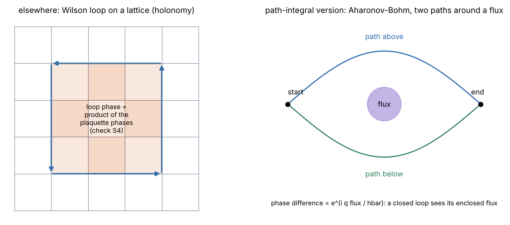

The phase around a loop equals the product of plaquette phases inside (S4). This is the holonomy rule already used in gap 2, so it opens nothing new.

### 5.6 Suzuki–Trotter: **a tool, not a lead**

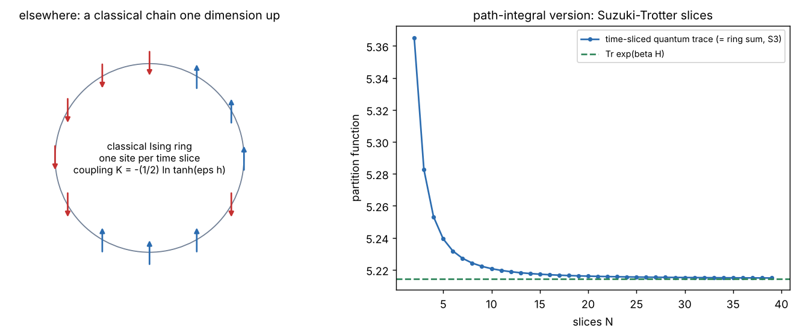

A time-sliced quantum trace equals a classical Ising ring sum exactly, one dimension up (S3). This is useful for exact checks, but it adds no piece the framework lacks.

### 5.7 Signature and Magnus: **none of the three gaps**

See section 4.

## 6. Assumptions

- "Strong sense" means each of H, ħ and the measure comes from a structure with a published theorem. This is my definition, chosen to match the ask.
- Conventions: k = −i/ħ is the quantum dial and k = −1 the heat dial. Points of the half-plane are z = β + iα for x ↦ αx + β.
- Citations confirmed by search this session: Daubechies–Klauder 1984/85, Daubechies–Klauder–Paul 1987, Nelson 1964, Klauder's affine metric and curvature, Gaveau–Jacobson–Kac–Schulman 1984, Diehl–Friz–Stannat 2017 and Chevyrev's arXiv 1510.09066. The rest are standard textbook results that I did not re-read: Bargmann, Lévy-Leblond, Groenewold–van Hove, Kostant–Souriau, Cameron, Itô, Albeverio–Høegh-Krohn, Selberg, Gutzwiller, Duistermaat–Heckman, Berezin and Klimek–Lesniewski.
- Klauder's "curvature −2/(βħ)" is read as scalar curvature. The Gaussian curvature is −1/(βħ) (M6).
- The curvature trade (2c) assumes a closed genus-g quotient exists, which needs a lattice in SL(2,R), and that the symplectic form is the metric area form. That holds for Klauder's metric (B6).
- Numerics: the oscillator and x⁴ levels come from a 1200-point grid on [−12, 12]. Monte Carlo tolerances are 4 standard errors. Hyperbolic Brownian motion uses 400 steps and 20,000 paths.
- There is no Lean file for this sub-topic, because it claims no new identities: the ones it uses are algebraic and checked symbolically in sympy (K2, Q1, M2, M6, B6). The phase 1–2 file `../lean/WhyI.lean` compiles in the shared library (21 theorems).

## 7. Files

- `checks.py`: 28 checks, all pass (output in `checks_output.txt`). K = dynamics, Q = quadratic world, B = ħ, M = measure, S = shapes.
- `figures.py`: writes the 17 pictures in `figures/`.

## 8. Sources

- Bargmann, V. (1954). On unitary ray representations of continuous groups. Ann. Math. 59.
- Lévy-Leblond, J.-M. (1963). Galilei group and nonrelativistic quantum mechanics. J. Math. Phys. 4.
- Groenewold, H. J. (1946), Physica 12; van Hove, L. (1951).
- Kostant, B. (1970); Souriau, J.-M. (1970): prequantization.
- Berezin, F. A. (1975). Quantization in complex symmetric spaces. Math. USSR Izv. 9.
- Klimek, S., Lesniewski, A. (1992). Quantum Riemann surfaces I. Comm. Math. Phys. 146.
- Kac, M. (1949). On distributions of certain Wiener functionals. Trans. AMS 65.
- Cameron, R. H. (1960). A family of integrals serving to connect the Wiener and Feynman integrals. J. Math. Phys. 39.
- Nelson, E. (1964). Feynman integrals and the Schrödinger equation. J. Math. Phys. 5.
- Itô, K. (1965); Albeverio, S., Høegh-Krohn, R. (1976). Mathematical Theory of Feynman Path Integrals. Springer LNM 523.
- Daubechies, I., Klauder, J. R. (1985). Quantum-mechanical path integrals with Wiener measure for all polynomial Hamiltonians II. J. Math. Phys. 26.
- Daubechies, I., Klauder, J. R., Paul, T. (1987). Wiener measures for path integrals with affine kinematic variables. J. Math. Phys. 28.
- Klauder, J. R. Enhanced quantization and affine quantization (affine metric and curvature).
- Milnor, J. (1976). Curvatures of left invariant metrics on Lie groups. Adv. Math. 21.
- Chen, K.-T. (1957). Integration of paths, geometric invariants and a generalized Baker–Hausdorff formula. Ann. Math. 65.
- Dyson, F. J. (1949). The radiation theories of Tomonaga, Schwinger, and Feynman. Phys. Rev. 75.
- Magnus, W. (1954). On the exponential solution of differential equations for a linear operator. CPAM 7.
- Lyons, T. (1998). Differential equations driven by rough signals. Rev. Mat. Iberoam. 14.
- Hambly, B., Lyons, T. (2010). Uniqueness for the signature of a path of bounded variation. Ann. Math. 171.
- Friz, P., Victoir, N. (2010). Multidimensional Stochastic Processes as Rough Paths; Friz, P., Hairer, M. (2014). A Course on Rough Paths.
- Diehl, J., Friz, P., Stannat, W. (2017). Stochastic partial differential equations: a rough paths view on weak solutions via Feynman–Kac. Ann. Fac. Sci. Toulouse.
- Chevyrev, I. Random walks and Lévy processes as rough paths. arXiv 1510.09066.
- Hairer, M. (2014). A theory of regularity structures. Invent. Math. 198.
- Feynman, R. P., Hibbs, A. R. (1965). Quantum Mechanics and Path Integrals (checkerboard).
- Gaveau, B., Jacobson, T., Kac, M., Schulman, L. S. (1984). Relativistic extension of the analogy between quantum mechanics and Brownian motion. Phys. Rev. Lett. 53.
- Suzuki, M. (1976). Relationship between d-dimensional quantal spin systems and (d+1)-dimensional Ising systems. Prog. Theor. Phys. 56.
- Wilson, K. G. (1974). Confinement of quarks. Phys. Rev. D 10; Aharonov, Y., Bohm, D. (1959). Phys. Rev. 115.
- Selberg, A. (1956); Gutzwiller, M. C. (1971). J. Math. Phys. 12.
- Duistermaat, J. J., Heckman, G. J. (1982). Invent. Math. 69; Atiyah, M. F. (1985). Circular symmetry and stationary-phase approximation. Astérisque 131.
- Witten, E. (2010). Analytic continuation of Chern–Simons theory. arXiv 1001.2933.
