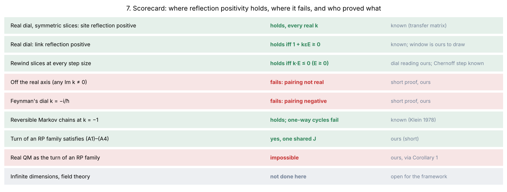
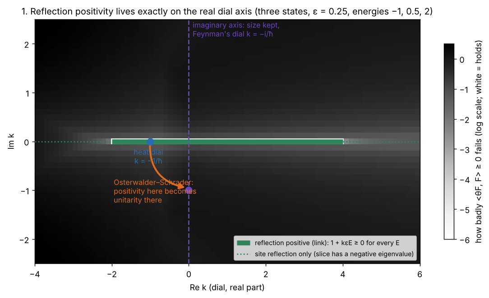
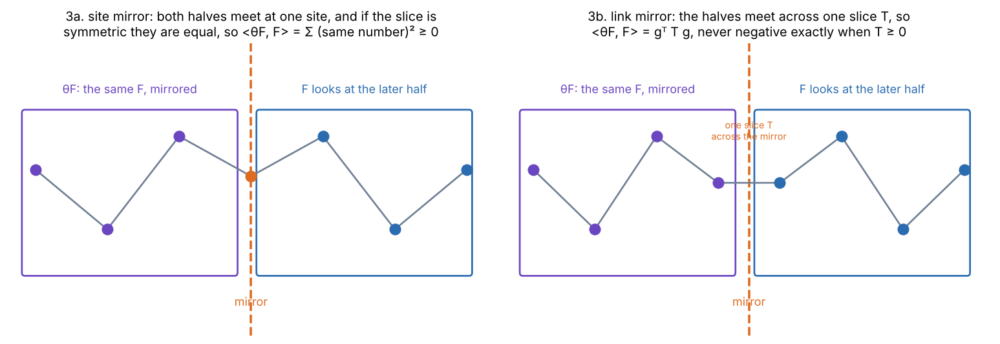
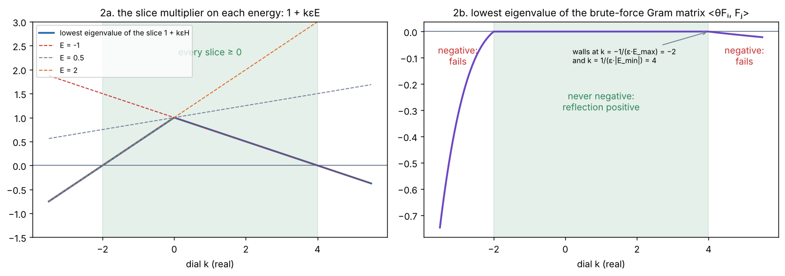
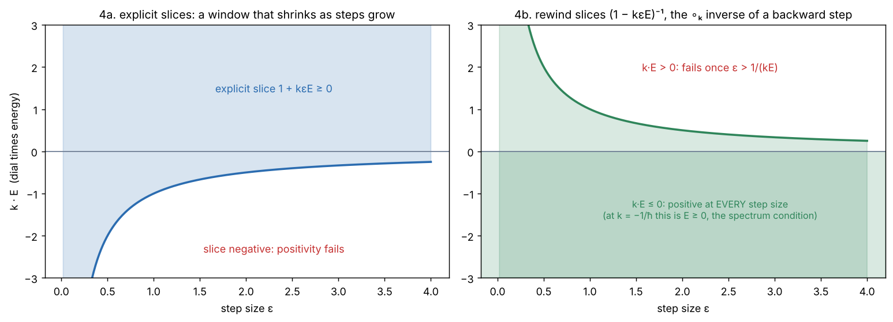
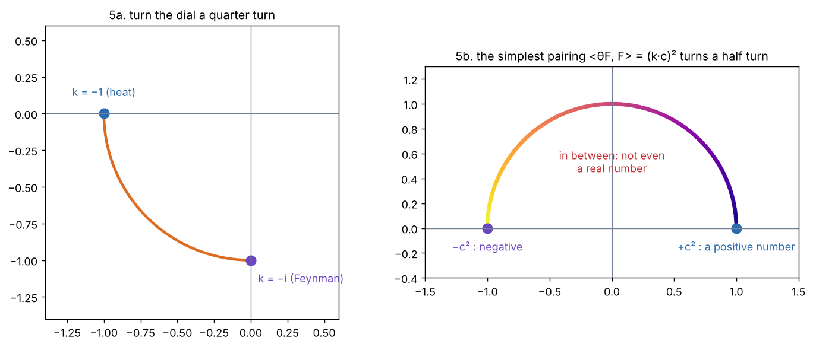
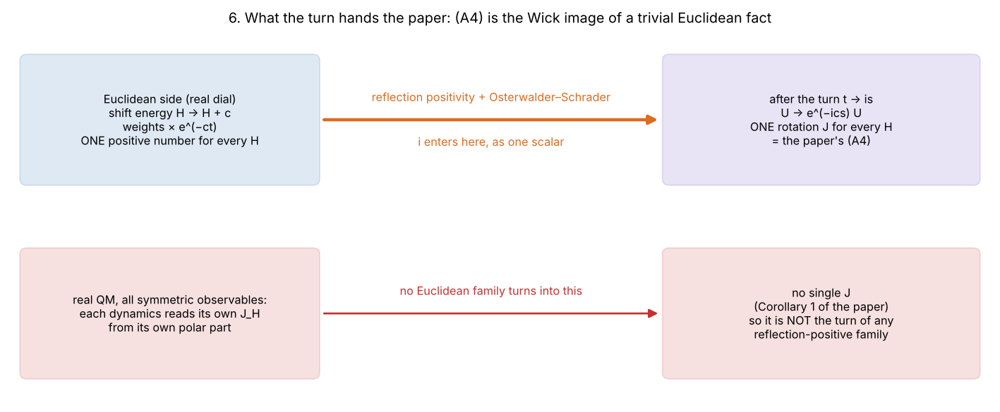

# Reflection positivity for the framework (Nov 27, 2026)

DRAFT. Part of topics/why-i.

**Answer.** Both, split by the dial. On the real dial axis, reflection positivity **must hold** for any chain of symmetric (reversible) slices. Mirroring through a site it holds at every real k. Mirroring across a slice it holds exactly when every slice multiplier 1 + kεE is nonnegative. With the framework's rewind slices that becomes, at every step size, exactly the positive-energy condition k·E ≤ 0. Off the real axis it **cannot hold**. For any Im k ≠ 0 the simplest pairing ⟨θF, F⟩ is not even a real number, and at Feynman's dial k = −i/ħ it is a negative number. Osterwalder–Schrader is the bridge between the two. Turning the dial from the real axis to the imaginary one brings in i as **one scalar shared by every Hamiltonian**, and that is exactly the paper's assumption (A4). So the answer strengthens the paper. For any theory that has a reflection-positive Euclidean side, (A4) is derived rather than assumed. Real quantum theory with all symmetric observables can't be the Wick rotation of any reflection-positive family.

The transfer-matrix criterion is known (references in §8). The dial reading, the rewind-slice statement, the off-axis failure, and the link to (A4) and to the paper are ours. All 15 checks pass (`checks.py`). 23 Lean theorems compile with core Lean 4.37.0-rc1 and use only the standard axioms (`lean/ReflectionPositivity.lean`). The whole library still builds with the new module in it: 3190 theorems in the shared-folder copy.

## 1. What the question means for us

A chain of weighted-circle steps has a multiplier that is the product of the slice multipliers (Base: `circK_lift`):

  1 + k·(a_N ∘ₖ … ∘ₖ a₁) = (1 + k·a_N) ⋯ (1 + k·a₁).

With steps a = ε·H, each slice is the matrix **T = 1 + kεH**. Expanded over intermediate states, the chain is a sum over paths x₀ → x₁ → … → x_N. Each path is weighted by the product of the slice entries T[x_{j+1}, x_j] (check R2). This is the "path integral" of `../README.md` §5, with nothing added.

- **The reflection θ** flips time, x_j ↦ x_{N−j}, and complex-conjugates a functional: (θF)(x) = conj F(θx).
- **The half-space algebra** is every functional F that looks only at the later half of the path. The **site** mirror goes through the middle site (N even). The **link** mirror goes through the middle slice (N odd).
- **The inner product** is ⟨θF, F⟩ = Σ over paths of weight · (θF)·F.
- **Reflection positivity** (Osterwalder and Schrader 1973) asks ⟨θF, F⟩ ≥ 0 for every F in the half-space algebra.

Indicator functionals span the half-space algebra. So the property holds exactly when the Gram matrix G_ij = ⟨θF_i, F_j⟩ is Hermitian and positive semidefinite. `checks.py` builds G by summing over **every path**, so no step assumes the answer.

## 2. Where it lives: the real axis

The grey shade shows how badly positivity fails at each complex dial value k. The example has three states, step ε = 0.25 and energies −1, 0.5 and 2. White means positivity holds. It holds only on the real axis: along all of it for the site mirror, and on the green window for the link mirror. It fails everywhere off the axis (checks R3, R4, R6).

## 3. Why a mirror makes a square

- **Site mirror.** Both halves meet at one site. If the slice is symmetric (T = Tᵀ for real slices, Hermitian in general), the mirrored half sums to the same number g(x) as the later half. So ⟨θF, F⟩ = Σₓ |g(x)|² ≥ 0 at **every real k** (R3; Lean `sitePair_square`, `site_rp`).
- **Link mirror.** The halves meet across one slice, so ⟨θF, F⟩ = g* T g. That is never negative exactly when **T ≥ 0** (R4, R5; Lean `link_rp`, and `link_fails_negative_diag` for the converse).

So reflection positivity is exactly a statement about one slice: it is symmetric, and for the link mirror it is a positive operator. This is the standard transfer-matrix criterion (§8).

## 4. The real-axis window, and how rewind slices remove it

On an energy level E the explicit slice is the number 1 + kεE, so the link mirror is positive for k in [−1/(εE_max), 1/(ε|E_min|)]. Here that is [−2, 4]. The Gram matrix's lowest eigenvalue crosses zero at exactly those walls (R4, R5). In framework language, positivity holds while every εE sits on the identity's side of the wall −1/k. That side is a subgroup under ∘ₖ, and the wall absorbs (R15; Lean `positive_side_closed`, `positive_side_inverse`, `wall_absorbs`).

The window is an artefact of explicit slicing:

- **In the continuum** each slice is e^{kεH}, which is positive at every real k (R9).
- **With rewind slices** (1 − kεH)⁻¹, the ∘ₖ inverse of a backward step (Chernoff's implicit step, `../path-integral-strong/README.md` §5.5), positivity holds at **every step size** exactly when **k·E ≤ 0 for every energy** (R8; Lean `rewind_all_steps_iff`, `rewind_pos`). At the heat dial k = −1/ħ, that is E ≥ 0. This is the positive-energy (spectrum) condition, the condition Osterwalder–Schrader reconstruction delivers on the quantum side.
- **Reversible Markov chains** at the probability dial k = −1 are reflection positive. A one-way cycle is not (R10). This matches Klein's characterization of Osterwalder–Schrader positive processes (1978).

## 5. Off the real axis it fails, and at Feynman's dial it is negative

For a symmetric H with an off-diagonal entry h, the slice entry is T₁₂ = T₂₁ = kεh. Being Hermitian needs conj(kεh) = kεh, which forces Im k = 0 (Lean `hermitian_iff_real_dial`).

The simplest pairing uses three times, with F the indicator of x₁ = 1 and x₂ = 2. It equals T₁₂T₂₁ = (kεh)². Turning k a quarter turn from −1 to −i turns this pairing a half turn, from +c² to −c². In between it is not a real number (R7; Lean `pairing_not_real`). At the Feynman dial it is real and strictly negative (Lean `feynman_pairing_negative`).

This failure is expected and not a defect. Reflection positivity is a Euclidean (real-dial) property. On the imaginary axis its job is taken over by unitarity: size is kept, as in `../README.md` §5.2.

## 6. Where i enters, and what that hands the paper

Osterwalder–Schrader reconstruction (1973, 1975) turns a reflection-positive Euclidean theory into a Hilbert space with a positive Hamiltonian H, so that Euclidean correlations are matrix elements of e^{−tH}. Real-time dynamics comes from continuing t → is. In dial terms that is turning k from −1/ħ to −i/ħ, since only k·t enters the chain.

- **Before the turn no i is needed.** If the Euclidean weights are real, the reconstructed space is a real Hilbert space and e^{−tH} is a real positive operator.
- **The turn forces i.** e^{−isH} is a real matrix for every s only when H = 0 (R12). So the continued dynamics lives on the complexification, and over the reals the i becomes an operator J with J² = −1.
- **It is one i for every H.** The continuation acts on the time parameter, a number, not on H. Every generator becomes the same scalar −i times its own H. Over the reals, A(H) = −J·H with **one J commuting with every H** (R11; Lean `wick_shift`, `wick_antisymm`, `wick_square`, `shift_rotation_shared`).
- **(A4) is the Wick image of a trivial Euclidean fact.** On the Euclidean side, shifting the energy zero multiplies every weight by the same positive number e^{−ct}, for every H (R13). After the turn that number becomes the same rotation e^{−ics}, which is (A4): A(H + c) = A(H) + cA(1). (A1) to (A3) hold as well (R11).
- **Corollary for the paper.** Real quantum theory with all symmetric matrices as Hamiltonians violates (A4) (the paper's Corollary 1; its per-dynamics J's differ, R14). So it is **not** the Wick rotation of any reflection-positive Euclidean family.

So the expert's question "does it have reflection positivity?" gets a positive answer. The framework's real-dial chain has it, for reversible slices with positive energy. That positivity is also the reason the paper's load-bearing assumption holds for every theory with a Euclidean formulation.

## 7. Weil positivity (the Riemann thread's question), in one paragraph

Weil's criterion says RH holds if and only if a certain distribution W satisfies W(f ∗ f̃) ≥ 0, where f̃(x) = conj f(−x), with x the logarithm of scale. That has the same "mirror, then pair" shape as ⟨θF, F⟩ ≥ 0. Two differences matter:

- **It asks more.** Weil asks positivity for every test function, which is positive-definiteness (Bochner type). Reflection positivity asks it only for functionals on one half, which is weaker.
- **Its generator is unknown.** For the framework's chains the generator H is given, and the theorem above settles positivity from the slice. For zeta, the "Hamiltonian" whose positivity Weil's criterion would express is the open Hilbert–Pólya problem.

Connes and Consani (arXiv:2006.13771) prove Weil positivity for the single archimedean place by trace-formula methods. Nothing here bears on RH, and we don't claim it does.

## 8. Known versus ours

**Known:**
- Reflection positivity and reconstruction: Osterwalder and Schrader, Commun. Math. Phys. 31 (1973) 83; 42 (1975) 281.
- Transfer-matrix and lattice reflection positivity: Osterwalder and Seiler, Ann. Phys. 110 (1978) 440; Fröhlich, Israel, Lieb and Simon, Commun. Math. Phys. 62 (1978) 1; Glimm and Jaffe, *Quantum Physics* (2nd ed., 1987).
- Osterwalder–Schrader positive processes and Markov chains: A. Klein, J. Funct. Anal. 27 (1978) 277.
- Surveys: Jaffe, "Reflection positivity then and now" (arXiv:1802.07880); Neeb and Ólafsson, *Reflection Positivity* (arXiv:1802.09037).
- The implicit (rewind) step: Chernoff (1968).

**Ours:**
- The dial reading: reflection positivity holds exactly on the real k axis, and the link window is the identity's side of the wall −1/k.
- Rewind slices: positivity at every step size if and only if k·E ≤ 0.
- The off-axis and Feynman-dial failure as short exact statements.
- The observation that the Wick turn of any reflection-positive family satisfies (A1)–(A4) with one shared J, and the resulting corollary about real QM. In the sources we checked we did not find the link between reflection positivity and the energy-zero argument stated. The step itself is short, so an expert may know it. The draft section says so.

**Not done here:** infinite dimensions and field theories. The finite-dimensional statements extend to bounded-below self-adjoint H in the standard way (see the surveys above), but the framework does not yet supply a field-theory measure.

## 9. Files

- `rp.py`: slices, brute-force Gram matrices, and the violation measure.
- `checks.py` → `checks_output.txt`: checks R1–R15, all pass.
- `figures.py` → `figures/f1…f7`.
- `lean/ReflectionPositivity.lean`: 23 theorems, core Lean, no sorry. Library path `FusedAlgebra/Topics/ReflectionPositivity.lean`. Compiled clean on Nov 27 in the shared library as `FusedAlgebra.Topics.ReflectionPositivity` (namespace `CircleOp.ReflectionPositivity`; library now 3,755 theorems in 172 modules). The topic copy's `MultAdd`, `wAdd` and `wAdd_lift` were renamed to the library's `CircleOp`, `circK` and `circK_lift`; no proof changed.
- `paper-section-DRAFT.tex`: a new section for `rotations-force-i/arxiv/main.tex`. main.tex itself is untouched.
