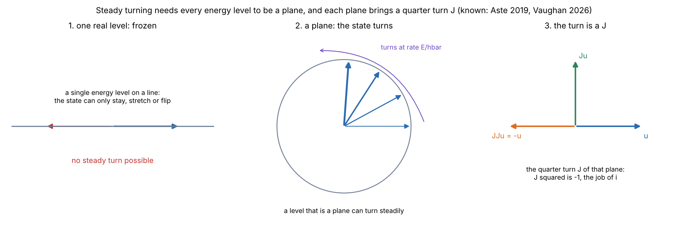
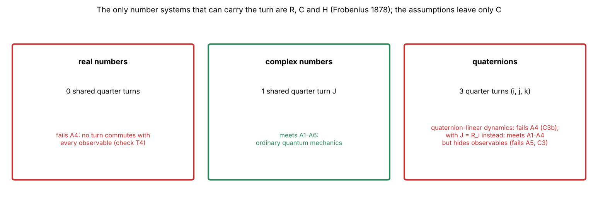
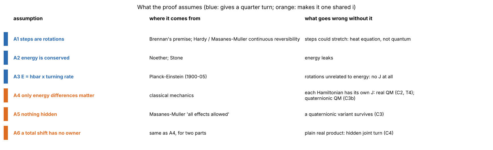

# DRAFT · Do rotations force quantum mechanics to use complex numbers? (Nov 26, 2026)

**Verdict.** Rotations on their own don't force it, because real-number quantum mechanics also evolves by rotations. Add two textbook facts, energy = ħ × turning rate and "only energy differences matter", and a five-line proof follows: every Hamiltonian must turn states with one and the same quarter turn J (J² = −1). That J does the job of i in Schrödinger's equation, and it is shared by the whole world, which rules out real quantum mechanics with independent parts.

Asked by Brennan (Nov 26): "I really want to prove quantum mechanics requires complex numbers because the steps along the way are rotations."

Method: published work first. Anything not found in the sources is labeled *ours*.

Checks: `checks.py`, 32/32 pass (`checks_output.txt`). Figures: `figures.py` writes `figures/r1`–`r6`.

---

## 1. What rotations give you, and what they don't

A step that keeps the size of the state is a rotation. Its generator A is antisymmetric (Aᵀ = −A). Three facts follow:

- **In odd dimension every rotation has a frozen direction** (det A = 0; check T1). Steady turning needs each energy level to be a plane.
- **Each turning plane has its own quarter turn** with frequencies in ± pairs (T1b).
- **For one dynamics, rotations always supply a J.** Take J = A|A|⁻¹ and H = ħ√(−A²); then A = JH/ħ (T2). This is the positive-frequency complex structure of Segal and Ashtekar–Magnon, recently re-derived for this question by Aste (2019) and Vaughan (2026).

That last point is why rotations alone are not a proof. **Every** rotation dynamics, including real quantum mechanics, comes with a J of its own. The catch is the words "of its own": in real quantum mechanics different Hamiltonians get different J's (counterexample C2, two Hamiltonians on ℝ⁴ whose quarter turns differ). Then there is no single i in the theory.

So the real question is: **what forces every Hamiltonian to use the same J?**

## 2. The energy-zero lever (the proof)

### Setup and assumptions

States are real unit vectors in ℝⁿ. Observables are symmetric matrices, and any observable can serve as the energy of some arrangement (A0). Each Hamiltonian H drives the state by ψ' = A(H)ψ, where:

| | Assumption | Where it comes from |
|---|---|---|
| A1 | A(H) is antisymmetric: **every step is a rotation** | Brennan's premise; continuous reversibility (Hardy; Masanes–Müller). **Can be replaced by: no state runs away (below)** |
| A2 | A(H) commutes with H: **energy is conserved** | Noether; Stone. **Not needed: it follows from A3 and A4 (step 3)** |
| A3 | A(H)² = −H²/ħ²: **a state of energy E turns at rate E/ħ** | Planck–Einstein. **Weaker version is enough: the rate only has to be some fixed function of E (see below)** |
| A4 | A(H + c) = A(H) + c·A(1): **only energy differences matter** | the zero of energy is a convention. **Also derivable: it follows from how two systems combine (below)** |

### Proof

1. **A3 at H = 1:** J := ħA(1) satisfies J² = −1, and it is antisymmetric by A1. So J is a quarter turn, and n is even.
2. **A3 for H + c:** with B := ħA(H), A4 gives ħA(H + c) = B + cJ, and A3 gives (B + cJ)² = −(H + c)². Matching powers of c gives B² = −H² and BJ + JB = −2H.
3. **Energy conservation comes free.** Because J² = −1, J commutes with BJ + JB, so **J commutes with H**. Then B commutes with BJ + JB too, because B²J − JB² = −H²J + JH² = 0, so **B commutes with H**: that is A2, derived rather than assumed (check T3d; Lean `EnergyShift.A2_redundant`).
4. **Write B = JH + E.** JH is antisymmetric, because J and H commute. So E is antisymmetric, anticommutes with J and commutes with H. Then B² = −H² + E², because the cross terms cancel (EJH = −JEH = −JHE). So **E² = 0**.
5. **An antisymmetric E with E² = 0 is zero**, because |E|² = tr(EᵀE) = −tr(E²) = 0 (T3b).

So **A(H) = JH/ħ for every Hamiltonian, with one and the same J.** Schrödinger's equation reads ħψ' = JHψ, which is iħψ' = Hψ with i = −J.

Checks:
- **T3:** on ℝ⁴, with all six entries of B left unknown, B = JH is the only solution.
- **T3a:** the degenerate case H = λ·1 leaves a two-parameter family after the linear steps. The Planck–Einstein condition then gives −(b₃² + b₄²) = 0, which kills it over the reals.
- **T3c:** a perturbation E that keeps A1 and A2 breaks A3. Two states of the same energy would then turn at different rates.

### Why every step is a rotation

Drop A1. The proof still gives one quarter turn J with J² = −1, and B = JH + E, where E squares to zero. Now shift the energy zero onto one of H's levels, λ. On that level the turn JH − λJ cancels, and **what is left is E alone**. A generator that squares to zero moves states in a straight line, ψ(t) = ψ + tEψ, so they **run away without limit** unless E = 0.

So "no state runs away under any dynamics" already forces A(H) = JH/ħ. Antisymmetry of J then follows from one more fact: the observables can tell all states apart except for the common phase. In plain words, **the only stable dynamics are rotations.** Check T3e; Lean `Stability.shift_to_level`, `nilpotent_flow`, `transpose_turn`.

### Planck–Einstein comes from the energy zero

A3 can be weakened to: **a state of definite energy E turns at some rate that depends only on E**, the same function for every Hamiltonian. Nothing says the rate is E/ħ, and ħ isn't given.

The shift rule then pins the function down. A(x·1) = A(0) + x·A(1), so its square is a polynomial of degree two in x. The squared rate must be quadratic: (E − E₀)²/ħ² + μ²/ħ². That is where ħ comes from, as a constant read off the function. E₀ is the energy where nothing turns, the natural zero.

The extra μ is the only way out. It needs a second quarter turn M on every energy level, anticommuting with J, which is a quaternion-like structure (example: R_i and R_j on ℝ⁸, with rate √((E − E₀)² + μ²)/ħ). A level of real dimension 2 has no room for one, so **one non-degenerate level forces μ = 0** and A(H) = J(H − E₀)/ħ: Planck–Einstein. With maximal observables (A5), such a level always exists. Check T3f; Lean `PlanckEinstein.M_sq`, `planck_einstein`.

**Composites rule out the gap too, with no condition on levels.** On the joint space the extra turn M of either system flips the balanced product into its mirror, so the joint dynamics can't stay on it unless M = 0. Booking a constant to either side also forces **the same ħ for every system**. Check T3g; Lean `NoGap.gap_zero`.

The rule itself can't be dropped: a clock that reads energy plus a multiple of a conserved charge, and one offset by the Hamiltonian's mean energy, pass every other assumption, composites included, but give equal-energy states different rates (check C5). What the rule really says is that **a state's rate is set by its own energy alone**.

### The shift rule comes from composites

Put two non-interacting systems side by side and add a constant c to their total energy. Booked to A or booked to B, it is **the same joint Hamiltonian**: (H_A + c)⊗1 + 1⊗H_B = H_A⊗1 + 1⊗(H_B + c). If the joint dynamics depends only on the joint Hamiltonian, and non-interacting parts evolve independently, the two bookings must change the dynamics the same way. One side depends only on H_A and the other only on H_B, so **neither can depend on its Hamiltonian at all**. That is A4 (with A1 and A3 making the change linear in c). The only extra input is that local changes are visible in the joint system, which holds for both the plain and the balanced tensor product. Check T6b; Lean `Booking.shift_independent`.

So the energy zero being a convention is not a postulate: **a constant in the total energy can't belong to either part.**

### What it costs real quantum mechanics

Since J commutes with every Hamiltonian (step 3), A0 makes it commute with every observable. In real quantum mechanics every symmetric matrix is an observable, and only multiples of 1 commute with all of them (T4). No quarter turn can do that, so **real quantum mechanics fails A4**: shifting the zero of energy would change the physics.

## 3. Real, complex or quaternion

Once one shared J exists, the observables are symmetric matrices that commute with J, which are exactly the complex Hermitian matrices (T5). Frobenius (1878) leaves three candidate number systems, and quaternions fail in one of two ways:

- **Genuine quaternionic QM (Adler 1995) fails A4.** Its dynamics must respect all three quarter turns i, j, k. The only operators commuting with every quaternionic observable are built from those three turns, and none of them respects the other two. So there's no J to carry the energy shift, and the energy zero isn't a convention there (C3b; caught in the rigor pass on Nov 27).
- **A variant that picks J = R_i meets A1–A4 but hides observables.** It allows 6 observables on a quaternionic two-level system, against 16 symmetric operators that commute with J (C3). That's where one more assumption comes in:
- **A5, nothing hidden:** every symmetric operator commuting with J is an observable. This is Masanes–Müller's "all effects are allowed" in this setting, and the paper reads it as "no superselection". With A5, the observables are the complex Hermitian matrices, (n/2)² of them (T5), and the theory is complex quantum mechanics.
- **A5 can't be derived from the rest.** Three smaller observable sets keep A0–A4 and stability. Superselection and the quaternionic variant fail completeness up to phase (T), since extra operators commute with every observable. A spin factor, the span of 1 and seven anticommuting γ's on ℂ⁸ (8 observables instead of 64), passes (T), is closed under the Jordan product, and passes the composite assumptions too, because those constrain only the dynamics. Only a rule on joint observables excludes it: products of local observables spanning them (local tomography) and closure under the Jordan product, which Barnum and Wilce (2014) show singles out complex QM. Deriving A5 would trade one assumption for several, so the paper keeps it (Remark "What (A5) excludes"; check T9).

Vaughan (2026) reaches the shared-structure point from normalisation and energy conservation: complex structure "at least", with quaternions not excluded. A4 and A5 close that gap here.

## 4. Two parts share one i

The lever works for composites too:

- **A6, a total shift has no owner.** Adding c to the total energy of A and B can be booked to A, which turns the joint state by J ⊗ 1, or to B, which turns it by 1 ⊗ J. It's the same physical change, so the two must agree on every joint state: J ⊗ 1 = 1 ⊗ J.

That condition cuts the plain real product ℝ^{n₁} ⊗ ℝ^{n₂} down to half its size (T6). On what remains:
- J ⊗ J = (J ⊗ 1)² = −1, so the whole system has one i.
- The space is the complex tensor product, which is Bang–Cho–Baek's "balanced tensor product" (2026).
- Products of local observables span every joint observable: 1/1, 16/16 and 36/36 for 1×1, 2×2 and 2×3 (T6). This is **local tomography**, the property that Hardy and Masanes–Müller use to single out complex numbers.

Without A6 (C4), on the plain real product the two bookings differ and J ⊗ J is a free hidden parameter. That is the extra joint quarter turn on the e-i-pi page (σ_y ⊗ σ_y). The 2021 Renou test and the 2022 experiments rule out exactly that version of real quantum mechanics.

## 5. What each assumption does

- **A1–A3 give a J for each dynamics.** This part is known and is not a proof: real quantum mechanics passes it.
- **A4 makes the J shared by every Hamiltonian.** This is the step Brennan's idea needed. Without it you get real quantum mechanics (C2, T4).
- **A4 also rules out genuine quaternionic QM** (C3b), and **A5 rules out the quaternionic variant** (C3).
- **A6 makes one J for the whole world** and gives local tomography (T6, C4).

## 6. Where this sits in the 2021–2026 debate

- **Renou et al. (2021), Chen et al. and Li et al. (2022):** real quantum mechanics with the plain real product is falsified.
- **Hoffreumon–Woods (2025) and Barrios Hita et al. (2026):** real theories with a modified composition rule match every experiment.
- **Bang–Cho–Baek (2026):** the Barrios Hita construction needs a hidden J with J² = −1 and a balanced tensor product, so it is complex quantum mechanics in real notation.
- **Feng–Ren–Vedral (2025):** a real theory with independent sources needs a nonlocal map.

**Tested against the theorem (Nov 27, checks R1–R4).** All three real formulations that match experiment, Hoffreumon–Woods, Barrios Hita et al. and Maioli–Curado–Gazeau (arXiv:2604.19482), meet every assumption once their dynamics is taken as the image of the complex one. None of them defines a Hamiltonian flow, so that step is our reading.
- **Hoffreumon–Woods:** their observables are exactly the symmetric matrices commuting with their J (their Lemma B.6), and their product rule equals projection onto W (R1, R2).
- **Barrios Hita et al.:** their quotient throws away exactly the J⊗J = +1 half, so their composite is W (R3).
- **Maioli–Curado–Gazeau:** their product rule is the real form of the complex tensor product (R4).

So the shared J isn't something these authors chose. The theorem says any theory meeting the assumptions must have it, and the one real theory without it is the one the experiments ruled out.

This proof says that whatever notation you use, a theory with rotation steps, E = ħω and a free energy zero has one shared quarter turn. Whether a real notation that carries that J "counts" as real quantum mechanics is a question about names, not physics. The physics is the shared J, and it is forced.

## 7. In the framework's terms

The dial's step is 1 + (t/N)·k·H. A real k stretches the state at first order. An imaginary k keeps its size to second order and builds exp(tJH/ħ) (T7; see the chain-resolves page). The theorem adds one thing: **the dial's turning direction is one J, the same for every Hamiltonian and every part of the world.** There is a single imaginary dial, k = −i/ħ, not one per system.

## 8. What's known and what's ours

| Piece | Status |
|---|---|
| A rotation dynamics carries its own J (positive frequency) | known: Segal; Ashtekar–Magnon; Aste 2019; Vaughan 2026 |
| A universal J commuting with all observables | postulated by Stueckelberg (1960); derived from Poincaré symmetry by Moretti–Oppio (arXiv:1611.09029) |
| Complex structure required for energy-conserving, normalised evolution | known: Vaughan 2026 |
| Balanced (complex) tensor product inside real constructions | known: Bang–Cho–Baek 2026 |
| Local tomography picks ℂ | known: Hardy 2001; Masanes–Müller 2011 |
| **Energy-zero lever: A4 plus Planck–Einstein forces one J for all Hamiltonians (§2)** | *ours*, as far as I found |
| **"A total shift has no owner" gives the balanced product (§4)** | *ours*, as far as I found |

I didn't find the energy-zero argument in what I read. It is short enough that it may exist elsewhere, perhaps in older work on real Hilbert spaces or in the Moretti–Oppio line. An expert should be asked before it's called new.

## 9. Is it a lead?

**Yes, as a clean proof. It is not new physics.** It turns Brennan's premise into a theorem with one honest correction: rotations get you a quarter turn, and "only energy differences matter" makes it one shared i. The argument is five lines, uses only textbook assumptions, and lands on the experimentally tested property (local tomography). It is worth writing up as a short note once someone who knows the real-Hilbert-space literature has checked that the energy-zero step isn't already published.

## Checks

`python3 checks.py` gives 32/32 PASS (sympy and numpy):

- Q0: complex QM satisfies A1–A4.
- T1, T1b: odd dimension; turning planes.
- T2: positive-frequency J.
- C2: two Hamiltonians with different J's.
- T3, T3a, T3b, T3c: the proof, generic and degenerate.
- T3d: energy conservation (A2) follows from A3 and A4.
- T3e: antisymmetry (A1) follows from stability and complete observables.
- T3f: Planck–Einstein (A3) follows from "the rate depends only on the energy", with ħ coming out as a constant.
- T3g: composites rule out the gap and force one ħ.
- C5: composites don't replace the rule: two clocks that pass everything else.
- T8: A0′ (the energy-zero shift changes no average) does A0's job for observables; without either, the shift is visible.
- T9: A5 is independent: superselection and quaternionic observables fail completeness, but a spin factor passes everything else.
- T4: real QM fails A4.
- C3, C3b, T5: quaternions (variant and genuine); complex Hermitian count.
- T6, C4: composites and local tomography.
- T6b: the shift rule A4 follows from composites.
- T6c: in the composite rule (C), independence of non-interacting parts does the work: J|H|/ħ meets everything else and still breaks A4. Faithfulness means composition excludes no state of a part.
- T10: A4 from measured averages: A0′ plus continuity and at most one unobservable phase (T₀) gives A4 on a single system; dropping continuity or T₀ each leaves A1, A3, A0′ and breaks A4.
- T11: with the weaker A3′, A0′ still forces A(H) = J(H − E0)/ħ: the offset rule passes everything and the gapped rule fails A0′, because shifting the energy zero then changes averages at second order in time.
- T7: the dial chain.
- R1–R5: the three recent real formulations tested against every assumption (§6), and why A4 has content.

## Assumptions

- The setting is finite-dimensional, with states as real unit vectors and dynamics linear and generated by A(H).
- A0, that any observable can be some Hamiltonian, is needed for §2's conclusion about observables. Without it, J only commutes with the Hamiltonians.
- **A0 can be replaced, for exactly that conclusion, by the energy-zero principle stated for measurements (A0′):** shifting the energy zero changes no measured average, for any state, observable, shift or time. Given A1, A3 and A4, a shift adds the common rotation cos s + J sin s to every evolution, so A0′ says every observable is unchanged by that rotation; at a quarter turn that is JᵀOJ = O, which means O commutes with J, and the converse holds too. A0′ says nothing about which operators can be Hamiltonians, so it doesn't replace A0's other job: in the stability argument for A1, A0 stays. Neither can be dropped: real QM with all symmetric observables but only J-commuting Hamiltonians passes A1–A4, yet shifting the energy zero makes some averages oscillate. Check T8; Lean `Unseen.comm_of_quarter`, `invariant_of_comm`.
- **Fixed: the weak form of A4.** A4 as written, A(H + c) = A(H) + cA(1), forces A(0) = 0 (take H = 0, c = 1). Under A3 that is automatic, but with the weaker A3′ it would force E0 = 0 and no gap, so the gapped example and the offset A(H) = J(H − E0)/ħ don't satisfy it. Propositions on A3′ (Planck–Einstein from the energy zero, no gap for composites, and the charge-rule counterexample) now use A4_w: A(H + c) = A(H) + cK with K a fixed matrix, defined in the remark on the weaker form of A4. Composition supplies A4_w under A3′ given continuity in c.
- **A4 itself follows from A0′ on a single system (Proposition "(A4) from measured averages"), given two conditions:** the dynamics depends continuously on H, and (T₀) the antisymmetric matrices commuting with every observable span at most one dimension (at most one phase that no measurement sees). Proof: A0′ makes e^{tA(H+c)}e^{−tA(H)} commute with every observable, so the shift adds an element of that space, a multiple βJ; A3 forces β = ±c with one sign per H, and continuity fixes the sign to +. Both conditions are needed: a discontinuous sign (some Hamiltonians run backwards) and a quaternionic unit that turns continuously with H each keep A1, A3, A0′ and break A4. It also sharpens Corollary real: with all symmetric observables nothing nonzero and antisymmetric commutes with every observable, so A0′ fails for every dynamics obeying A1 and A3, with no appeal to A0 or A4. A3′ also suffices (Proposition "Planck–Einstein from measured averages"): with A1, A3′, A0′, T₀ and continuity, A(H) = J(H − E0)/ħ for every H, so A3 holds with energies measured from E0 and there is no gap, whatever the degeneracies. The key step: the second time-derivative of e^{tA(H+c)}e^{−tA(H)} must also commute with every observable, which forces A(H) to commute with J and so kills any gap term. So one route needs only single-system assumptions: A1, A3′, A0′, T₀, continuity. Check T11; Lean `Averages.sigma_from_shifts` and `AveragesPE` for the algebraic steps only (continuity, differentiation and the use of T₀ are not Lean-checked). No-signalling does not by itself replace the independence clause of (C): it gives A0′ for a part only if the part's reduced dynamics is its own generator's, which is itself independence. Check T10. Not Lean-checked.
- A4 is read as A(H + c) = A(H) + c·A(1), so a shift of the energy zero adds a fixed turn and nothing else.
- The symbolic check T3 is on ℝ⁴ only. The proof in §2 holds in any finite dimension, and its last step is checked in general by T3b.
- Lean: `lean/Averages.lean` (11 theorems) and `lean/AveragesPE.lean` (12 theorems) check the algebraic steps of the two measured-averages propositions; their analytic steps (differentiation, continuity, connectedness, periods of h, additive to linear) are checked only numerically (T10, T11). `lean/Unseen.lean` (2 theorems) checks the A0′ equivalence. `lean/NoGap.lean` (6 theorems) checks that composites kill the gap. `lean/PlanckEinstein.lean` (12 theorems) checks the algebra behind weakening A3. `lean/Stability.lean` (4 theorems) checks the algebra behind replacing A1. `lean/Booking.lean` (4 theorems) checks the booking argument for A4. `lean/EnergyShift.lean` (18 theorems, core Lean) checks proof steps 2–4, including the derivation of A2, in any ring without 2-torsion. Step 5, the trace argument, needs matrix algebra from mathlib, so the sympy check T3b stands in for it. All eight Lean files compile clean in the shared library (no sorry, no proof changed), as `FusedAlgebra.Topics.EnergyShift`, `Booking`, `Stability`, `PlanckEinstein`, `NoGap`, `Unseen`, `Averages` and `AveragesPE`.
- The literature placement comes from abstracts and the papers I opened. Vaughan's date, and whether the energy-zero lever is already published, aren't confirmed. The closest prior results found (Nov 27) are operational: Alfsen and Shultz's dynamical correspondence and Barnum, Müller and Ududec's "energy is observable" postulate both single out complex QM from a linear map between observables and generators, assumed on all of them inside a Jordan-algebra framework. The theorem here assumes linearity only for shifts of the energy zero, plus Planck–Einstein, and derives the rest. The paper now cites both.

## Files

- `checks.py`, `checks_output.txt`
- `figures.py`, `figures/r1`–`r6`
- `NOTE-DRAFT.md`: a short note on the proof for an expert to check (draft, not sent)
- `arxiv/`: the proof as an arXiv paper (`main.tex`, figures, ancillary checks, `SUBMIT-STEPS.md`); draft, not submitted

## Sources

- Stueckelberg, "Quantum theory in real Hilbert space", *Helv. Phys. Acta* 33, 727 (1960); Moretti and Oppio, [arXiv:1611.09029](https://arxiv.org/abs/1611.09029)
- Aste, "Origin of the complex structure of quantum mechanics", [arXiv:1905.12894](https://arxiv.org/abs/1905.12894) (2019)
- Vaughan, "The requirement of (at least) complex structure for quantum mechanics", [arXiv:2609.23041](https://arxiv.org/abs/2609.23041) (2026)
- Bang, Cho and Baek, "Hidden complex structure in quotient-space real quantum mechanics", [arXiv:2607.05865](https://arxiv.org/abs/2607.05865) (2026)
- Barrios Hita et al., *PRL* 136, 240202 (2026), [arXiv:2503.17307](https://arxiv.org/abs/2503.17307)
- Hoffreumon and Woods, [arXiv:2504.02808](https://arxiv.org/abs/2504.02808) (2025)
- Feng, Ren and Vedral, "Locality implies complex numbers in quantum mechanics", [arXiv:2504.07808](https://arxiv.org/abs/2504.07808) (2025)
- Renou et al., *Nature* 600, 625 (2021); Chen et al., *PRL* 128, 040403 (2022); Li et al., *PRL* 128, 040402 (2022)
- Hardy, quant-ph/0101012 (2001); Masanes and Müller, *NJP* 13, 063001 (2011)
- Barnum and Wilce, "Local tomography and the Jordan structure of quantum theory", *Found. Phys.* 44, 192 (2014), [arXiv:1202.4513](https://arxiv.org/abs/1202.4513)
- Barnum, Müller and Ududec, "Higher-order interference and single-system postulates characterizing quantum theory", *NJP* 16, 123029 (2014), [arXiv:1403.4147](https://arxiv.org/abs/1403.4147)
- Alfsen and Shultz, "On orientation and dynamics in operator algebras. Part I", *Commun. Math. Phys.* 194, 87 (1998); Niestegge, [arXiv:1402.0158](https://arxiv.org/abs/1402.0158)

Textbook, not re-fetched: Frobenius (1878); Segal (1950s, positive-frequency complex structure); Ashtekar and Magnon (1975); Adler (1995, quaternionic QM).
