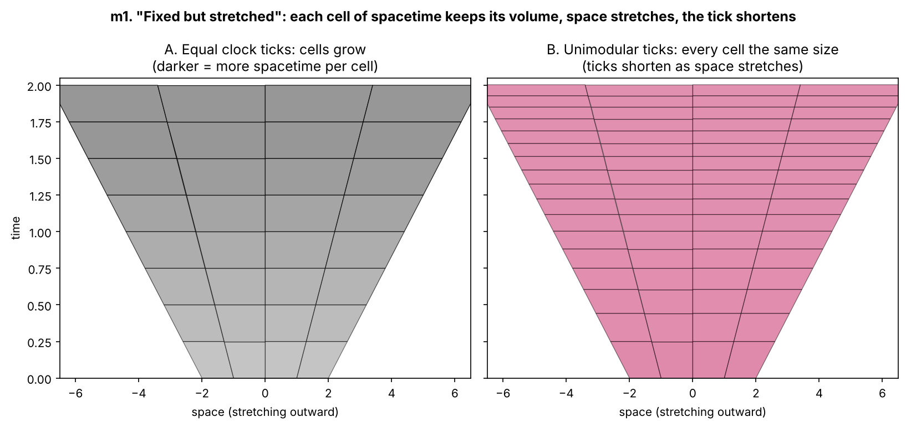
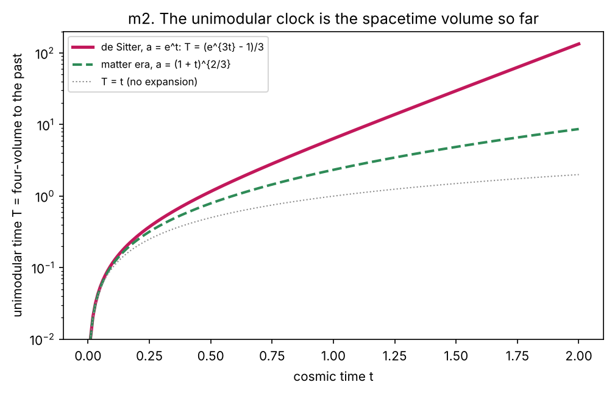
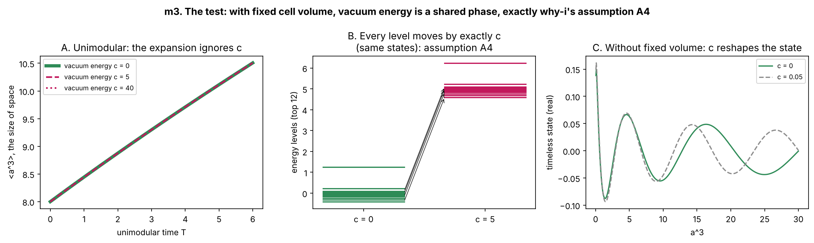
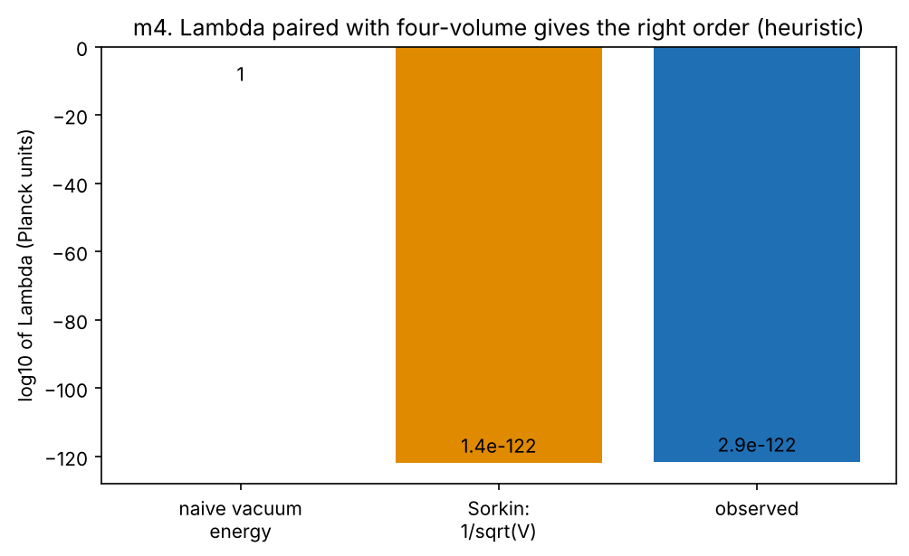
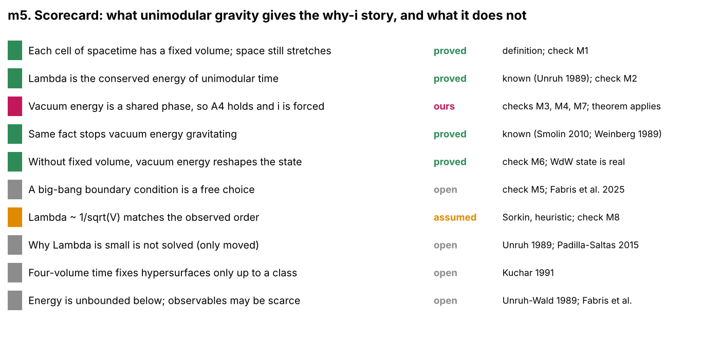

# DRAFT: Unimodular gravity and why quantum needs i (Nov 28, 2026)

**DRAFT. Not versioned, not proved in Lean, not pushed to the repo.**

Asked by Brennan in the thread: "Please look at unimodular gravity, which I think makes sense", and "I'm pretty sure the entire
volume of spacetime is fixed, but being stretched". It follows the lead named in Part 5 of the bridge paper
([`../bridge-paper/`](../bridge-paper/README.md)).

Checks: [`checks.py`](checks.py) → [`checks_output.txt`](checks_output.txt), **8 of 8 pass** (about 20 seconds; numpy, scipy,
sympy). Numbers are in [`results.json`](results.json). Pictures: [`figures.py`](figures.py) → [`figures/`](figures/) m1 to m5.
Hashes: [`SHA256SUMS`](SHA256SUMS). **Colour key: green = proved, blue = observed, orange = assumed or heuristic, magenta = ours,
grey = open.**

## The result in plain words

**Yes, it fits. In unimodular gravity a constant vacuum energy is exactly a shared phase in its time, so why-i's key assumption
holds and the theorem forces one shared i. The same fact is why vacuum energy stops gravitating there.** In ordinary quantum
gravity (Wheeler–DeWitt) the vacuum energy reshapes the state, there is no time, and the best-known state is real. So in
unimodular gravity two puzzles become one fact: quantum mechanics needs i, and the energy of empty space doesn't weigh anything.
The physics is known (Unruh 1989; Henneaux and Teitelboim 1989). Reading it as why-i's assumption A4 is ours.

**Does it open a lead? Yes, a real one, with limits.** It is the one place in gravity where the derivation of i goes through
unchanged. It does not explain why the cosmological constant is as small as it is: that value becomes a free starting
condition (Unruh 1989; Padilla and Saltas 2015). Sorkin's heuristic, which pairs the cosmological constant with spacetime volume
the way energy pairs with time, gets the observed size to within a factor of 2. Four known objections still stand (section 4).

*m1. Your picture, drawn in one space dimension. A: with equal clock ticks, the cells of spacetime grow as space stretches
(darker means more spacetime per cell). B: unimodular gravity fixes every cell's volume. Space still stretches, so each tick gets
shorter. In three space dimensions the tick shrinks as 1/a³.*

---

## 1. What is fixed, and what stretches (known)

- **Fixed:** the volume of each small cell of spacetime, √(−g) = 1. In a model universe this is the gauge N·a³ = 1, with a the
  size of space and N how fast the clock ticks.
- **Stretches:** space itself. The universe still expands.
- **The clock:** with each cell's volume fixed, the unimodular time T is the four-volume of spacetime so far: dT = a³ dt. For an
  accelerating (de Sitter) universe, T = (e^(3Ht) − 1)/(3H) (check M1, symbolic). So the total four-volume isn't fixed: it grows,
  and its growth *is* the clock.

*m2. Unimodular time against ordinary cosmic time. Because space keeps stretching, the four-volume so far runs ahead of cosmic
time, fastest when the expansion accelerates.*

So your "fixed but stretched" is right at the level of the cells. What isn't fixed is the total.

## 2. The cosmological constant is the energy of that clock (known)

In the model universe the unimodular Hamiltonian is H = −π_a²/(24a⁴) + ρ(a) (Fabris et al. 2025, Eq. 18, matching Unruh 1989).
On any solution with energy E, the expansion obeys

  (ȧ/a)² = (ρ − E)/6,

which is Friedmann's equation with the cosmological term set by −E (check M2, symbolic). **So the cosmological constant is the
conserved energy of unimodular time, and the four-volume is its conjugate**, just as ordinary energy is conjugate to ordinary
time. Unruh (1989) put it this way: solutions are superpositions of cosmological-constant states, each with the phase
"the cosmological constant times the four-volume". The quantum theory has an ordinary Schrödinger equation and complex wave
functions, and the Wheeler–DeWitt equation is avoided.

## 3. The test: does why-i's theorem go through? (ours)

why-i's lever is A4: shifting the energy zero, H → H + c, adds the same rotation to every dynamics. In unimodular time, a
constant vacuum energy c adds exactly c × 1 to the Hamiltonian, because the matter term is N·a³·ρ and N·a³ = 1. The test checks
that on a grid in the size of space (z = a³, with dust):

*m3. A: the size of space over unimodular time, for vacuum energy c = 0, 5 and 40. The three curves lie on top of each other.
B: every energy level moves up by exactly c, and the states don't change. That is A4. C: the same vacuum energy in the ordinary,
timeless form (Wheeler–DeWitt) reshapes the state even at c = 0.05, and that state is a real function.*

- **M3:** the universe evolves (⟨a³⟩ = 8.0, 8.88, 10.11 at T = 0, 2, 5), and vacuum energy c = 1, 5 or 40 changes that history by
  at most 6×10⁻¹³. **Vacuum energy doesn't gravitate in unimodular time**, in the quantum theory too.
- **M4:** every level moves by exactly c (error 5×10⁻¹³) and every state overlaps its old self to 12 digits. That is
  A(H + c) = A(H) + c·A(1), why-i's A4.
- **M5:** the theory has one real free choice, a boundary condition at the big bang (a = 0). Changing it changes the history by
  0.85, so it matters. A4 holds for every choice (vacuum energy then changes the history by 1.5×10⁻¹³).
- **M6:** without fixed cell volume, the vacuum energy enters as c × a³. The size of space doesn't commute with the rest of the
  Hamiltonian (‖[z, H]‖ = 260), so by the shift rule the vacuum energy is physical. The timeless state at c = 0 and c = 0.05
  overlaps by only 0.61, and it is a real vector: no time, and nothing that needs i.
- **M7:** the unimodular evolution e^(−iHT) is not real. Written over the real numbers it needs a quarter turn J with J² = −1,
  and the theorem says that J is one and the same for every Hamiltonian in the family.

**What this shows (ours).** The theorem's assumptions hold in unimodular quantum cosmology: the generator is antisymmetric once a
boundary condition is chosen, energy is conserved, levels turn at |E|/ħ, and A4 holds exactly. So **the i is forced there, for the
same reason vacuum energy doesn't weigh anything.** In the Wheeler–DeWitt form neither is true. This explains, in one rule, why
Unruh's states are complex and the Hartle–Hawking state is real.

**What it doesn't show.** The model is the simplest one: a flat universe with dust, on a grid. The grid version of the timeless
state in M6 is an illustration, the nearest-to-zero level, not an exact solution. And the theorem is proved for finite dimensions.

## 4. What unimodular gravity does not fix (known objections)

*m4. The size of the cosmological constant in Planck units. A naive vacuum-energy estimate gives about 1. Sorkin's estimate,
one over the square root of the four-volume of the observable universe, gives 1.4×10⁻¹²². The observed value is 2.9×10⁻¹²².*

1. **The value of the cosmological constant isn't predicted.** It becomes part of the starting conditions. Unruh wrote that
   "there apparently is nothing in the theory to protect us" from large values. Padilla and Saltas (2015) argue unimodular
   gravity is classically a gauge-fixed form of general relativity, so it can't "bring a new perspective" to the problem. What it
   does is stop the *vacuum energy* from setting Λ. Why the leftover constant is small remains open.
2. **Sorkin's size estimate (heuristic, check M8).** If Λ and four-volume V are conjugate, an uncertainty ΔΛ·ΔV ~ 1 with
   ΔV ~ √V (spacetime made of discrete elements) gives Λ ~ 1/√V. With V the observable universe's four-volume, that is
   1.4×10⁻¹²² against an observed 2.9×10⁻¹²². It came before the 1998 discovery of the accelerating expansion. It predicts Λ
   fluctuates over cosmic history (Ahmed, Dodelson, Greene and Sorkin 2004), and that version is being tested against data.
3. **The clock is only partly a clock.** Kuchař (1991) showed four-volume time picks out the moment of measurement only up to a
   class of hypersurfaces, unless more structure is added. Unruh and Wald (1989) warn the theory "may suffer from a shortage of
   measurable observables".
4. **Energy unbounded below and a free boundary condition.** The Hamiltonian is not bounded below for an ordinary field (Fabris et
   al. 2025), and it needs a chosen boundary condition at the big bang (M5). The theorem doesn't need a lower bound, but the
   physics of a universe with unbounded negative energy is unsettled.

*m5. Scorecard. Green: proved or known. Magenta: our reading. Orange: heuristic. Grey: open.*

## 5. What this means for the bridge

The bridge paper's hinge says a constant shift is harmless when it multiplies the same amount of spacetime for every history.
Unimodular gravity is exactly the version of gravity where that is true, because every cell has the same volume. In that version:

- the i of quantum mechanics is forced by why-i's theorem, and
- the energy of empty space doesn't gravitate,

and both come from the one fact checked in M3 and M4. **Quantum gravity is still not reached.** This is a model universe, not a
full theory, and the objections in section 4 stand.

**The next test worth doing:** go beyond one dimension of a model universe. Either add a second field (the scalar in Fabris et
al.) and check that A4 and the shared J survive, or take Smolin's (2010) full-theory version, where the Wheeler–DeWitt equation
is read as evolution in four-volume time, and check whether the energy-zero shift is still a shared phase once space has many
independent regions.

**Update (Nov 28): fitted to data.** See [`../unimodular-fit/`](../unimodular-fit/README.md): a small leak of the constant into
matter fits DESI and supernovae about 2σ better than plain unimodular gravity (BIC still prefers plain), and of the quantum
origins only Sorkin's uncertainty has the right size.

## Assumptions

- The flat model universe with dust, in the unimodular gauge N·a³ = 1, with Hamiltonian −π_a²/(24a⁴) + ρ(a) and the ordering of
  Fabris et al. (Eq. 19). Grid: 600 points on 0 < a³ ≤ 30, closed off at the far end.
- One self-adjoint extension chosen by the grid's end condition; M5 varies it.
- why-i's assumptions A0 to A4 as stated in the short paper, in finite dimensions.
- M8 uses H₀ = 67.4 km/s/Mpc and Ω_Λ = 0.685, and takes the four-volume as (Hubble radius)⁴. It is an order-of-magnitude check.

## Checks (8 of 8 pass)

| Check | What it shows |
|---|---|
| M1 | Unimodular time is the four-volume so far: dT = a³ dt |
| M2 | The cosmological constant is the conserved energy of unimodular time |
| M3 | Vacuum energy doesn't change the expansion in unimodular time |
| M4 | Levels shift by exactly c, states unchanged: A4 |
| M5 | The big-bang boundary condition matters, and A4 holds for each choice |
| M6 | Without fixed volume, vacuum energy reshapes the (real) timeless state |
| M7 | Unimodular evolution needs i |
| M8 | Sorkin's 1/√V has the observed order of magnitude |

## Sources

- W. G. Unruh, "Unimodular theory of canonical quantum gravity," Phys. Rev. D 40, 1048 (1989).
- M. Henneaux and C. Teitelboim, "The cosmological constant and general covariance," Phys. Lett. B 222, 195 (1989).
- W. G. Unruh and R. M. Wald, "Time and the interpretation of canonical quantum gravity," Phys. Rev. D 40, 2598 (1989); the
  fixed-volume-element theory is in its Sec. III. Read for this page.
- K. Kuchař, "Does an unspecified cosmological constant solve the problem of time in quantum gravity?," Phys. Rev. D 43, 3332
  (1991). Abstract only.
- L. Smolin, "Unimodular loop quantum gravity and the problems of time," arXiv:1008.1759 (2010). Partly read.
- A. Padilla and I. D. Saltas, "A note on classical and quantum unimodular gravity," Eur. Phys. J. C 75, 561 (2015),
  arXiv:1409.3573. Abstract only.
- J. C. Fabris et al., "Revisiting unimodular quantum cosmology," arXiv:2504.11955 (2025).
- M. Ahmed, S. Dodelson, P. B. Greene and R. Sorkin, "Everpresent Λ," Phys. Rev. D 69, 103523 (2004). Known through later
  reviews (arXiv:2307.13743, arXiv:2304.03819), not read directly.
- S. Weinberg, "The cosmological constant problem," Rev. Mod. Phys. 61, 1 (1989).
- J. B. Hartle and S. W. Hawking, Phys. Rev. D 28, 2960 (1983).
