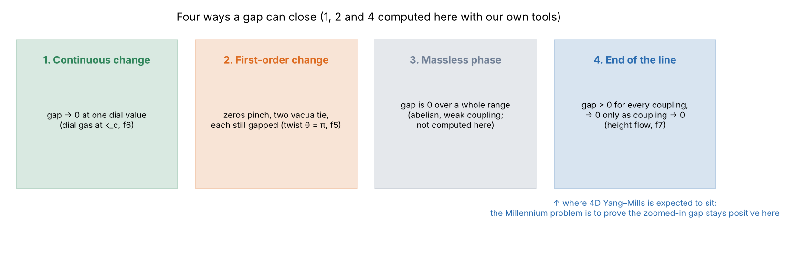
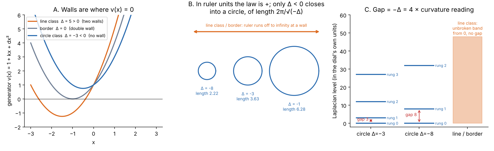
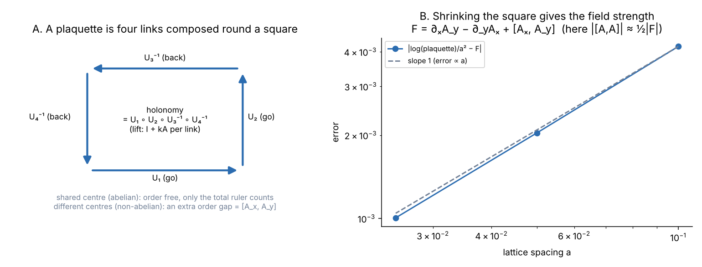
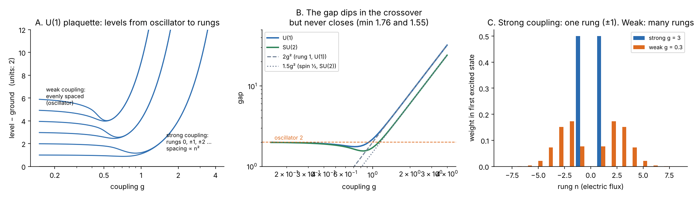
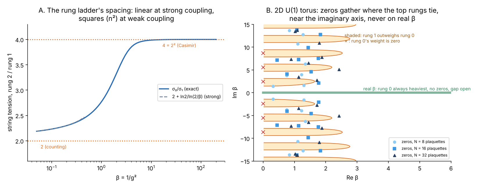
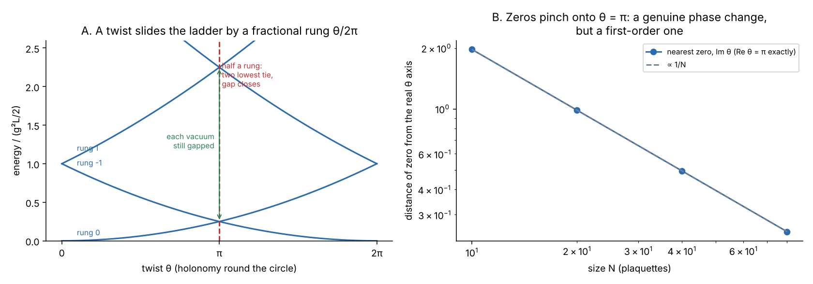
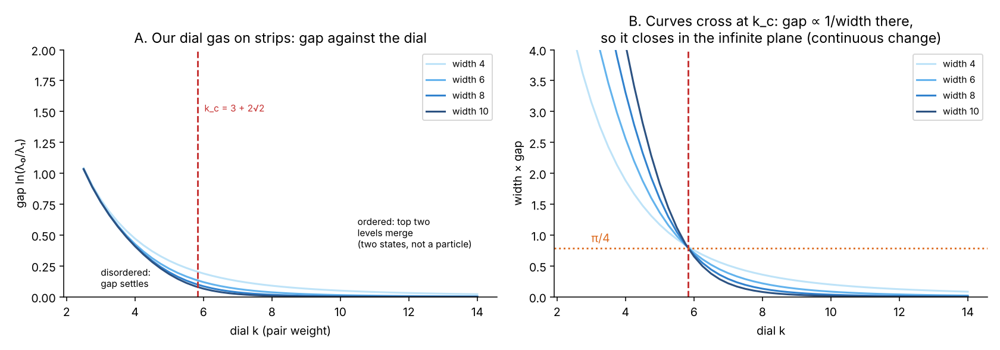
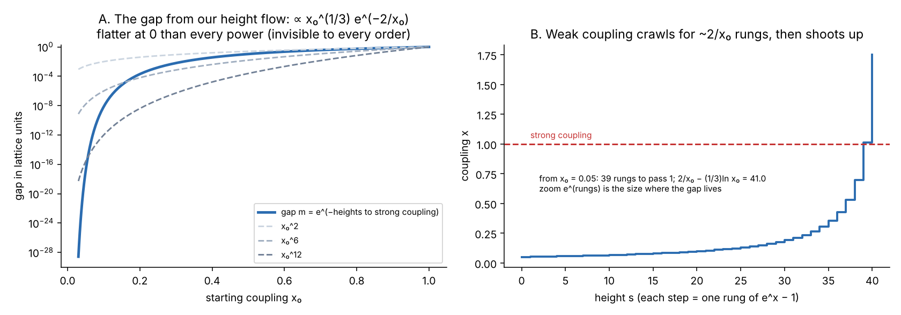

# DRAFT · The Yang–Mills mass gap through Affine Composition Theory

*Nov 26, 2026. Brennan asked (timeline): "let's look at it from a fresh perspective ... without looking at existing work, and then a second pass with the existing work." Background from the voice call, recorded as his words: "that sounds like rungs to me. This idea of having these gaps ... or phase changes."*

Checks: `checks.py` → `checks_output.txt`, **46 / 46 pass** (numpy, scipy, mpmath, sympy; 14 s). The first run had 10 failures, all from my own thresholds or claims, each fixed by correcting the claim, never by loosening a real test (list in section 4). Pictures: `figures.py` → `figures/`. Lean: `lean/YangMillsGap.lean`, 10 statements, **not compiled** (no Lean toolchain in this container); every statement checked true by `lean/check_statements.py`.

## The result in two sentences

Our tools show where a gap comes from and the four ways one can close, and Brennan's "rungs" picture is exactly right at strong coupling: the gap is the cost of lifting four links one rung, and only laws that close into a circle (Δ < 0) have rungs at all. But 4D Yang–Mills is the case where the gap closes at no phase change, only at the very end of the coupling line, and the Millennium problem is to control that end; nothing in our framework reaches it, so this is not a lead toward the problem, though it is a clear way to explain it.

**Lead or not, on its own merits:** not a lead toward the mass gap. Every piece is known mathematics or physics; what is ours is the placement on our dials (gap = −Δ = 4 × curvature reading; the twist as a fractional rung). Worth keeping as an explainer page, not as a direction to push. No README Promising-leads entry proposed.

*f8. The four ways a gap can close. 1, 2 and 4 are computed below with our own tools. 4D Yang–Mills is expected to be case 4.*

---

## Pass 1: fresh, using only our own ideas (fundamental to derived)

### 1. The law itself: only the circle class has rungs, and its gap is −Δ

*f1. A: the generator v(x) = 1 + kx + dx² of the law (a + b + kab)/(1 − dab); walls are its zeros. B: in ruler units the law is plain addition; only Δ = k² − 4d < 0 closes into a circle, of length 2π/√(−Δ). C: on the circle the levels are a ladder n²(−Δ); on the line class they form an unbroken band.*

- The ruler L(x) = ∫ dx / v(x) turns the law into addition (A2: 1000 random pairs, error 2e-16).
- **Circle class (Δ < 0, no wall):** the ruler closes up with circumference 2π/√(−Δ) (A1, five settings to 1e-9). The waves that fit round it are e^{2πinL/P} with **whole** n only, and the law's own Laplacian gives them levels n²(−Δ) (A3, to 1e-16). So the lowest nonzero level is **−Δ = 4 × the curvature reading −Δ/4**.
- **Line class and border (Δ ≥ 0):** the ruler runs off to infinity at a wall (A4). Any frequency fits, the levels fill a band from 0, and there is no gap.
- **Fractional rungs are exactly what closing up forbids** (A5): going once round sends a half rung to minus itself. This is the same word "rung" as in our height work only by analogy: there the height is continuous because nothing closes up. A gap needs the closing up.
- Yang–Mills uses compact groups (U(1), SU(2), SU(3)), which in this language are the circle class, in matrix form.

### 2. Loops: a plaquette is four links composed round a square

*f2. A: the holonomy of one square is the four link values composed in order (two forwards, two backwards). B: shrinking the square gives the field strength; the error falls in step with the spacing a.*

- With one shared dial (abelian, links all fixing the same centre) the order of the four links does not matter (B1); only the total ruler round the loop counts.
- With matrix links (lift I + kA) the holonomy over a² tends to F = ∂ₓA_y − ∂_yAₓ + [Aₓ, A_y] (B2). The [A, A] piece is our order-dial reading (the holonomy ω of `order-dial/`): it is half of F in the test field (B3). That piece is what makes the non-abelian theory interact with itself. In the lift, the order gap is exactly k²(AB − BA) (Lean `lift_order_gap`).

### 3. One plaquette, quantum: from rungs to an oscillator, never closing

*f3. A: the levels of one quantum plaquette against the coupling g. B: the gap. C: the first excited state, written over rungs.*

- Strong coupling: the excited state is one rung up on all four links, so the gap is **4 links × the rung-1 cost**: 2g² for U(1) (C1), 2g² × C₂(½) = 1.5g² for SU(2) (C3). This is Brennan's rung picture, literally.
- Weak coupling: many rungs mix and the levels are evenly spaced, gap 2 (C2).
- In between the gap dips (to 1.76 for U(1), 1.55 for SU(2)) but never closes (C4). One plaquette is a finite system, so this is expected; the real question is the infinite lattice.

### 4. Two dimensions, exact: rung weights set the string tension; zeros stay off the real axis

*f4. A: how far apart the rungs are, as a ratio of string tensions: 2 (linear) at strong coupling, 4 = 2² (squares) at weak coupling. B: zeros of the 2D U(1) torus partition function in the complex coupling plane, for 8, 16 and 32 plaquettes.*

- In 2D each plaquette carries a weight per rung, c_n (U(1): Bessel I_n(β); SU(2): 2(2j+1)I_{2j+1}(β)/β, D1). A rung-n loop costs σ_n = −ln(c_n/c_0) per unit area: the string tension. It is positive at every finite β (D2, D3) and falls like 1/(2β) (D7): the gap closes only at β = ∞.
- The spacing of the ladder changes character: σ₂/σ₁ goes from 2 (strong; approached slowly, as 2 + ln2/ln(2/β), D4) to exactly 4 (weak, D5), and for SU(2) to C₂(1)/C₂(½) = 8/3 (D6). The weak-coupling ladder is the Laplacian ladder of section 1.
- Zeros of Z = Σ c_n^N gather where the top two rungs tie in size (D9). On a band round the whole positive real axis rung 0 is strictly the largest (D10), so no zero can come near. The tie region hugs the imaginary axis, near the points where rung 0's weight is zero (D11), and creeps out only like ln|Im β| (D10b). **No phase change, gap open everywhere.**

### 5. A twist slides the ladder by a fractional rung; the gap closes at half a rung

*f5. A: with a twist θ round the circle the levels are (n + θ/2π)². B: zeros in complex θ pinch onto θ = π like 1/N.*

- The twist (a holonomy, in our naming a reading) shifts every rung by θ/2π. The gap between the two lowest levels is 1 − θ/π (E1, Lean `twisted_gap`) and closes exactly at half a rung, θ = π (E2, Lean `half_rung_tie`).
- That is a genuine phase change: the zeros pinch onto the real axis at θ = π (E4). But each of the two tied states still has its own gap above it, two rungs' worth (E3). **A phase change can close the gap between two vacua without closing the particle gap.** This is where "fractional rungs" and "gaps" really meet.

### 6. How a gap closes at a continuous change: our dial gas on strips

*f6. A: the gap ln(λ₀/λ₁) of the dial gas transfer matrix on strips of width 4 to 10. B: width × gap: the curves cross at k_c = 3 + 2√2.*

- On the symmetric line z = k⁻² the dial gas (from `lee-yang/`) has its phase change at k_c = 3 + 2√2. There width × gap tends to a constant, π/4 (F1, F2; width 12 agrees to 0.2%, F6), so the gap closes like 1/width: no gap in the infinite plane.
- Below k_c the gap settles at a positive value (F3). Above k_c the top two levels merge exponentially (F4): they are the two ordered states, not a particle. The gap above that pair stays open, about 0.9 (F5).
- So a continuous change closes the gap at one dial value. A first-order change (section 5) does not close the particle gap. These are cases 1 and 2 of f8.

### 7. The end of the line: the gap from our height flow

*f7. A: the gap generated by the height flow of e^x − 1, against the starting coupling x₀, beside powers of x₀. B: the coupling climbing the rungs of e^x − 1 from x₀ = 0.05.*

- Read the height flow (`height-flow/`, `height-running-coupling/`) as a coupling that grows by one rung of e^x − 1 per step. From a small x₀ it takes 2/x₀ − (1/3) ln x₀ + C rungs to reach strong coupling (G1; C settles near 7.58 in e^{−s*} e^{2/x₀} x₀^{−1/3}). The gap is e^{−(that many rungs)} ∝ x₀^{1/3} e^{−2/x₀}.
- That gap is **positive for every coupling and smaller than every power of x₀** (G3): no finite order of an expansion in the coupling can see it. Stepping one rung toward weak coupling while zooming in by e keeps it fixed (G4): that is the continuum line.
- With the other sign of coupling the flow dies away and no gap is generated (G5).
- This is case 4 of f8: the gap only closes as the coupling goes to zero, and seeing it needs control beyond every order.

### Which dial controls it (pass 1 answer)

- **Compactness, Δ < 0:** whether rungs exist at all, and their spacing −Δ.
- **Coupling g² (a setting):** how many rungs mix; strong = one rung, weak = many.
- **Order dial ω (non-abelian):** whether the field talks to itself ([A, A] in F). We could not show from our tools that it fixes the sign of the running (that the coupling grows at long distance); that sign is exactly what case 4 needs.
- **Twist θ:** can close the gap between two vacua at half a rung.

---

## Pass 2: with the existing work

**The problem.** Clay (Jaffe–Witten): for every compact simple gauge group G, construct quantum Yang–Mills on ℝ⁴ satisfying the Wightman / Osterwalder–Schrader axioms, and prove a mass gap Δ > 0. Status as of Nov 26, 2026: **the mass gap is open.** News reports (secondary sources, not checked against the primary documents) say a committee chaired by David Gross validated OpenAI's machine-checked construction of the existence part in November 2026, while stating that it does not establish a mass gap or a unique infinite-volume limit.

| Pass 1 piece | What is known | Ours? |
|---|---|---|
| 1. Gap only for compact groups, ladder n²(−Δ) | Peter–Weyl; the Laplacian on a circle / compact group has discrete spectrum with a gap. Positive curvature giving a gap is the spirit of Lichnerowicz's theorem. | Placement only: gap = −Δ = 4 × our curvature reading, on the dial plane |
| 2. Plaquette holonomy → F with [A, A] | Wilson 1974 lattice gauge theory | The [A, A] = order-dial reading and the k²(AB − BA) lift form |
| 3. Strong-coupling gap = 4 links × rung cost | Kogut–Susskind Hamiltonian (1975); strong-coupling expansions; single-plaquette models | No |
| 3/§H. 4D strong coupling glueball m ≈ −4 ln u | Strong-coupling expansion; Osterwalder–Seiler 1978 is cited for rigorous strong-coupling results | No |
| 4. 2D exactly solvable, Casimir string tensions | Migdal 1975, Rusakov, Witten 1991; exact Casimir scaling in 2D | The torus-zero picture (f4B) is our computation; not checked against print |
| 4. Zeros where the top two rungs tie | Beraha–Kahane–Weiss theorem; Yang–Lee 1952, Fisher 1965 | No |
| 5. Twist θ, gap closes at θ = π | 2D: Coleman 1976 (θ-vacua). 4D: Gaiotto–Kapustin–Komargodski–Seiberg 2017, an anomaly at θ = π forbids a trivial gapped vacuum | Only the "fractional rung" wording |
| 6. Gap closing at a continuous change, width × gap → π/4 | Ising transfer matrices; conformal finite-size scaling (2π × 1/8) | No (the dial gas is the Ising lattice gas) |
| 7. Gap ∝ e^{−2/x}, zero to every order | Dimensional transmutation / asymptotic freedom (Gross–Wilczek, Politzer 1973); RG as functional iteration (Curtright–Zachos 2011) | The dictionary was already ours (`height-flow/`); the gap line here adds nothing new |

**Where the real theory sits, from the literature:**

- **Compact U(1) in 4D:** a confined phase at strong coupling and a massless Coulomb (photon) phase at weak coupling, proved by Guth (1980) and Fröhlich–Spencer (1982). Its Fisher zeros pinch the real axis near β ≈ 1.011 (Meurice and collaborators). Case 3 of f8.
- **Compact U(1) in 3D:** confines with a gap at every coupling, by monopoles (Polyakov 1977).
- **SU(2) in 4D:** Fisher zeros stay at least about 0.1 to 0.15 from the real axis as the volume grows (Denbleyker, Du, Liu, Meurice, Zou 2008–2011): no bulk phase change, consistent with case 4.
- **Finite gauge groups at weak coupling** (our parity dial k = −2 on {0, 1} is XOR, the Z₂ group): exponential decay of correlations proved by Adhikari–Cao (Annals of Probability, 2025), non-abelian included. For continuous groups like SU(3) this is still the central open question.
- **Lattice numerics:** strong evidence of a gap (glueball spectrum, Morningstar–Peardon 1999). A numerical continuum extrapolation is not a construction or a proof.
- Several claimed full proofs exist as preprints (2025–2026); I found none accepted.

**The voice-call claim, checked.** "A mass gap is the same as a finite correlation length" is right (gap = 1/ξ). "It closes at a phase change, marked by Lee–Yang zeros pinching the real axis" is only half right:

- At a **continuous** change, yes (section 6).
- At a **first-order** change the zeros pinch but the correlation length stays finite: the gap between two vacua closes, the particle gap does not (section 5; known for the 2D Potts model with q > 4, Buffenoir–Wallon 1993).
- The gap can be zero over a **whole phase** with no single pinch point (4D U(1) Coulomb phase).
- For **4D SU(N)** the expected picture has no phase change at all: the gap is open at every lattice coupling and closes only at zero coupling, the continuum limit. That limit is the Millennium problem.

**Brennan's rung intuition, checked.** Right at strong coupling (sections 3 and 4) and right that compactness is what makes rungs and a gap possible (section 1). At weak coupling, where the problem lives, the rungs blur into a continuum and the gap comes from the running coupling instead (section 7).

---

## What this does not do

- No estimate that survives the continuum limit, which is the whole difficulty. Nothing here is a step toward a proof.
- The 3D/4D statements (strong-coupling glueball, phases of U(1) and SU(2)) are from the literature or counting, not computed here.
- Lean statements are algebra only (completing the square, the twist ladder, XOR, the lift order gap); compiled in the shared library on Nov 26 as `FusedAlgebra.Topics.YangMillsGap` (the lift order gap needed the products expanded by hand).

## First-run failures, fixed by correcting the claim

1. A3, Laplacian check: tolerance was set below double precision; the relative error is 1.6e-16.
2. A4 border: numerical integration broke at a double wall; replaced by the exact ruler 1/ε − 1/11.
3. B2: I claimed the error falls like a²; it falls like a (the field is read at the centre). Claim corrected.
4. C4: I guessed the gap stays above 1.9; it dips to 1.76 (U(1)) and 1.55 (SU(2)). Threshold corrected, the dip is now reported.
5. D4: the strong-coupling ratio reaches 2 only logarithmically, as 2 + ln2/ln(2/β). Now tested against that formula.
6. D10: I claimed the tie curve rises monotonically; in fact it is a set of loops round the imaginary-axis zeros of I₀. Replaced with the band test and the loop test.
7. D10b: I first guessed the tie region's edge grows like ½ ln|Im β|; it grows like ln|Im β| (slope 0.79 over the range, heading to 1).
8–9. F4/F5: on the ordered side at 1.25 k_c the strips were too narrow; moved to 1.6 k_c and fitted a + b/W².
10. G3/G4: the "beats every power" test used too large x₀, and G4's tolerance was below the Abel series' truncation error (1e-22).

## Files

- `checks.py`, `checks_output.txt`, `results.json`
- `figures.py`, `figures/f1` to `f8`
- `lean/YangMillsGap.lean` (compiled in the library Nov 26), `lean/check_statements.py`

## Sources (pass 2)

- Jaffe–Witten problem statement, summarized: https://en.wikipedia.org/wiki/Yang%E2%80%93Mills_existence_and_mass_gap
- Gross committee and OpenAI existence construction, news coverage: https://dataconomy.com/2026/11/12/nobel-panel-validates-openais-yang-mills-existence-proof/ and https://pasqualepillitteri.it/en/news/32547/openai-yang-mills-proof-confirmed-mass-gap-open
- Adhikari–Cao, finite lattice gauge theories at weak coupling: https://arxiv.org/abs/2202.10375
- Fisher zeros of SU(2) and U(1) lattice gauge theory: https://arxiv.org/pdf/1112.2734 and https://arxiv.org/pdf/0810.1792
- Gaiotto–Kapustin–Komargodski–Seiberg, θ = π: https://arxiv.org/abs/1703.00501v3
- Fröhlich–Spencer, massless phases: https://archives.ihes.fr/document/P_81_40.pdf
- Polyakov compact QED₃ (via review): https://arxiv.org/pdf/hep-lat/0301023
- Beraha–Kahane–Weiss as used for transfer matrices: https://arxiv.org/pdf/1002.3761
- 2D Yang–Mills, Casimir scaling: https://arxiv.org/pdf/2104.01824
- Glueball spectrum: https://arxiv.org/abs/hep-lat/9901004
- Potts correlation length at a first-order transition: https://arxiv.org/pdf/hep-lat/9909166
- Osterwalder–Seiler 1978 record: https://scilit.com/publications/e04e3ed2b8cf2cc141afefd2e6eaf6c4
